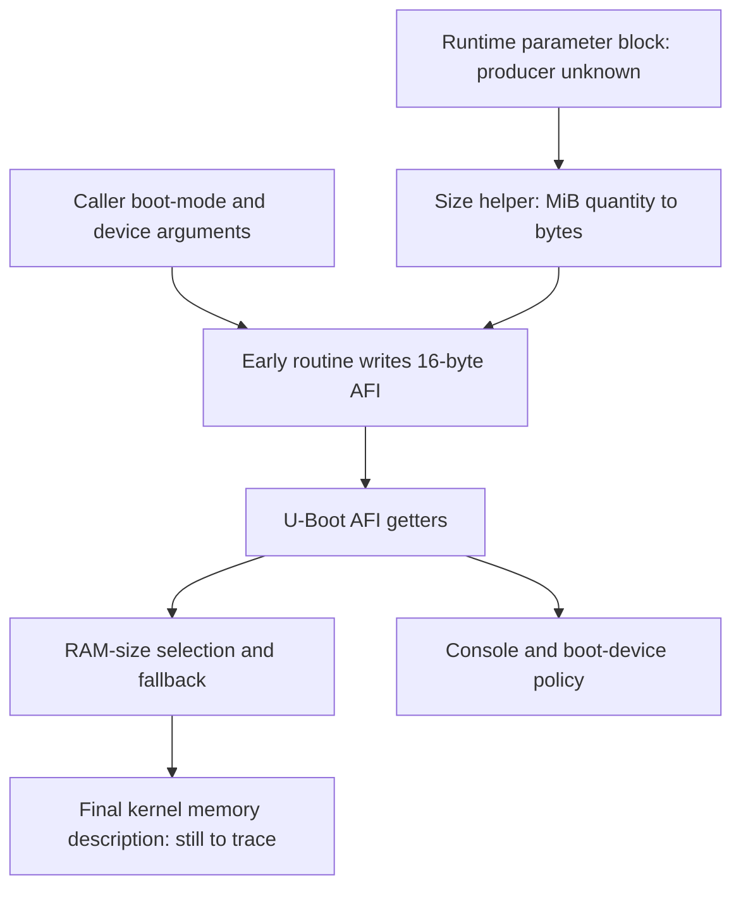

# AFI producer and memory handoff

Evidence: BOOT-004, BOOT-005, MEM-004, FW-002. This analysis concerns **Koriki v1.0 for the original RG35XX**, not every ATM7039S firmware. Addresses below are firmware-visible addresses, not established physical mappings.

## Coordinates and reproducibility

The acquisition plan and component hashes are in [the firmware catalogue](../evidence/firmware/koriki-v1.0.json). `early-region.bin` is a selected disk window beginning at `0x200200` and ending at `0x300000`. Its SHA-256 is `904f92f60dbdf653f29b453899c459d1fff4cbe1ae7278ea98fa41cd2a3145df`. The boundary includes padding/other material and **does not establish the loader's true size**.

Early offsets in this chapter are relative to that window. U-Boot offsets are relative to its **payload**, excluding the 64-byte uImage header. Add `0x40` for offsets within `u-boot.uimage`, or `0x300040` for offsets in the disk image. Mixing these coordinate spaces creates misleading cross-references.

A32 instructions were inspected with Capstone 5.0.6 and independently checked for PC-relative loads and direct branch targets with [arm_refs.py](../tools/arm_refs.py). The committed inventories record numeric references rather than redistributing decompiled code. Instruction decoding is static evidence, not evidence that a particular path executed.

## Recovered interface

The pinned U-Boot `arch/arm/include/asm/arch-owl/owl_afi.h:5–15` defines this layout, and release-binary consumers agree:

| AFI offset | Size | Source name | Early producer observation | U-Boot consumer start |
|---|---:|---|---|---:|
| `+0x00` | 4 bytes | magic | Clears the 16-byte structure, then copies three `AFI` bytes | all getters |
| `+0x04` | 1 | boot_mode | Stores saved argument r0 | `0x4194` |
| `+0x05` | 1 | boot_dev | Stores saved argument r1 | `0x41c8` |
| `+0x06` | 1 | uart_index | Low byte read from `0xb407082c` | `0x41fc` |
| `+0x07` | 1 | uart_pad | Low byte read from `0xb4070830` | `0x4230` |
| `+0x08` | 4 | uart_baudrate | Word read from `0xb4070834` | `0x4264` |
| `+0x0c` | 4 | ddr_size | Result of helper `0x9180` | `0x429c` |

The routine at `0x6500` loads `0xb4060300` for its clear/copy calls, then `0xb4060000` as a base for stores at `+0x304..30c`. The helper routines at `0xaf4c` and `0xaf64` implement byte fill and byte copy loops. Their behavior was inspected, rather than inferred solely from call signatures. The magic source literal is `0xb406b12b`; the matching bytes occur at window offset `0xb12b`. This supports a **local code/data address hypothesis** of window base `0xb4060000`, not a complete MMU/physical-memory map.

The caller at `0x6588..65cc` derives a boot-device code and tail-branches to `0x6500`. It supplies mode zero on this path. Other paths and actual reset entry have not been exhaustively recovered.

## Size encoding and limits

The producer calls helper `0x9180` with `r0=0xb4070820`. That helper combines input bytes `+2` and `+3` little-endian and shifts the result left 20 bits. The result is stored at AFI `+0x0c`. This establishes the static conversion `((byte3 << 8) | byte2) << 20` in 32-bit arithmetic, consistent with converting a MiB quantity into bytes.

It does **not** establish the runtime value, capacity-detection algorithm, DDR width, rank count or usable Linux memory. Bytes at an analogous offset in the disk window are not a runtime memory capture. The producer of the `0xb4070820` parameter block and its relationship to DDR training remain open.

The source `board/actions/owl/owl.c:39–49` calls `owl_get_ddr_size()`, accepts values at least 8 MiB, and otherwise falls back to `CONFIG_SYS_SDRAM_SIZE`. `include/configs/s500.h:72–75` defines 496 MiB with a 16 MiB reservation comment. These are **source-build policy**, not a measurement of this release or the handheld. The function named `dram_init` here selects a size; it does not itself implement DDR training.

The source's `owl_afi_init()` returns zero while its copy/default code is inside `#if 0`. The getters read the handoff location directly and have separate fallback values. Do not describe this disabled block as an executed AFI initialization stage.

## Handoff model

Solid edges represent inspected data dependencies, not a measured execution trace. Generic ARM memory-bank/FDT fixup source is available in `arch/arm/lib/bootm-fdt.c`; proving the release's final DT and reservations still needs further binary tracing or an existing trustworthy runtime capture.

## Next questions

1. Trace the initialization of `0xb4070820` and distinguish configured capacity from detected capacity.
2. Establish early-region entry/relocation and address translation before naming SRAM/ROM regions.
3. Recover DDR controller writes, training decisions and error paths around the initialization diagnostics. Strings alone do not establish their implementation.
4. Trace release U-Boot memory-bank construction and FDT changes; reconcile its `0x05000000` header with the source configuration's `0x08000040` text base.
5. Compare a separately acquired stock/Garlic image before extending these observations to those releases.

## Stock firmware answers (MEM-005, BOOT-009, UART-003)

1. **Producer of `0xb4070820`.** Loader routine `0xb4065ff8` copies the DRAM record from `bootloader.ini` (load `0xb4062400`): ini+0x1c clock 468 MHz → block+0, ini+0x20 capacity 256 MiB → block+2, and bus selector, CS, type, rcc, ODT and drive → block+4..+0xa. The size helper therefore yields 256 MiB from **configuration**. Capacity scan/test code exists and one path rewrites block+2/+3, so a detected value cannot be excluded statically.
2. **Entry and relocation.** The loader's `PACK` directory declares `bootloader.bin` at `0xb4060000`, `bootloader.ini` at `0xb4062400` and `app.bin` at `0x00001000` (BOOT-009). This is the image's own declaration, which strengthens the local address hypothesis above; it is still not an MMU/physical map.
3. **DDR controller writes.** Located (DDR-001); see the dossier's register sequence.
4. **UART fields.** ini+0x0e/0x0f/0x10 (index 3, pad 0, 115200) feed AFI `+0x06..+0x0b` (UART-003).
5. **Stock comparison.** Done: Koriki v1.0's early window equals stock 230309; all stock loader code is identical across releases.

## End-to-end values (PR #5)

Executing the stock loader on each shipped image (DRAM outcome supplied as 256 MiB) writes the AFI `"AFI"`, boot_mode 0, boot_dev `0x20`, uart 3, pad 0, 115200, ddr_size `0x10000000` (BOOT-013). boot_dev comes from block 0's boot code (0→`0x20`, 2→`0x22`, 3/5→`0x00`, 4→`0x40`), not from the ini byte printed as "bootdev= 0x22".

U-Boot consumers:

* boot_mode/boot_dev select `bootcmd` (BOOT-015).
* uart_index becomes `console=ttyS3`.
* boot_dev becomes `boot_dev=sd0` and `androidboot.bootdev=sd` for AFI `0x20`, and `boot_dev=sd2` for AFI `0x22`. OBS-001 showed `sd2`: the observed unit's loader wrote `0x22` (block-0 code 2), see [the reconciliation](../reports/sd2-boot-path-reconciliation.md).
* ddr_size becomes `gd->ram_size` and the DT `/memory reg=<0 0x10000000>` (BOOT-017).

When the magic is absent, U-Boot assumes PRODUCE and runs `ramboot`. The resume path (`0xb40664e4`) does not rewrite the AFI (PR #6).

## Every DRAM outcome (PR #6)

[MEM-010](../evidence/findings.json): the AFI is written by `0xb4066588` → `0xb4066500` only on the cold path, after the write-back, **whether or not DRAM init succeeded**.

| Outcome | AFI `ddr_size` | U-Boot `gd->ram_size` / `/memory` |
|---|---|---|
| Cold success (reference hypothesis) | `0x10000000` | `0x10000000` |
| Cold success, memory test fails | unchanged (test result ignored) | unchanged |
| Cold failure (training or other) | `0x80000000` (forced 2048 MiB) | not reached: main enters ADFU |
| Resume (any outcome) | not written this boot | not reached: jump to resume vector or power-off |
| Hypothetical: resume vector returns | whatever SRAM holds (image bytes are code, no magic) | getters fall back: PRODUCE mode, `0x1f000000` |
| Capacity ≥ 4096 MiB in the record | wraps to 0 (`cap << 20`, 32-bit) | fallback `0x1f000000` |

`boot_chain.py analyze --dram-scenario NAME` derives the size from the loader's own DRAM code instead of `--ram-mib`.

## What a running Linux can confirm (PR #7)

The V3 capture sees the end of this chain only: the `/memory` node U-Boot wrote (P-RAM), the `/chosen` initrd location (P-INITRD) and the AFI-derived `console=ttyS3` and `boot_dev=sd0` terms (P-CONSOLE, P-AFI-BOOTDEV). A `/memory` of `0x1f000000` would mean U-Boot's fallback, i.e. no valid AFI size. The physical DRAM size and the loader's own decisions are not observable after boot. The 3.10 procfs tree does not export `/memreserve/` (FW-019).
