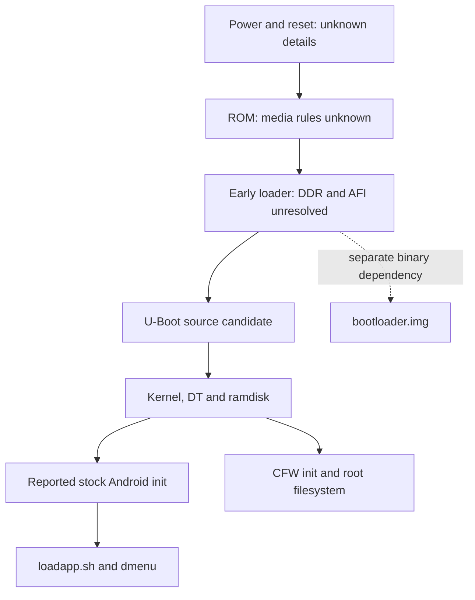

# Boot chain and source dependencies

Scope: original RG35XX, with source-built Batocera recipe distinguished from reported stock behavior. Findings: BOOT-001..003, MEM-001..003, ART-001, KNULLI-001.

## Evidence-based stage map

| Stage | Evidence | Source availability / confidence | Unresolved |
|---|---|---|---|
| Power-on / reset | No captured hardware trace | Unknown | Reset vector, rail timing, PMIC/SoC handshake |
| Internal Boot ROM | Required conceptual stage, no dump/manual inspected | Existence/behavior not reconstructed | ROM mapping, boot straps, media search, validation rules |
| Early loader / DRAM setup | Build image recipe refers to separate `bootloader.img` | Binary dependency indicated by recipe; producer not established | Image format, DDR training, AFI producer, licensing |
| U-Boot | `uboot-rg35xx.mk` pins source commit `0a557e37...`; source reads AFI | Verified build recipe, untested output | Match to shipped/stock loader and exact environment |
| Kernel / DT / ramdisk | Source config builds 3.10.37 kernel/DTS; packaging copies uImage, uInitrd→ramdisk.img, DTB→kernel.dtb | Verified packaging intent | Actual release contents and load addresses |
| Linux memory / devices | Related kernel reserves low memory and media heaps | Verified source path, not measured target behavior | Final DT fixups, runtime RAM, driver selection |
| Stock init | Tinyhack reports Android-derived init/init.rc/loadapp.sh/dmenu sequence | Reported observation | Reproduce against hash-identified stock image |
| CFW userspace | Source-built root filesystem and initrd selected in recipe | Verified build configuration | Release-specific changes, missing binaries |

The diagram is a dependency model, not a measured trace. Dashed dependency does not establish exact ROM behavior.

## Disk offsets are not memory addresses

At Batocera commit `961d8ab...`, `board/batocera/actions/rg35xx/genimage.cfg` places:

| File | Offset within generated disk image | Table entry |
|---|---:|---|
| bootloader.img | `0x200200` | Not in partition table |
| u-boot-dtb.img | `0x300000` | Not in partition table |
| First FAT boot partition | `0x800000` | Bootable FAT32 |

This is a source recipe, not an acquired image partition report. It neither proves stock uses identical offsets nor explains why ROM selects those locations. The U-Boot package installs an output named `u-boot-rg35xx.img`, while this image recipe names `u-boot-dtb.img`; additional build stages must be traced before claiming the recipe is self-contained. `post-image.sh` also references a 2600mAh DTB absent from this inspected checkout. These are build-reproducibility questions, not silently repaired hardware facts.

## Memory handoff

Related U-Boot checks AFI magic and reads boot device, serial parameters and DDR size from a structure referenced at `0xb4060300`. That is an address in the boot environment; its physical translation and producer were not established in the initial edition; the continuation recovers a release-specific writer (see below). Related kernel memory reservations depend on runtime low-memory limits and vendor heap properties. A static DT with `memory=<0 0>` cannot substitute for the final boot handoff.

## What can plausibly be replaced

U-Boot and the old kernel have source candidates. Porting modern Linux still requires a valid DT, clocks, timer/IRQ, storage and display/power dependencies. The earlier loader's DDR initialization remains the most consequential unresolved binary dependency. PowerVR userspace is a separate dependency after Linux starts.

Stock, GarlicOS 1.4.9, historical Koriki and current KNULLI are not interchangeable evidence sets. No complete GarlicOS image was inspected. Tinyhack reports a stock/Garlic kernel difference and changing historical Koriki kernel choices; the source build recipe establishes an available route, not what every release actually shipped.

## Continuation: hash-identified release evidence

The next acquisition was completed for Koriki v1.0: a full image verifies both recipe offsets, and its early region contains an AFI writer matching released U-Boot consumers. See [firmware analysis](../reports/firmware-analysis.md) and [AFI handoff](afi-handoff.md). The source-stage table above remains a description of the original source baseline, not a release trace. ROM media rules, DDR training, final memory fixups and stock/Garlic equivalence remain unresolved.

## Stock firmware reconstruction

Four Anbernic stock releases are now hash-identified and analysed ([dossier](../reports/anbernic-stock-reverse-engineering.md), FW-014..017, BOOT-009..011, MEM-005, DDR-001). The stage map above is superseded for stock by:

| Stage | Stock evidence | Status |
|---|---|---|
| Boot ROM | Not in the image | Unknown |
| Raw loader at sector 4097 (448 sectors) | ActBrm-checksummed blocks + `PACK` directory: `bootloader.bin` @ `0xb4060000`, `bootloader.ini` @ `0xb4062400`, `app.bin` @ `0x1000` | Verified layout (BOOT-009) |
| SRAM stage (`bootloader.bin`) | PLL setup (core/dev 600 MHz), PMIC early init, **DRAM init via uPCTL `0xb01c0000` + PUBL `0xb01c8000`**, AFI producer | Strongly supported (DDR-001, MEM-005) |
| DRAM stage (`app.bin`) | Chip-identity gate and `bootloader.ini` write-back; jumps to U-Boot loaded by bootloader.bin (corrected, C-APPBIN) | BOOT-014 |
| U-Boot 2015.04 | GPIOC6 variant strap → `allenS500=1`; `check_boot_flag` replaces `bootcmd=run ramboot` with `run mmcboot` | BOOT-011, BOOT-015; loads kernel/ramdisk/DTB from SD0 p1 (BOOT-016, resolves BOOT-007) |
| Kernel 3.10.37 (flower, GCC 4.7.3) | Android init; host-mode USB; launcher `dmenu.bin` | FW-016, USB-002, UI-002 |

The disk image is GPT-partitioned (MISC/SYSTEM/CONFIG/ROMS) but keeps the same raw offsets as the CFW recipe. Koriki v1.0's whole pre-kernel chain (loader window and U-Boot) is byte-identical to stock 230309 (BOOT-010).

## Stock boot chain, instruction level (PR #5)

The full trace is in [the reconstruction report](../reports/stock-boot-chain-reconstruction.md) and machine-readable in [`stock-boot-chain.json`](../evidence/firmware/stock-boot-chain.json). It supersedes the stage tables above for stock firmware.

| # | Stage | Reads (disk offset → address) | Hands over with | Finding |
|---|---|---|---|---|
| S0 | Boot ROM (not in image) | block 0 `0x200200` → `0xb4060000` (inferred) | jump `0xb4060000` | BOOT-012, BOOT-019 |
| S1 | Block 0 | ROM svc r9=4: `0x205600` ×40 KiB → `0xb4065400` | code at `0xb4064c00`; jump `0xb4065400` | BOOT-012 |
| S2 | bootloader.bin | ini `0x202600` → `0xb4062400`; app.bin `0x219200` → `0x1000`; U-Boot `0x300000` → `0x05000000` | AFI `0xb4060300`; `r0=0x05000040`; `blx 0x1000` | BOOT-013 |
| S3 | app.bin | (writes ini back if `SFVD` missing) | jump to `r0` | BOOT-014 |
| S4 | U-Boot init | env: mmc 1 `0x5000` (absent → default) | `bootcmd=run mmcboot` | BOOT-015, BOOT-018 |
| S5 | mmcboot | FAT `mmc 0:1`: uEnv.txt → `0x04400000`, uImage → `0x7fc0`, ramdisk.img → `0x1ffffc0`, kernel.dtb → `0x03800000` | `bootm` | BOOT-016 |
| S6 | bootm / FDT | in place; `/memory`, `/chosen`, `/memreserve/` written | — | BOOT-017 |
| S7 | Linux entry | — | `pc=0x8000 r0=0 r1=0 r2=0x03800000`, MMU/caches off | BOOT-017 |

`ramboot` (images already in RAM) is used only when the AFI says PRODUCE or is missing. The disk offsets `0x200200`/`0x300000` are therefore raw loader inputs, and the kernel, RAM disk and DTB are ordinary FAT files.

## DRAM paths inside bootloader.bin (PR #6)

The [DRAM reconstruction](../reports/dram-complete-reconstruction.md) completes the stage between `bootloader.ini` and the AFI. These are instruction-level results, reproduced by emulation and independent models; hardware outcomes are synthetic.

| Path | Selected by | DRAM work | AFI | Next stage |
|---|---|---|---|---|
| Cold boot | PMU_CTL3 s2 flag clear (or vector 0, or "from s4") | mode 0 on the ini second record, rank retry, probe, memory test (result ignored), write-back | written (capacity << 20) | app.bin, U-Boot |
| Cold boot failure | DRAM routine returns ≠ 0 | as above until the failure | written anyway (2048 MiB) | ADFU (`load fail to adfu`), no U-Boot |
| Resume | s2 flag, not from S4, non-zero vector (PMIC regs 8/0x5d) | mode 1 on the ini **primary** record: no probe, no test, no retry, PIR 0x3f, PREA/REF bursts | **not written** | jump to the kernel resume vector |
| Resume failure | mode 1 returns ≠ 0 | — | not written | RTC alarm +3 s, s2 flag set again, PMIC power-off |
| Resume check | vector bit 31 and alarm wake | mode 1, then back to self-refresh | not written | PMIC power-off |
| ADFU request | PMIC reg 0x35 bit 1, or (boot code ≠ 0) GPIO C11→C10 loopback echoing 0x55aa55aa (BOOT-025) | none | not written | ROM ADFU |

## Pre-DRAM path for boot codes 0 and 2 (PR #9)

The code from block 0 to the DRAM init call is reconstructed in [docs/predram-initialization.md](predram-initialization.md) ([report](../reports/sd2-predram-reconstruction.md); BOOT-024/025, CLK-007, UART-004, PMIC-002, GPIO-002). For the observed code-2 path it is the same instruction path as code 0, except that `adfu_check` adds a 32 × 1 ms GPIO loopback test. Executed in emulation, the two codes differ only by that block, up to and through DRAM init (reference scenario). Boot ROM state is not covered, so C-PREDRAM-PATH stays open. The [ADFU loopback reconstruction](../reports/adfu-loopback-reconstruction.md) shows the test uses the TF2 slot's DAT0/DAT1 pads, enters ADFU only on an exact echo, and never reaches DRAM init on that exit (BOOT-026/027, GPIO-003/004).

The [SD2 DRAM comparison](../reports/sd2-dram-reconstruction.md) extends the cold reference comparison to training, faults, geometry and resume. It executes the main branch from the DRAM caller return and either reaches the continuation boundary before app.bin/U-Boot loading, reaches an ADFU/recovery boundary, or transfers through a synthetic resume path. Both codes report the same DRAM result in the tested continuing cases.

## Physical observation OBS-001 (2026-11-27) and the PR #8 reconciliation

The tables above follow the **code-0 / AFI `0x20` branch** (SD0). OBS-001's running kernel reported `boot_dev=sd2` and its boot card on controller `0xb0238000`. PR #8 executed every branch end to end from the image ([report](../reports/sd2-boot-path-reconciliation.md), BOOT-022/023, STOR-003): the observed unit takes the **code-2 / AFI `0x22` branch**, and the stage map for it is

| # | Stage | Observed unit | Basis |
|---|---|---|---|
| S0 | Boot ROM | boots from TF1 = SD2; leaves CMU_DEVCLKEN0 bit 7 set | inferred |
| S1 | Block 0 | bit 7 → boot code 2 | emulated |
| S2 | bootloader.bin | same raw reads; AFI `mode 0, dev 0x22, uart 3, 256 MiB` | emulated |
| S4 | U-Boot init | `mmc 0` = SD0 (no card: init fails, stays registered), `mmc 1` = SD2 (registered only for AFI 0x22); environment from `mmc 1` (the boot card, `0x5000`) → default | emulated |
| S4 | check_boot_flag | `bootcmd = run emmcboot` | emulated |
| S5 | emmcboot | `fatload mmc 1:1` uEnv.txt, uImage, ramdisk.img, kernel.dtb (same files and addresses as S5 above) | emulated + default env |
| S6–S7 | handoff | bootargs `… allenS500=1 androidboot.bootdev=sd boot_dev=sd2`, byte-identical to OBS-001 | emulated, **matches observation** |
| — | Linux | `boot_dev=sd2` → SD2 host gets index 0 (`mmcblk0`, named `emmc_boot_card` by slot); rootfs `boot/BATOCERA` loop-mounted rw | binary + source, **observed** |

Physical medium (SD), controller (SD2), U-Boot device (`mmc 1`), Linux index (`mmcblk0`) and role label ("emmc") are five different things. The ROM, the CMU bit and the AFI bytes are still inferred, not observed.
