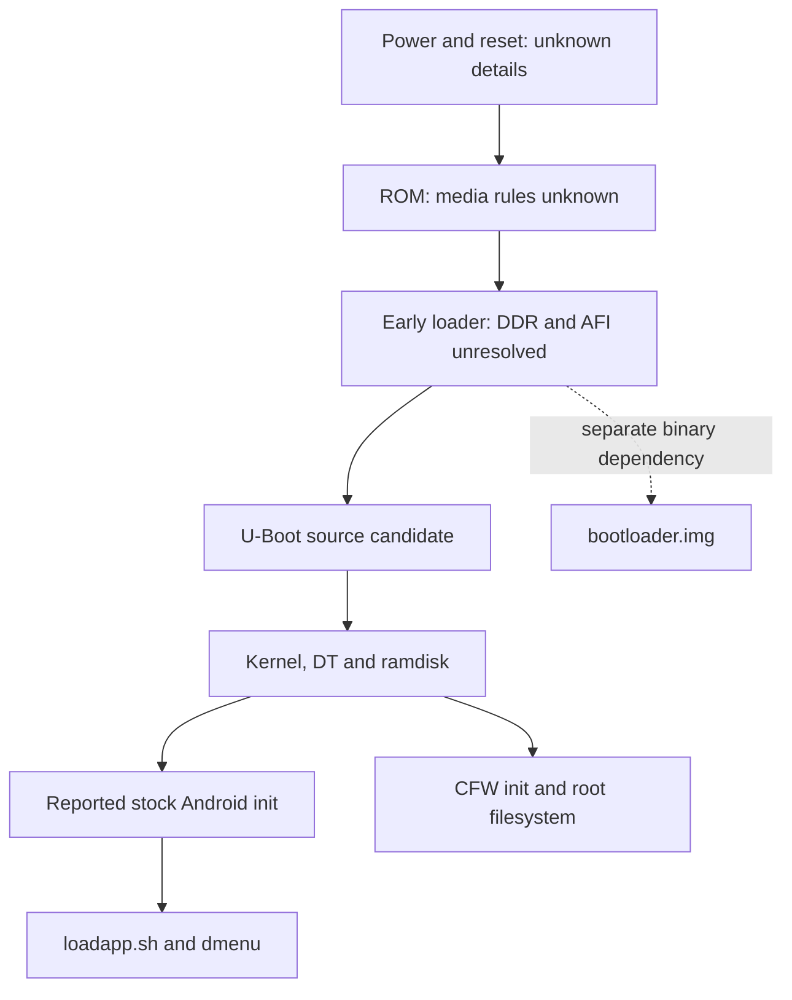

# Boot chain and source dependencies

Scope: original RG35XX, with source-built Batocera recipe distinguished from reported stock behavior. Findings: BOOT-001..003, MEM-001..003, ART-001, KNULLI-001.

## Evidence-based stage map

| Stage | Evidence | Source availability / confidence | Unresolved |
|---|---|---|---|
| Power-on / reset | No captured hardware trace | Unknown | Reset vector, rail timing, PMIC/SoC handshake |
| Internal Boot ROM | Required conceptual stage, no dump/manual inspected | Existence/behavior not reconstructed | ROM mapping, boot straps, media search, validation rules |
| Early loader / DRAM setup | Build image recipe refers to separate `bootloader.img` | Binary dependency indicated by recipe; producer not established | Image format, DDR training, AFI producer, licensing |
| U-Boot | `uboot-rg35xx.mk` pins source commit `0a557e37...`; source reads AFI | Verified build recipe, untested output | Match to shipped/stock loader and exact environment |
| Kernel / DT / ramdisk | Source config builds 3.10.37 kernel/DTS; packaging copies uImage, uInitrd→ramdisk.img, DTB→kernel.dtb | Verified packaging intent | Actual release contents and load addresses |
| Linux memory / devices | Related kernel reserves low memory and media heaps | Verified source path, not measured target behavior | Final DT fixups, runtime RAM, driver selection |
| Stock init | Tinyhack reports Android-derived init/init.rc/loadapp.sh/dmenu sequence | Reported observation | Reproduce against hash-identified stock image |
| CFW userspace | Source-built root filesystem and initrd selected in recipe | Verified build configuration | Release-specific changes, missing binaries |

The diagram is a dependency model, not a measured trace. Dashed dependency does not establish exact ROM behavior.

## Disk offsets are not memory addresses

At Batocera commit `961d8ab...`, `board/batocera/actions/rg35xx/genimage.cfg` places:

| File | Offset within generated disk image | Table entry |
|---|---:|---|
| bootloader.img | `0x200200` | Not in partition table |
| u-boot-dtb.img | `0x300000` | Not in partition table |
| First FAT boot partition | `0x800000` | Bootable FAT32 |

This is a source recipe, not an acquired image partition report. It neither proves stock uses identical offsets nor explains why ROM selects those locations. The U-Boot package installs an output named `u-boot-rg35xx.img`, while this image recipe names `u-boot-dtb.img`; additional build stages must be traced before claiming the recipe is self-contained. `post-image.sh` also references a 2600mAh DTB absent from this inspected checkout. These are build-reproducibility questions, not silently repaired hardware facts.

## Memory handoff

Related U-Boot checks AFI magic and reads boot device, serial parameters and DDR size from a structure referenced at `0xb4060300`. That is an address in the boot environment; its physical translation and producer have not been established. Related kernel memory reservations depend on runtime low-memory limits and vendor heap properties. A static DT with `memory=<0 0>` cannot substitute for the final boot handoff.

## What can plausibly be replaced

U-Boot and the old kernel have source candidates. Porting modern Linux still requires a valid DT, clocks, timer/IRQ, storage and display/power dependencies. The earlier loader's DDR initialization remains the most consequential unresolved binary dependency. PowerVR userspace is a separate dependency after Linux starts.

Stock, GarlicOS 1.4.9, historical Koriki and current KNULLI are not interchangeable evidence sets. No complete GarlicOS image was inspected. Tinyhack reports a stock/Garlic kernel difference and changing historical Koriki kernel choices; the source build recipe establishes an available route, not what every release actually shipped.

## Next static investigation

Obtain a public, lawful original-RG35XX boot bundle with release URL, exact size and SHA-256. Extract bootloader, U-Boot, kernel, ramdisk, DT and modules without executing them. Determine their formats and hashes, correlate version/build strings, trace early DDR/AFI handling, then compare compiled source paths to actual binaries. Do not replace a bootloader during this phase.
