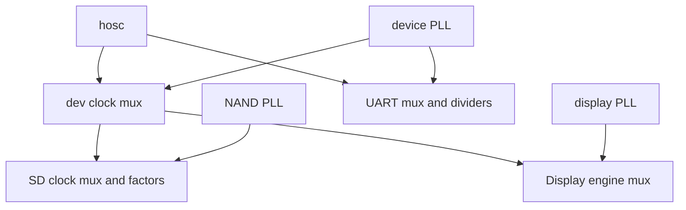

# Clock reconstruction: S500 comparison only

Evidence: `linux` source `drivers/clk/actions/owl-s500.c`, lines 31–86 (CMU offsets), 95–125 (PLL/parent definitions), 181–205 (gates/dividers), and later composite definitions. Finding CLK-001 establishes selected offset agreement with the related vendor header. These are **S500 source definitions**, with ATM7039S applicability inferred.

| Consumer | Source-defined parent candidates | What still needs checking |
|---|---|---|
| dev_clk | hosc / dev_pll_clk | Mux encoding, actual oscillator |
| SD clocks | dev_clk / nand_pll_clk | Divider table, gate/reset and target timing |
| UART clocks | hosc / dev_pll_clk | Actual clock path versus DT fixed frequency |
| Display engine | display_pll_clk / dev_clk | Divider/factor encoding and display rail |
| PWM | losc / hosc | Pinmux and target polarity |
| I2S | audio_pll_clk | Audio-family frequency and rate divisors |
| DMA | h_clk | Reset, gating and coherency |
| GPIO | apb_clk | Gate and interrupt/wake behavior |

This deliberately omits undocumented ATM7039S relationships and does not claim a complete clock tree. Mainline's clock macros encode rates and delays for S500; none is a proven ATM7039S operating limit. CPU/DDR/GPU PLL changes, regulator edits and disabling unused clocks must wait for a hardware-specific review and separate authorization.
