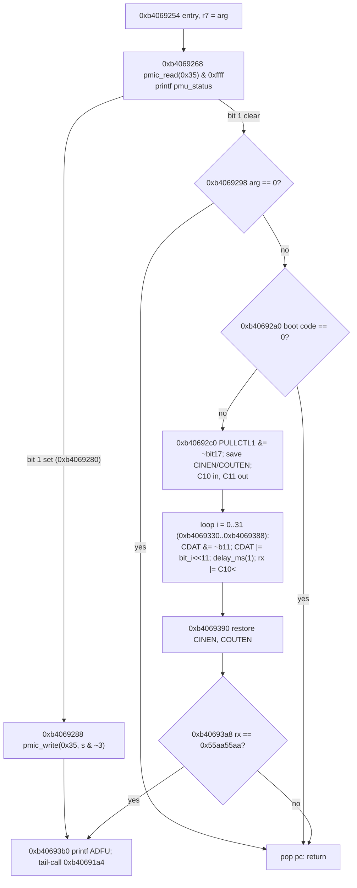

# ADFU GPIO loopback reconstruction and hardware-state modelling (PR #9, part 2)

Scope: the early loader's ADFU decision routine `adfu_check` `0xb4069254`, its GPIO C11→C10 loopback test, the ADFU re-entry `0xb40691a4`, and the state the test leaves for later code. Five pinned releases were checked, with Koriki v1.0 as the reference. Everything is offline: no device, card, register, PMIC or recovery interface was touched, and nothing here describes how to build a physical trigger.

| Item | Where |
|---|---|
| Findings | **BOOT-026** (algorithm and precedence), **BOOT-027** (re-entry boundary), **GPIO-003** (board-level pin mapping), **GPIO-004** (persistent state and downstream) |
| Refined | BOOT-025 |
| Contradiction | C-PREDRAM-PATH narrowed, still **open** |
| Evidence | [`evidence/firmware/adfu-loopback.json`](../evidence/firmware/adfu-loopback.json) |
| Tools | [`tools/adfu_analysis.py`](../tools/adfu_analysis.py), [`tools/gpio_model.py`](../tools/gpio_model.py), and opt-in extensions of `predram_analysis.Trace` and `dram_complete.Harness` |
| Tests | [`tests/test_adfu_analysis.py`](../tests/test_adfu_analysis.py) |

## 1. Executive summary

* **The algorithm is reconstructed at instruction level, and the earlier description holds with refinements.**
  * PMIC register 0x35 is read first on every call. Only bit 1 matters.
  * A failed I2C read also enters ADFU, because −1 masks to `0xffff`.
  * The argument guard is a full 32-bit test. The boot-code guard is strictly "code ≠ 0", so codes 1, 4, 5 and `0x80000000` run the test too.
  * The loop always runs 32 iterations. It drives LSB first, samples after each 1 ms delay, accumulates in the same order, and requires an exact 32-bit match.
* **An independent reference model agrees with the firmware's own instructions in all 41 synthetic scenarios.** Agreement covers: every GPIO write value in order, sampled bits, received word, PMIC write-back, delays, final registers and console text. The four other releases agree on a spot check, and their bytes are identical.
* **Only an exact echo enters ADFU.**

  | Input | Received word | Result |
  |---|---|---|
  | Wrong last bit | `0xd5aa55aa` | normal return |
  | Inverted echo | `0xaa55aa55` | normal return |
  | One-bit-late echo | `0xab54ab54` | normal return |
  | Interrupted echo | `0x000055aa` | normal return |
  | Echo matching only from bit 8 | `0x55aa5555` | normal return |
  | Pseudorandom input | `0xb8001234` | normal return |

  If GPIO data reads return the output latch rather than the pad level, the test can never pass.
* **The pins are SD0 DAT0/DAT1 (pinned vendor pinctrl data).** GPIOC10 = `P_SD0_D0`, GPIOC11 = `P_SD0_D1`, and PULLCTL1 bit 17 is SD0_D0's pull-up field. SD0 is the TF2 slot (PR #8).
  * So the test drives TF2 DAT1, samples TF2 DAT0, and first removes DAT0's pull-up.
  * Just before the test, `board_mfp_init` muxes SD0 D0/D2/D3/CMD/CLK to the vendor's JTAG function values.
  * No shipped DTB uses these pins as plain GPIOs.
  * A factory or service fixture in TF2 is the most plausible purpose. It remains a hypothesis.
* **Persistent state.**
  * Direction registers are restored exactly.
  * PULLCTL1 bit 17 stays cleared.
  * GPIO_CDAT bit 11 ends at 0. Other CDAT bits are preserved only if data reads return the latch; otherwise non-output latch bits are rewritten.
  * Nothing later in the loader touches these registers.
  * In the PR #6 DRAM caller (reference scenario, now run with the GPIO model), DRAM-stage writes outside the GPIO block are identical for codes 0 and 2.
  * Later stages (app.bin, U-Boot, Linux's `mmc0_default`) may reconfigure the pads. That is not traced.
* **The ADFU decision never reaches DRAM init.** The re-entry copies ROM `0xffff5200` over SRAM `0xb4060000`, changes three CMU registers, sets VBAR and SP, and jumps into the copy. The emulator stops at that jump.

## 2. Research questions and answers

| # | Question | Answer (evidence type) |
|---|---|---|
| 1 | What allows or suppresses the test? | PMIC bit 1 clear (or the read succeeding) **and** argument ≠ 0 **and** boot code ≠ 0 (decoded, executed) |
| 2 | How is the word assembled? | `rx \|= sample_i << i`, i = 0..31, LSB first, the same order as the drive (decoded, executed, reference) |
| 3 | Imperfect, inverted, delayed or absent loopback? | Always a normal return; only an exact echo matches (executed, reference; 12 input scenarios) |
| 4 | Temporary state | COUTEN bit 10 cleared / bit 11 set, CINEN bit 10 set / bit 11 cleared, 64 CDAT writes (decoded, executed) |
| 5 | Persistent state | PULLCTL1 bit 17 = 0, CDAT bit 11 = 0, other CDAT bits depend on read semantics (executed, reference) |
| 6 | Unrelated bits preserved? | Directions and PULLCTL1: yes. CDAT: only under latch read semantics (executed, reference) |
| 7 | Do initial values matter? | Not for the decision (except under latch semantics). They do decide which bits change (eight initial-state scenarios) |
| 8 | Is the changed state consumed later? | Not by the loader or the reference DRAM run. Later stages may rewrite it (not traced) |
| 9 | Mux/electrical assumptions | GPIO enables must control the pads although MFP_CTL2 selects JTAG (D0) or the ROM-left function (D1); DAT0 floats once its pull-up is removed. Unknown |
| 10 | Board-level purpose | Fixture in TF2 linking DAT1→DAT0 (hypothesis). Alternative: UART adapter on the same pair |
| 11 | After the ADFU decision? | BOOT-027 sequence, stop at the jump to ROM code |
| 12 | Needs physical evidence | GPIO read semantics, mux priority, TF2 wiring, PMIC reg 0x35 meaning, real timing, ROM code |

## 3. Provenance

* The same five images as part 1, each hash-verified against the acquisition manifest by the tool.
* Twelve regions were hashed per release, including literal pools, the PMIC table and strings (`regions` in the evidence). They are byte-identical in all five releases.
* All 46 instruction anchors decode as expected in every release.
* The full scenario matrix ran on Koriki v1.0. Each stock release ran two scenarios (loopback and low) as a spot check. Repeating the matrix on identical bytes would add no information.
* Board sources were fetched by hash from `evidence/files.json`:
  * vendor `pinctrl_data-atm7059.c`;
  * vendor `regs_map-atm7039.h`;
  * vendor `rg35xx_atm7039.dts`.
* The shipped `kernel.dtb` of each image was hashed and surveyed.
* Mainline `pinctrl-s500.c` was rate-limited (HTTP 429) and was not used.
* Tool versions: adfu_analysis v1, predram_analysis v1, Capstone 5.0.6, Unicorn 2.1.4.

## 4. Instruction-level algorithm (BOOT-026)

The pseudocode below is generated from the anchors in the evidence (`pseudocode`, `anchors`):

```
adfu_check(arg):                                   ; 0xb4069254, arg = ini word +0x14 (1 in every release)
  reg  = halfword[0xb406b9d4]                      ; 0x35
  s    = pmic_read(reg) & 0xffff                   ; I2C error -> -1 -> 0xffff
  printf("pmu_status = 0x%x\n", s)
  if s & 2:                                         ; only bit 1
      pmic_write(reg, s & ~3)                       ; result ignored
      goto enter                                    ; GPIO untouched
  if arg == 0: return
  if word[0xb4064c00] == 0: return                  ; boot code 0 (SD0) returns here
  PULLCTL1 = PULLCTL1 & ~(1 << 17)                  ; not restored
  in_saved  = CINEN ; out_saved = COUTEN
  COUTEN &= ~(1<<10) ; CINEN |= 1<<10               ; C10 input
  CINEN  &= ~(1<<11) ; COUTEN |= 1<<11              ; C11 output
  shift = 0x55aa55aa ; rx = 0
  for i in 0..31:                                   ; no early exit
      CDAT = CDAT & ~(1<<11)                        ; write 1
      CDAT = CDAT | ((shift & 1) << 11)             ; write 2 (fresh read, no clear)
      shift >>= 1
      delay_ms(1)
      rx |= ((CDAT >> 10) & 1) << i
  CINEN = in_saved ; COUTEN = out_saved
  if rx != 0x55aa55aa: return
enter:
  printf("Prepare to entry ADFU mode\n")
  tail-call rom_reentry_adfu()                      ; 0xb40691a4
```

Instruction-level details:

* **Register allocation.**

  | Register | Role |
  |---|---|
  | r4 | status & 2, which is 0 on the test path, so it doubles as the loop counter |
  | r5 | status, then the received word |
  | r6 | status register number, then the drive shift register |
  | r7 | argument, then the saved COUTEN |
  | r8 | saved CINEN |
  | ip | compare literal |

* **Drive.** Each iteration writes CDAT twice. The first write clears bit 11; the second re-reads and ORs the bit in. So a run of 1-bits shows a brief low on C11 between iterations.
* **Delay and sample order.** The delay comes after the drive and before the sample. The first sample is taken about 1 ms after the first drive.
* **Comparison.** It uses a freshly loaded literal at `0xb40693a4`, because r6 has been shifted to 0. It is an exact `cmp`/`popne`.
* **Return value.** r0 on return is not a status, and dram_caller ignores it.
* **Dependencies.** Timer 0 must be running (delay_ms → delay_us polls `0xb0168010`). The PMIC bus must be selected (pmu_init), and the boot-code word must be set (block 0).



Every anchor in the task brief was confirmed, with one correction: `0xb40692c0` is the `bic` on PULLCTL1, and the PULLCTL1 read happens at `0xb40692b0`.

## 5. PMIC decision precedence

* Register 0x35 is read and printed on every call. Precedence is: **PMIC bit 1 > argument == 0 > boot code == 0 > loopback**.
* Write-back:
  * `0x0002` and `0x0003` → `0x0000`;
  * `0xff06` → `0xff04` (high bits kept);
  * `0x0001` and `0x8005` → no write, test runs.
* A read failure enters ADFU and writes `0xfffc`. The PMIC path performs no GPIO access and no delay.
* The accessors do not retry. The I2C transfer has a 501 × 1 ms poll bound, which is static only, because the I2C transaction layer is a register file here.
* The meaning of register 0x35 is **not** established. No pinned ATC2603C source was available, and no clear-on-write behaviour is modelled or assumed. The firmware's write is demonstrated; its effect on the PMIC is unknown.

## 6. GPIO and pad registers

| Register | Header name (pinned) | Test use | Semantics status |
|---|---|---|---|
| `0xb01b0018` | GPIO_COUTEN | bit 10 off, bit 11 on, restored | output enable by name only |
| `0xb01b001c` | GPIO_CINEN | bit 10 on, bit 11 off, restored | input enable by name only |
| `0xb01b0020` | GPIO_CDAT | bit 11 driven, bit 10 sampled | **read semantics unknown** (latch vs pad) |
| `0xb01b0064` | PAD_PULLCTL1 | bit 17 cleared, not restored | vendor data: bit 17 = SD0_D0 pull-up enable; electrical effect unverified |

All accesses are 32-bit read-modify-writes through `0xb406919c`/`0xb4069194`. Other bits of COUTEN, CINEN and PULLCTL1 are preserved, provided their reads return the last written value (a model assumption).

## 7. Board-level pin mapping (GPIO-003)

Pinned vendor sources (line numbers re-derived by the tool and hash-checked):

* `pinctrl_data-atm7059.c`
  * line 169: `P_SD0_D0 _GPIOC(10)`; line 170: `P_SD0_D1 _GPIOC(11)`.
  * line 2642: `PAD_PULL_CONF(P_SD0_D0, 1, 17, 1, 0x1, 0)`; line 2643: D1 at bit 16.
  * The mux lists:

    | MFP_CTL2 field | Pad | Function values |
    |---|---|---|
    | [19:17] | SD0_D0 | 0 SD0 · 1 NOR · 3 JTAG · 4 UART2 · 5 UART5 |
    | [16:14] | SD0_D1 | 0 SD0 · 1 NOR · 4 UART2 |

* `rg35xx_atm7039.dts`: `mmc0_default` (mux sd0, pull `<2>` on D0–D3/CMD); `serial5_default` and `mmc_share_uart` (D0/D1 as UART5).

Shipped DTBs:

* All five `kernel.dtb` files (Koriki `ad4b8b4d…`, stock `2c558f01…`, `07fc051e…`, `94ef841c…` ×2) contain only those four references.
* None has a GPIO specifier for pins 74/75: no buttons, card-detect, power or test assignments.

Firmware:

* `board_mfp_init` (table entry 1, ini+0x0d = 1) writes MFP_CTL2 before the test:
  * [19:17] = 3 (JTAG, D0);
  * [13:11] = 3 (D2/D3);
  * [8:7] = 3 (CMD);
  * [6:5] = 2 (JTAG, CLK).
* [16:14] (D1) is not written.

Interpretation:

| Statement | Confidence |
|---|---|
| The test links TF2 DAT1 → DAT0 | inferred (pad identity from vendor data, TF2 = SD0 from PR #8) |
| Intended partner is a factory/service fixture | hypothesis |
| Intended partner is a UART adapter (the vendor's UART5/UART2 debug pair) | alternative hypothesis |
| PCB wiring | not seen |
| Whether GPIO enables override the JTAG mux | unknown |

These sources are ATM7059-named vendor data used by the RG35XX kernel. They do not prove silicon behaviour. No instructions for bridging pins are given or implied.

## 8. Synthetic model architecture

`tools/gpio_model.py` `GpioModel` is a deterministic, firmware-agnostic model of the GPIO/pad window:

* registers with explicit initial values;
* read semantics `mixed` (OUTEN → latch, INEN → pad level, else `undriven`) or `latch`;
* per-pin input rules (`const`, `follow`, `invert`, `delay`, `script`, `follow_except`, `prbs`), evaluated on the model's own microsecond clock;
* sample windows, opened by DAT accesses separated by ≥ 500 µs;
* a transition log;
* strict mode (unexpected accesses reported) and pass-through mode for whole-path runs.

The harness advances the clock:

* `predram_analysis.Trace(gpio=...)`: 1 µs per synthetic timer read;
* `dram_complete.Harness(gpio=...)` / `run_caller(..., gpio=...)`: by each stubbed delay's requested µs.

Both hooks are opt-in. With `gpio=None` the historical responses are unchanged, and `sd2-predram.json` regenerates byte-identically. The full assumption list is in the evidence (`model.assumptions`).

Other opt-in Trace additions:

| Option | Effect |
|---|---|
| `timer_step` | 0 = stalled timer |
| `i2c_fail_regs` | injected PMIC read failures |
| `rom_copy_stub` | records copies from ROM without inventing bytes |
| `run_function(entry, args)` | runs a single routine |

## 9. Scenario results

41 routine-level scenarios (`scenarios`), all with **firmware = reference**:

* **PMIC values:** `0x0000`, `0x0001`, `0x0002`, `0x0003`, `0xff06`, `0x8005`, and read failure. Bit 1 with code 0 and with arg 0 still enters ADFU.
* **Guards:** code 0 returns and arg 0 returns. Codes 1, 4, 5 and `0x80000000`, and arg `0x80000000`, all run the test.
* **Inputs:**

  | Input | Received word | Result |
  |---|---|---|
  | loopback | `0x55aa55aa` | **ADFU** |
  | low | `0x00000000` | return |
  | high | `0xffffffff` | return |
  | inverted | `0xaa55aa55` | return |
  | bit 13 wrong | `0x55aa75aa` | return |
  | first bit wrong | `0x55aa55ab` | return |
  | last bit wrong | `0xd5aa55aa` | return |
  | bits 3, 9 and 22 wrong | `0x55ea57a2` | return |
  | prbs | `0xb8001234` | return |
  | one-bit delay | `0xab54ab54` | return |
  | interrupted after 16 | `0x000055aa` | return |
  | matches from bit 8 | `0x55aa5555` | return |

* **Read semantics:** under `latch`, ideal loopback gives `0x00000000`, or `0xffffffff` with a preset latch, and returns.
* **Initial states:** all-ones, mixed, unrelated bits, undriven-high, pull bit 17 set/clear, C11 latch set/clear, and C10 initially an output. Every one has directions restored. The decision follows the input except under latch semantics.
* **Stalled timer:** the run stops in `timer_count` inside `delay_us` at the 200,000-instruction emulator budget. The firmware has no timeout.
* **Requested delay:** 32 calls × 1000 µs = 32 ms whenever the test runs, and 0 otherwise. Real duration additionally depends on the timer clock and on I2C/printf/MMIO time, so no physical timing is claimed.

Whole-path runs (`full_path`, `dram_stage`):

| Run | Result |
|---|---|
| main, code 2, C10 low | reaches `0xb40690b8` |
| main, code 2, ideal loopback | stops at the ADFU re-entry; DRAM never entered |
| main, code 0, loopback | reaches DRAM; no adfu GPIO access |
| `run_caller(..., boot_code=2, gpio=...)` | the same three outcomes; non-GPIO DRAM-stage writes for code 2 with C10 low equal code 0's |

## 10. Persistent state and downstream dependencies (GPIO-004)

| Register | Final state | Conditional on |
|---|---|---|
| COUTEN, CINEN | = initial, exactly (saved before any change) | nothing |
| PULLCTL1 | initial & ~bit 17 | changes only if bit 17 was set |
| CDAT | bit 11 = 0; others unchanged under `latch` semantics; under `mixed`, non-output latch bits = their read level (C10 = level at the last iteration's second read) | read semantics, initial directions, undriven level |

Downstream:

* **Demonstrated dependency:** none.
* **No dependency found:**
  * the executed main path after adfu_check;
  * the PR #6 DRAM caller (reference scenario, GPIO model attached);
  * a constant-address scan of everything reachable from main (137 functions) and of the DRAM-routine subtree, apart from pmu_detect's failure-only GPIO C26 pulse and i2c_select's bus-0 MFP_CTL2 path, neither of which runs here.
* **Also observed:** the DRAM routine writes `0xb01b00b4` = `0x3ff` (MEM_MARGIN_CTRL1 by name) for both codes.
* **Possible:**
  * app.bin `0x9430` rewrites the SD0 pulls, including bit 17 (no direct caller found);
  * U-Boot initialises SD0 on this path and carries MFP_CTL2 table literals;
  * Linux `mmc0_default` reprograms SD0 mux and pulls.
* **Unknown:** the electrical effect of an un-pulled DAT0 and of the rewritten latches on the TF2 slot or a card in it.

The reference DRAM run completing does **not** show that DRAM is unaffected on hardware. Conversely, no evidence links the changed bits to DRAM.

## 11. ADFU re-entry boundary (BOOT-027)

Executed sequence (`reentry`):

1. timer_init(0);
2. **ROM copy requested and not performed:** `0x2e00` bytes from `0xffff5200` to `0xb4060000`;
3. 5 ms;
4. `0xb0160000` := `0x30a`, `0xb0160004` := `0x114`;
5. 5 ms;
6. `0xb0160004` \|= `0x1000`; `0xb016001c` &= ~`0xf0000`;
7. 5 µs;
8. VBAR := `0xffff0000`;
9. SP := `0xb4070800`;
10. stop at the jump to `0xb4060000`.

Categories:

| Category | Content |
|---|---|
| Executable loader instructions | everything up to the `blx` |
| Modelled ROM read | none: the copy is recorded only |
| Unavailable | the ROM contents and what they do |
| Inferred | the ROM enters its USB recovery (ADFU) mode |

A return from the ROM code would pop from the new stack and is not a defined path. DRAM init is not reached.

## 12. Scientific limitations

* Everything is synthetic or source-derived.
* The reference model and the firmware runs share the GPIO read-semantics and window assumptions, so their agreement validates the reading of the instructions, not the hardware.
* The DTB and pinctrl evidence names pads and functions, not PCB traces.
* PMIC reg 0x35 is uninterpreted.
* No hardware finding was marked validated, and OBS-001 predictions are unchanged.

## 13. Reproduction

```sh
python tools/fetch_sources.py SRC          # hash-pinned public sources (or fetch only the three files named in §3)
python tools/adfu_analysis.py evidence evidence/firmware/adfu-loopback.json --sources SRC \
  --image koriki-v1.0=FW/koriki-v1.0.img --image stock-221203=FW/stock-221203.img \
  --image stock-221223=FW/stock-221223.img --image stock-230309=FW/stock-230309.img \
  --image stock-20231014=FW/stock-20231014.img            # about 2 minutes; byte-deterministic
python tools/adfu_analysis.py run FW/koriki-v1.0.img --boot-code 2 --arg 1 --pmic 0 --input invert
ATM_FIRMWARE_DIR=FW ATM_SOURCES_DIR=SRC python -m unittest tests.test_adfu_analysis -v
```
