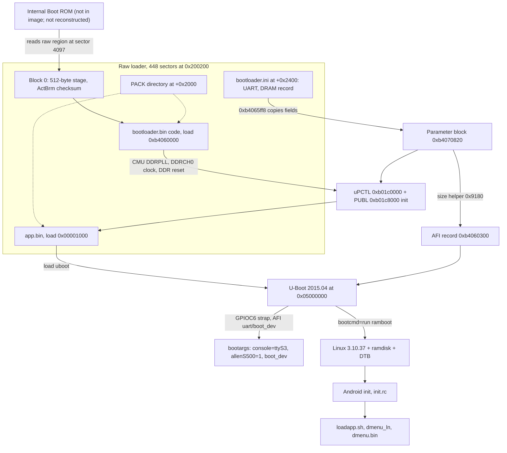

# Anbernic stock firmware reverse engineering

Scope: the **original 2022–2023 RG35XX** (Actions ATM7039S). Four Anbernic stock releases were acquired and analysed statically: 221203, 221223, 230309 and the 20231014 dual-system image. Nothing was executed, mounted, flashed or run on hardware. No firmware, library or decompiled code is redistributed; this report and the files in [`evidence/firmware/`](../evidence/firmware/) contain hashes, offsets, metadata and original analysis only.

Findings: FW-014..017, BOOT-009..011, MEM-005, DDR-001, GPU-011, USB-002, UI-002, DT-005. Contradictions: C-STOCKLIKE, C-DDR-WIDTH. All are in the [findings ledger](../evidence/findings.md).

## 1. Executive technical summary

| Result | Why it matters | Evidence |
|---|---|---|
| The stock loader is a documented container: ActBrm-checksummed blocks plus a `PACK` directory naming `bootloader.bin` (load `0xb4060000`), `bootloader.ini` (`0xb4062400`) and `app.bin` (`0x00001000`) | First recoverable format for the pre-U-Boot stage; the declared load address corroborates the earlier `0xb4060000` hypothesis | BOOT-009 |
| `bootloader.ini` holds the DRAM configuration: 468 MHz, 256 MiB, x16, 1 CS, ODT and drive strength. It produces the `0xb4070820` block from which the AFI DDR size is computed | Answers the open AFI question "who writes `0xb4070820`" | MEM-005 |
| DRAM bring-up programs two blocks at **`0xb01c0000`** and **`0xb01c8000`**, absent from every public RG35XX map; 128/129 accesses match the public DesignWare **uPCTL/PUBL** layout, preceded by a DDR PLL/clock/reset handshake that the vendor clock tree names exactly | The most consequential closed dependency (DDR init) now has a register-level outline and a candidate public IP | DDR-001 |
| Loader **code is byte-identical** across all stock releases; only the DRAM ODT/drive bytes (changed in 20231014) and a 5 KiB opaque area vary. **Koriki v1.0's loader and U-Boot are byte-identical to stock 230309** | Koriki's pre-kernel chain is Anbernic's, verbatim | BOOT-010 |
| From 230309, U-Boot samples **GPIOC6** as a board-variant strap and passes `allenS500=1`; the kernel then uses alternative LED and earphone-detect GPIOs | Firmware-level evidence of two board variants from early 2023 | BOOT-011 |
| Stock does **not** use the SGX: GPU node disabled, module never loaded, no EGL/GLES. Its module is **DDK 1.12@3052601 (Android, ION/sync)**, not Koriki's DDK 1.14@3625561 (DRM/OMAPLFB) | Stock is not a source of a working accelerated stack; DDK generations are not interchangeable | GPU-011 |
| Stock init leaves USB in **host** role with the umonitor stopped and `adbd` disabled; `ro.secure=0`, `ro.debuggable=1` | Static explanation of why ADB needs a script on stock (Tinyhack) | USB-002 |
| The dual-system image carries the **GarlicOS kernel**, built from essentially the stock tree with the stock toolchain | First hash-identified GarlicOS kernel in this project | FW-017 |

## 2. Identity and provenance

The manufacturer page `win.anbernic.com/download/270.html` links a Google Drive folder. Its listing (retrieved 2026-11-24) contains `system + 64G ROM/35XX双-20231014-EN4GB.rar` (10/16/23; Drive reports "490M") alongside ROM-only folders. A direct download was refused by Drive ("quota exceeded"). This is a temporary rate limit; it was not bypassed.

The bytes come from the archive.org item `RG35XX_original_firmwares`, which mirrors four releases. Identity indicators for the 20231014 release:

| Indicator | Value | Strength |
|---|---|---|
| Archive size | 513,778,207 bytes = 489.97 MiB, matching Drive's "490M" | Weak (rounding) |
| RAR member name | `35XX双-20231014-EN4GB.IMG`, the manufacturer's original name (the mirror renamed only the archive) | Moderate |
| RAR member mtime | 2023-10-16 10:19, matching the Drive listing date | Moderate |
| uImage timestamps | kernel 2023-10-14 07:13:31 UTC, U-Boot 2023-10-14 07:13:35 UTC | Strong internal consistency |
| Kernel string | `Linux 3.10.37 (flower@flower-B85M-D2V) … #42 SMP PREEMPT Sat Oct 14 15:13:26 CST 2023` | Strong |
| U-Boot build path | `/home/flower/cc_share/action/7039s/produce/9/handheld/sdk-s500/…` | Ties the build to a "7039s" product built from Actions' S500 SDK |
| Board model | DT model "Actions GS705A board"; GPT partition names MISC/SYSTEM/CONFIG | Matches earlier RG35XX research, not RG35XX Plus/H/SP (H700) |

For 230309, the expanded image MD5 `d3053e5d…` equals an archive.org upload by a **different uploader** (`anbernicrg35xxstockfirmware`), so two independent mirrors agree byte for byte. **No manufacturer checksum exists**, so authenticity is strongly supported rather than proven (FW-014). All hashes are in [`acquisitions.json`](../evidence/firmware/acquisitions.json).

## 3. Acquisition and integrity

```sh
python tools/acquire_firmware.py anbernic-stock-archive INPUTS --filename RG35XX-20231014-EN4GB.rar --expand
python tools/acquire_firmware.py anbernic-stock-archive INPUTS --filename RG35XX-64GB230309EN.rar --expand
python tools/acquire_firmware.py anbernic-stock-archive INPUTS --filename RG35XX-EN-221223.rar --expand
python tools/acquire_firmware.py anbernic-stock-archive INPUTS --filename RG35XX-221203.zip --expand
```

Each archive is streamed with a size/SHA-256 check. Exactly one named member is then expanded through [`archive_members.py`](../tools/archive_members.py), which rejects traversal, symlinks, duplicates and oversize members, and is checked against the pinned expanded SHA-256. Distribution 7-Zip lacks the RAR codec, and libarchive 3.7.2 rejects the 221223 RAR4 member with a CRC error; `unar` 1.10.7 extracts it with the archive-declared CRC32. The tool tries extractors in order and records which one succeeded. Every expanded CRC32 matched the archive's.

| Release | Archive | Image | Layout |
|---|---|---|---|
| 221203 | zip, 235,347,617 B | 1 GiB, `7c466a74…` | First 1 GiB of a 64 GB GPT layout |
| 221223 | RAR4, 266,172,913 B | 1 GiB, `0bd553d5…` | Same, truncated |
| 230309 | RAR5, 327,143,582 B | 1 GiB, `e3772f59…` | Same, truncated |
| 20231014 | RAR5, 513,778,207 B | 3,965,190,144 B, `e5f61b7d…` | Complete 4 GB dual-system image; GPT backup header valid |

The ROM partition was not read beyond its `/CFW` system tree, and no game ROM was listed or hashed.

## 4. Component inventory

[`image_inventory.py`](../tools/image_inventory.py) produced deterministic manifests for each release: [`stock-20231014-inventory.json`](../evidence/firmware/stock-20231014-inventory.json) and the 221203/221223/230309 equivalents. Totals: 3,552 hashed files.

| Region | 20231014 | Notes |
|---|---|---|
| Protective MBR + GPT | sectors 0–33, CRC-valid | Koriki v1.0 uses a plain MBR instead (FW-015) |
| Raw loader | `0x200200`, 448 sectors, `ec9e4ec8…` | Extent confirmed by MISC/DMENU.BIN `dd seek=4097 count=448` |
| U-Boot uImage | `0x300000`, 726,396 B, `5b8d5b2c…`, "U-Boot 2015.04 for owl board", load `0x05000000` | Default env `bootcmd=run ramboot`, identical to Koriki's |
| MISC (FAT16 "MAKEBOOT") | uImage `3dc735f0…`, ramdisk.img `a49e8fb8…`, kernel.dtb `94ef841c…`, three battery DTBs (2100/2600/2800 mAh), modules (`pvrsrvkm`, `dc_owl`, `ethernet`, `gpio_keys_polled`, `atc260x_cap_gauge`), logos, DMENU.BIN/HDMI.BIN scripts | A "System Volume Information" folder shows the image was handled on Windows |
| SYSTEM (ext4) | Android 4.4.2 toolbox/mksh/adbd, SDL 1.2 stack, glibc 2.15 in `/usr/local/lib`, `dmenu.bin` launcher, 15 emulator binaries | No EGL/GLES/PowerVR userspace |
| CONFIG (ext4) | launcher settings only | |
| ROM partition `/CFW` | GarlicOS: `ROOTFS.IMG`, `MAIN`, `START`, `OS/BOOT/STOCK` and `OS/BOOT/GARLIC` boot sets | MISC currently holds the STOCK set (flag file `stock.flag`) |

Deduplication against previously catalogued firmware:

| Component | Match |
|---|---|
| Early window `0x200200–0x300000` | Stock 230309 = Koriki v1.0 `early-region.bin` (`904f92f6…`) |
| U-Boot | Stock 230309 = Koriki v1.0 = CFW alpha 0.4+ (`814ce6db…`) |
| `atc260x_cap_gauge.ko`, `gpio_keys_polled.ko` | Stock 230309/20231014 = Koriki 1.0.3.1 boot bundle |
| `app.bin`, loader code | Identical in all four stock releases |
| `kernel.dtb` | Stock 230309 = 20231014 |
| GarlicOS `RAMDISK.IMG`, `def_config.bin` | = stock 221203 |
| GarlicOS modules and kernel | Unique |

## 5. Boot-chain reconstruction



Solid edges are static data or control dependencies seen in code. The ROM-to-block-0 edge is inferred from the layout. Block-execution order beyond block 0 is not established.

**Checksum rule** (BOOT-009). The trailer is `"ActBrm" AA 55 <u32>`, where the u32 equals the sum of the block's little-endian words up to (excluding) that word, plus `0x1234`. The four blocks are: `[0x0,0x200)`, `[0x1e00,0x2000)`, `[0x5400,0x33c00)` (bootloader.bin code, **excluding** the PACK directory and `bootloader.ini`, so DRAM-config edits do not change it) and `[0x19000,0x38000)` (app.bin padded to 248 sectors). [`actions_loader.py`](../tools/actions_loader.py) reproduces this for all five loaders: [`stock-loaders.json`](../evidence/firmware/stock-loaders.json).

**Stage roles.** Strings and references place DDR init, PMIC early init, AFI production and "load app" in `bootloader.bin` (SRAM-resident, `0xb4060000`). The DRAM-resident `app.bin` holds SD/eMMC/NAND/SPI-flash drivers. *Correction (PR #5, C-APPBIN):* bootloader.bin itself loads U-Boot, and app.bin only gates on a chip identity and may write `bootloader.ini` back (BOOT-013/014). *Resolved (PR #5):* U-Boot's `check_boot_flag` replaces the default `bootm` of addresses in memory with `run mmcboot`, which loads the kernel, RAM disk and DTB from the FAT partition ([reconstruction](stock-boot-chain-reconstruction.md), BOOT-015/016).

**Answers to the brief's boot questions**

| Question | Static answer | Status |
|---|---|---|
| Which stage configures the DRAM controller? | `bootloader.bin` function `0xb40673f4` | Strongly supported (DDR-001) |
| How is RAM size determined? | Configured 256 MiB in `bootloader.ini`, copied to `0xb4070820+2`, shifted `<<20` into AFI `ddr_size`; capacity scan/test code exists and can rewrite the field | Configured value verified; runtime path open (MEM-005) |
| Clock and reset init | Loader: CMU core/dev/bus PLLs and dividers early, then DDR PLL/clock/reset handshake; U-Boot: GPIO clock | Partial |
| Early loader → U-Boot interface | AFI record at `0xb4060300` (BOOT-004/005), now with a traced producer | Verified layout |
| Kernel parameters | U-Boot builds `earlyprintk clk_ignore_unused selinux=0`, `console=ttyS<AFI uart>`, optional `allenS500=1`, charger/upgrade modes, `boot_dev=`, `androidboot.serialno=` | Static (BOOT-006/011) |
| Runtime DT modifications | U-Boot writes `/chosen` bootargs; others not traced | Partial |
| Proprietary components | All pre-kernel stages are binary-only; the pinned public U-Boot is related but lacks the strap/allen code | — |

## 6. Kernel build identity and configuration

| Kernel | Build | Text functions | Vendor-only 122 |
|---|---|---|---|
| Stock 221203 | flower #18, 2022-12-03, Linaro GCC 4.7.3 | 34,641 | 119 |
| Stock 221223 | flower #46, 2022-12-23 | 34,641 | 119 |
| Stock 230309 | flower #17, 2023-02-25 | 34,644 | 119 |
| Stock 20231014 | flower #42, 2023-10-14 | 34,644 | 119 |
| GarlicOS (in 20231014 image) | blackseraph@Pandemonium #116, 2023-04-06, same GCC 4.7.3 | 34,641 | 119 |
| Koriki v1.0 | ctalon@endymion #75, GCC 4.9.4 | 34,604 | 122 |

The three vendor-only functions missing from every stock build (`bta_test_init`, `bta_test_waiting_turn_over`, `owl_get_dsi_gamma_val`) exist only in Koriki's builds. Normalised-body comparison (A32 branch immediates and kernel-VA literals masked; [`kernel_compare.py`](../tools/kernel_compare.py)):

| Pair | Common | Same size | Same normalised body |
|---|---|---|---|
| 221203 → 221223 | 34,641 | 34,639 | 34,366 |
| 221223 → 230309 | 34,640 | 34,631 | 31,570 |
| 230309 → 20231014 | 34,644 | 34,644 | 34,530; only initramfs-region symbols differ |
| GarlicOS vs 230309 | 34,640 | 34,597 | 31,458 |

Stock vs Koriki v1.0, judged by one exact anchor symbol per subsystem (`subsystem_anchor_presence` in [`stock-kernels.json`](../evidence/firmware/stock-kernels.json); suffix-normalised name diffs alone over-report, because inlining changes helper symbols):

* **Only in stock (and the GarlicOS kernel):** Actions USB port monitor (`umonitor_core_init`, `usb_hal_set_cmu_usbpll`), xHCI, USB serial and CDC-ACM host, ext2, PWM LEDs, Owl CPU-hotplug policy, joydev; `allen_check_cpu_type` from 230309.
* **Only in Koriki:** EHCI, Bluetooth (`btusb`, `rfcomm`), fbcon, squashfs, CVBS output, VDE/VCE video engines, i2c-dev.
* **In both:** Binder, exFAT, dwc3, Android composite gadget (`android_bind`, `mtp_bind_config`, `rndis_function_bind_config`).

## 7. Stock vs Koriki classification

| Subsystem | Classification | Basis |
|---|---|---|
| Raw loader, `app.bin` | Unmatched proprietary implementation; **identical** between stock 230309 and Koriki | Byte identity (BOOT-010) |
| U-Boot | Likely derived from known source (pinned `u-boot_s500`) plus vendor additions (GPIO strap, `allenS500`, charger/upgrade bootargs) | Strings, env, BOOT-006/011 |
| Kernel core and Owl BSP | Matching known source (public S500 3.10 tree) | FW-009/010 |
| "allen" board code, USB stub/upgrade gadget, BT PCM, dwc3 overflow handling | Modified vendor implementation, in both stock and Koriki | FW-010, FW-016 |
| `allen_check_cpu_type` variant handling | Vendor addition from 230309; Koriki solves the same problem with `*_new` DT properties | BOOT-011, DT-005 |
| USB monitor (umonitor) | Present in stock; absent from Koriki's build config | FW-016 |
| SGX kernel module | Known DDK source family, different DDK generations (1.12 vs 1.14) | GPU-011 |
| Userspace | Reused Actions ATM7051H Android 4.4.2 demo build plus Anbernic launcher | UI-002 |

## 8. Significant proprietary hardware-specific functions

| Component / address | Function | Notes |
|---|---|---|
| loader `0xb4065ff8` | `bootloader.ini` → parameter block copy | Traced field by field |
| loader `0xb40663f8` | SPI-NAND parameter backup check (magic `SFVD` at `0xb4063800`) | Not on the SD path |
| loader `0xb40673f4` | DRAM bring-up, 6,752 bytes | DDR-001 |
| loader `0xb4066854` | console `printf` | Labels the DRAM record |
| loader `0xb40670e8/f0/f8`, `0xb4067120/40` | write / read / RMW / clear-bits / set-bits accessors | Semantics verified from instructions |
| U-Boot `0x05025e5c` | GPIOC6 variant strap | BOOT-011 |
| U-Boot `0x05021898` | GPIO value read; GPIO ≥ 224 routed to the PMIC | |
| kernel `allen_check_cpu_type`, `atc260x_power_probe`, `atc2603c_init` | variant flag and consumers | BOOT-011 |

Ghidra 11.4.2 headless auto-analysis ([`ghidra_headless.py`](../tools/ghidra_headless.py)) found 323 functions in `bootloader.bin` and 194 in `app.bin`. Its extents agree with the Capstone-derived helpers (2-instruction accessors) and the DDR function size. Only extents, call edges and constants are committed ([`stock-loader-ghidra.json`](../evidence/firmware/stock-loader-ghidra.json)).

## 9. Recovered register operations

**Early clocks** (loader `0x5e74–0x5f40`, before DRAM init; static operands decoded with the vendor clock tree, which is ATM7059-named and not verified for ATM7039S):

| Register | Written | Vendor-tree reading |
|---|---|---|
| CMU_COREPLL | `0x332` | HOSC enable (bit 8), COREPLL enable (bit 9), 50 × 12 MHz = **600 MHz** |
| CMU_DEVPLL | `0x164`; bit 12 cleared then set (RMW) | DEVPLL enable (bit 8), 100 × 6 MHz = **600 MHz**; bit 12 selects the DEV clock source |
| CMU_BUSCLK / CMU_BUSCLK1 | `0x1c710000`, then RMW clear `0x3` set `0x2` / `0x2e004` | Raw values only |
| CMU_SD0CLK, CMU_SD2CLK | `0xc` each | Raw ("emmc clk=12mhz" printed nearby) |
| SPI0_CLKDIV | `0x1` | "spi0 clk=50mhz" |

**DRAM bring-up order** ([`stock-ddr-sequence.json`](../evidence/firmware/stock-ddr-sequence.json), 129 static accesses):

1. CMU_DDRPLL: clear bit 8 (`DDRPLLEN` in the vendor clock tree).
2. CMU_DEVCLKEN0: clear mask `0xa` (`DDRCH0`, `DMAC` clocks). CMU_DEVRST0: clear then set mask `0x5` (`DDR`, `DMAC` resets). CMU_DEVCLKEN0: set `0xa`. CMU_DDRPLL rewritten (computed frequency).
3. uPCTL `SCTL`/`STAT` state requests and polls; PUBL `ACIOCR=0x1bfc3c18`, `DXCCR=0x80c`, `DSGCR=0xc5fc0000`; `ACDLLCR` 0 → `0x40000000`; `PIR=0x10000000`.
4. DFI update timings `4/0xa/8`; `TOGCNT1U`, `TOGCNT100N`, `TINIT=200`, `TRSTH`; `POWCTL=1`, poll `POWSTAT`.
5. `MCFG`, `MCFG1`; PUBL `DCR`, `MR1`, `MR2`, `PTR0-2`, `DTPR0-2`, `DTAR=0x20000000`, `DXCCR=0x911`, `ODTCR=0x21`, `ZQ0CR1`, `ACIOCR` updates.
6. All four byte lanes: `DXGCR` clear `0x786`. Lanes 2 and 3: set bit 0 (lane 3 cleared again on one path). Read `ZQ0SR0`; `PGCR`; `PIR=0x81`; `MCMD` commands.
7. All uPCTL DRAM timing registers (`TMRD` … `TDPD`), `SCFG=0x700`, DFI read/write latency and status configuration, `ECCCFG=0`, `TSTATEN`.
8. Read the per-lane `DXGSR0` training status.

Named against U-Boot's public `ddr_rk3288.h` layout via [`map_accesses.py`](../tools/map_accesses.py). One write (PUBL `+0x3fc`=1) lies outside that layout. DMM writes accompany controller start: `DMM_SCH_CTRL` bit 2, `DMM_TO_DE_CRITICAL_USB2=0xf8010000`, `DMM_INTERLEAVE_FRAGMENT=0x2`, and unnamed DMM offsets `0x64`, `0x68`, `0x80`, `0x88`.

**Integration into the register model.** [`registers/curated/firmware-observations.json`](../registers/curated/firmware-observations.json) adds candidate blocks `firmware:DDR_UPCTL` (65 offsets) and `firmware:DDR_PUBL` (29 offsets), four DMM offsets, and firmware evidence on CMU_DDRPLL, CMU_DEVCLKEN0, CMU_DEVRST0, DMM_*, MEM_MARGIN_CTRL1 and GPIO_CDAT. [`apply_firmware_registers.py`](../tools/apply_firmware_registers.py) applies them idempotently, and `build_dataset.py` preserves them on rebuild. Width, access and reset values stay unknown; nothing is hardware-validated.

**Kernel.** Static `IO_ADDRESS` references are few (most drivers `ioremap`). New firmware-side observations: `owl_l2x0_init` writes the PL310 prefetch control (`+0xf60`=`0x78800002`) and power control (`+0xf80`=3). `cpu_package()` reads `0xb01b00e0 & 0xf`, which public `cpu-owl.c` documents as ATM7033=`0xf`/ATM7039=`0xe`; it is used only on the suspend path.

## 10. GPU

* **Stock:** `/gpu@b0300000` disabled; no `insmod` of `pvrsrvkm.ko`/`dc_owl.ko`; no EGL/GLES/`libsrv_um`. `pvrsrvkm.ko` (`86346a75…`) is `SGX_DDK_Android_RSCompute sgxddk 1.12@3052601`, non-DRM, built with Linaro GCC 4.7.3. It uses ION buffer import (`owl_ion_device`, `ion_import_dma_buf`, `owl_mmu_import_buffer_on_dc`), Android native sync (`sync_fence_*`, `sw_sync_*`), and power/clock hooks (`owl_powergate_power_on/off`, `module_clk_enable/disable`, `regulator_set_voltage`, PLL "putaway" helpers, clock notifiers). `dc_owl.ko` is the display-class companion (`depends=pvrsrvkm`).
* **Koriki:** `SGX_DDK_Linux_XOrg sgxddk MAIN@3625561` (1.14), `depends=drm`, with built-in OMAPLFB fbdev bridge and early-suspend handlers, paired with 1.14 userspace.
* Both modules contain the UM–KM DDK version check (`PVRSRV_ERROR_DDK_VERSION_MISMATCH`), so 1.14 userspace cannot drive the stock 1.12 module.

Conclusion: stock provides **no** working GPU stack to reuse; Koriki's proprietary DDK 1.14 remains the only functional one examined. Neither is an open implementation (GPU-011; compare GPU-003/008/010).

## 11. USB and debugging

| Aspect | Static evidence | Classification |
|---|---|---|
| Controller support in kernel | dwc3 + xHCI + Android gadget (adb, mtp, mass storage) + Actions umonitor (`/sys/monitor/usb_port`) | Supported in stock kernel |
| Boot role | init starts the monitor, forces device, then forces **host** and stops the monitor | Static behaviour |
| ADB | `adbd` service disabled; device mode only via `usbmond.sh USB_B_IN`/`usbdbg.sh` (VID `10d6`, PID `0c02` mass_storage,adb or `4e42` mtp,adb) | Plausible after running the script, as Tinyhack showed |
| Root/debug | `ro.secure=0`, `ro.debuggable=1` → `console` root shell service on the console TTY | Plausible; physical UART access unverified |
| Koriki | No umonitor in kernel; EHCI instead of xHCI; its own `S01adb` | Different stack |
| VBUS/ID | `usb_set_soft_vbus`, `usb_get_idpin_state`, `usb_hal_set_cmu_usbpll` in stock | Hardware behaviour unverified |

This extends Tinyhack's `ADB_ON.sh` (which uses the same controls) by locating the stock defaults that make it necessary. Real role switching, VBUS and cable behaviour need a device test (§15).

## 12. Other subsystems

* **CPU/memory:** stock init writes the `autoplug/lock` and `powersave` governor; `dmenu/cpu_setting.sh` lists 240–1008 MHz steps. Kernel CPU hotplug policy (`owl_pm_hotplug_*`) is present only in stock.
* **Board variants:** see BOOT-011. Variant A uses LED GPIOs 22/21/18 and earphone detect GPIO 28; variant "s500" uses 78/79/80 and 81.
* **Display:** stock enables HDMI mirroring through `/sys/devices/framebuffer.4/graphics/fb0/mirror_to_hdmi` (HDMI.BIN); the launcher uses `/dev/fb0` and `/dev/fb1`.
* **Power:** the DT battery profile is selected by copying `DTBS/<capacity>mAh.dtb` (2100/2600/2800) to `kernel.dtb` in the Garlic path.
* **Storage:** SD0 clock is configured in the loader (`CMU_SD0CLK`, `CMU_SD2CLK`; "emmc clk=12mhz"), and the loader carries SD/eMMC/NAND/SPI-NAND/SPI-NOR drivers.

## 13. Contradictions with existing research

* **C-STOCKLIKE:** "stock-like" Koriki and "stock-derived" Garlic kernels were imprecise. Koriki shares vendor BSP code, not the stock build or USB configuration. Garlic is a separate build from nearly the stock tree.
* **C-DDR-WIDTH:** the manufacturer's 32-bit DDR vs the board's x16 loader configuration.
* **BOOT-004 strengthened:** the `0xb4060000` base is now declared in the PACK directory.
* **MEM-004's open producer:** answered by MEM-005.
* **KNULLI/BOOT-001** recipe offsets (`0x200200`, `0x300000`) also hold for stock, though stock uses GPT rather than MBR.

## 14. Unknowns

* Boot ROM behaviour: block execution order, media search, the role of the `[0x1e00,0x2000)` block and the 5 KiB per-release area.
* ~~Who loads kernel/ramdisk/DTB before U-Boot's `bootm` (BOOT-007).~~ Resolved: U-Boot `mmcboot` (BOOT-015/016).
* ~~Computed DRAM timing values and the DDR PLL frequency field encoding; whether lanes 2/3 are disabled at run time; whether capacity detection overrides 256 MiB.~~ Resolved offline in [ddr-timing-reconstruction.md](ddr-timing-reconstruction.md): CMU_DDRPLL = (F/12) | 0x300; lanes 2/3 have DXGCR bit 0 cleared for the ×16 records; cold boot uses the second ini record and detects capacity (MEM-006, DDR-002).
* Which boards strap GPIOC6 high, and whether "s500"/"a7039" mean different silicon.
* The 5 KiB high-entropy area: now placed inside bootloader.ini and best explained by app.bin's SRAM write-back (BOOT-019, inferred; C-OPAQUE).
* USB role/VBUS behaviour on hardware; reachability of the console shell.
* DDK 1.12 microkernel and userspace for the stock module (absent).

## 15. Prioritised next investigations

| Rank | Task | Mode |
|---|---|---|
| 1 | ~~Recover computed DRAM timing values by symbolic evaluation of `0xb40673f4` with the `bootloader.ini` inputs~~ **Done**: [ddr-timing-reconstruction.md](ddr-timing-reconstruction.md) | Offline |
| 2 | Trace the U-Boot (stock) path that places kernel/ramdisk/DTB in memory: owl board init, `boot_dev`, any FAT reads in non-env code | Offline |
| 3 | Disassemble block 0 and the `[0x1e00,0x2000)` block with the Boot ROM interface in mind (calls to `0xffff....`) | Offline |
| 4 | Compare the loader's UART/PMIC early init with `atc260x` kernel code to document the PMIC I2C bring-up sequence | Offline |
| 5 | Read-only serial log on a spare card to capture the loader's own "DRAM init … Ok:DCU_CFG" and "-----s500/-----a7039" lines. **Requires explicit approval; not performed.** Expected: x16, 256 MiB and the strap result. Risk: opening the device for UART pads. | Hardware, approval required |
