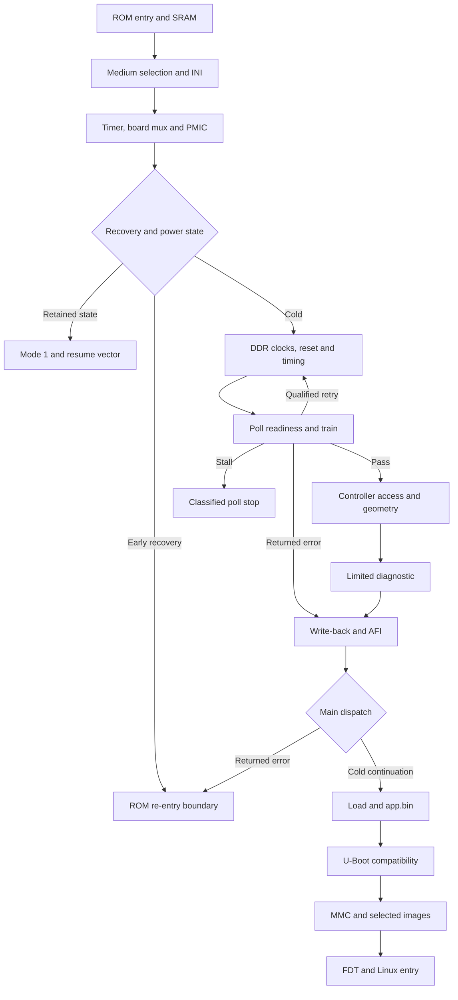

# ATM7039S boot initialization dependency analysis

The [initialization contract](../docs/bootloader-initialization-contract.md) describes what another developer needs to establish to replace the early loader or hand off to an existing stage. This report records how its claims were tested and where the underlying evidence stops.

## Evidence boundary

PR #9 head was verified as `c525a28bd4fb1b758e5a784075e3c6a0a91d9edc` before committing. The initial local checkout had an equivalent commit with the identical tree. Artifact digests and historical summaries are therefore based on the reviewed tree. Five whole-image identities and the prior 35-scenario integration matrix remain the release-level provenance. Focused replays use 14 Koriki scenarios and two 20231014 scenarios. Data for the other three stock releases comes from the existing five-release comparisons.

The replay uses the same live loader object from block 0 through the app.bin branch. It carries the original ordered hook stream in RLE with no normalization. A supplemental trace captures requested delays and named instruction anchors on that machine. The U-Boot AFI/global-data and MMC invocations, boot-device selection, model script/FAT operations, FDT fixups and Linux cleanup come from separate state-transfer or model boundaries. Raw U-Boot initialization MMIO and kernel instructions beyond the entry are outside the stream. The static U-Boot audit is a separate, hash-pinned landmark record.

The contract incorporates pre-DRAM and ADFU control flow, the independent arithmetic and geometry models, the cold/resume caller comparison, and data consumed from actually loaded app/U-Boot bytes. It independently reconstructs the AFI and INI bytes from ordered SRAM stores and compares them with the final result. It also checks that the validated AFI reaches the same bounded U-Boot consumer and FDT memory bank. Stages, accesses and normalized evidence are therefore subject to distinct checks. The raw trace retains first-stage MMIO, modeled PMIC bus accesses, storage request results and RAM tests. [Unified evidence](../evidence/firmware/unified-boot-chain.json) · [DRAM comparison](../evidence/firmware/sd2-dram-comparison.json) · [OBS-001](../evidence/observations/OBS-001.json)

## Conditional dependency graph

The diagram groups evidence at functional boundaries. The structured graph gives each edge a type, condition, justification and supporting evidence. Direct firmware data/control edges identify facts needed for the same stock control flow or compatible consumer. Model edges show an explicit boundary and input source. Ordering-only edges are tested where observable and do not independently establish a physical requirement. Conservative dependencies express the default design stance pending electrical qualification. Unresolved edges retain candidate effects that the trace cannot settle. The two retry transitions have explicit guards and bounds and are represented separately from the per-attempt acyclic prerequisites.

| Relationship | Classification and implication |
|---|---|
| INI → board mux and record selection | Direct data dependence. An independent board profile can provide the same classes of input in another format |
| Timer → requested delay → UART reset, PMIC clock-out, GPIO and DDR | Firmware dependence. Independent timing can satisfy the need if it is qualified and deadlines handle a stalled counter |
| UART setup → DRAM | Observed ordering only. Standalone diagnostic output does not establish that UART is required to initialize memory |
| PMIC configuration → DDR | Firmware runs PMIC first. Electrical dependencies and safe settling remain unresolved |
| Gate/reset/PLL order → PHY and controller programming | Preserve the observed sequence conservatively until access, reset and clock conditions are explained |
| Readiness → training → controller access → geometry probe | Firmware control flow with synthetic readiness. Actual readiness must be checked in a future implementation |
| Trained geometry → size → diagnostic/write-back/AFI | Direct data. A diagnostic pass and an AFI record do not certify usable memory |
| Cold success → proprietary app and U-Boot consumption | Stock compatibility. A future handoff can replace these stages if their live inputs, side effects and transferred responsibilities are accounted for |
| Raw AFI → RAM size and boot role → FDT/bootargs | Direct getter/boot flag behavior plus a modeled global/board data bridge |
| FDT → Linux r2 | Direct handoff with the pinned payload, selected placement and cleanup ABI |

[Generated edges and operation anchors](../docs/bootloader-operation-reference.md)

## Trace checks and discrepancies

| Check | Result used by the contract |
|---|---|
| SD0 vs SD2 | Code 2 is selected before code 0, then both request LBA `0x102b`, 80 sectors to `0xb4065400`. ADFU GPIO runs only in the eligible nonzero path. The AFI boot device differs by 2. Post-DRAM writes distinguish `0xb0160050` (SD0) and `0xb0160058` (SD2) |
| Earlier release vs 20231014 | Preserved trained geometry and reference size under the selected model. Exact MR1 and ZQ0CR1 differ as predicted by INI input. Two repeats for the dual-to-single rank sequence |
| Delay vs event order | UART's 1 µs, PMIC's 300 µs, GPIO's 32 × 1000 µs, and the DDR clock/reset delays are checked as requests. Actual early timer polling and DDR delay stubs are labeled explicitly |
| Re-entry and timer counts | Early recovery reinitializes timer 0. The initial setup operation is checked within the pre-ADFU boundary. Later recovery writes remain present in the raw stream |
| Cold failure | 101 ZQ polls for the named timeout, persistent synthetic training error, and a never-ready PGSR wait. Returned-error AFI and SRAM updates are present, and continuation remains blocked |
| RAM admission | A diagnostic failure can reach Linux in stock. An independently detected 64 MiB can hit the protected U-Boot load placement boundary |
| Resume | Stored primary record, PIR `0x3f`, PREA/REF bursts, and vector vs power-off terminal are checked. Cold write-back, AFI stores and loading are absent |
| App boundary | Exact CHIPID request/read count is scoped to the active helper. SFVD absence reaches write intent only. The alternate static pad routine remains separate |
| U-Boot startup | Static code loads the stack literal `0x050ffff0`, uses r9 for startup state and applies type-23 relocations. Runtime destination/reservations stay unknown |
| Linux success | Checked as a chained outcome. Actual bounded CPU state, DT pointer, memory bank, initrd, AFI transfer and kernel entry agree |

The replay comparison initially reported a resume fixture divergence because JSON object keys for the PMIC map are strings while the live in-memory inputs use integers. The comparison now uses an ordinary JSON round trip before structural comparison so array types and key representation agree. It introduces no changes to hardware responses, addresses, trace data, or stage state. The full historical compact summary is required to match for every replayed fixture. For committed traces, archived state snapshots pin the available ordered prefix. Raw stream hashes and semantic assertions cover the saved trace, with fresh execution providing end-to-end reproduction. [Ordered cases and model boundaries](../evidence/firmware/boot-initialization-trace.json)

## Corrective verification (ordering methodology)

The [contract verification report](bootloader-contract-verification.md) replaced the first-occurrence comparison for repeated DRAM operations. The 14 DRAM chain edges from gate disable through controller GO are `per-attempt`. Attempts begin at the `controller-phy-programming` boundary (`0xb4067fec`) and end at the next attempt, capacity probe, final DCU programming, caller return, resume alarm re-arm or terminal boundary. Each attempt is classified from its own boundaries as training error, trained, programming failure or unbounded poll. Its rank count comes from the PGCR write (`0xb40686d8`) and its width from DX2GCR bit 0 (`0xb406862c`).

Within each attempt the validator requires the programming prefix and the operations its outcome implies, and rejects operations its outcome excludes even where no scenario check applies. Every unbounded access check of a required operation must recur inside each attempt. Ordered edges compare positions inside the attempt only. The retry sequence, attempt count and final working selectors are predicted from the input record with the structured retry rules and compared with the executed attempts and recorded training results. Twenty attempts in 16 traces pass. The remaining global edges use `last-before-first` except `boot-select → load-early`, which carries an explicit first-occurrence justification. Boundary-restricted checks use named windows that fail when a boundary is absent or ambiguous; the invalid-INI timer check uses an explicit `caller-finishing` alternative.

## Remaining implementation decisions

Protect the inherited SRAM until its ownership is established. Treat a ROM service or substitute transport as a defined interface with error semantics. Retain pin and PMIC order for analysis until rail effects, physical pad routes and supported board revisions can be distinguished. The DRAM arithmetic and software behavior can be independently specified now. Clock/reset accessibility, mode forwarding, actual DRAM chip geometry, ZQ/PHY status and reliable memory admission remain prerequisites for physical implementation. Recovery policy, diagnostics, config format and persistence can be replaced as explicit decisions. Resume remains separately gated by electrical retention. Compatibility with the existing U-Boot needs the real global-data, relocation and reservation layout. A direct Linux stage must validate the target platform separately.

## Artifact and provenance conventions

The curated source lives at `specifications/bootloader-initialization.json` because it contains both observations and design decisions. Generated evidence binds it to selected archived JSON evidence by path, object selection and digest, and attaches catalogue IDs at matched addresses. Firmware-only reference names do not create new hardware definitions. Configuration inputs use byte offsets and widths. Trace selectors distinguish access PC, caller site, address, width, count, conditional fixture and RMW masks, while terminal assertions compare exact downstream state. Physical evidence labels point to OBS-001 selections. Unknown values remain JSON null with open status and affected profiles.

Firmware and source inputs remain separate from the artifacts. Related PUBL/uPCTL layouts are compared with the pinned U-Boot example (GPL-2.0+ per source ledger). The exact upstream ARM boot protocol, ATC2603C header and regulator driver were inspected at the source ledger revision. Their file identities and line selections are in the [source reference manifest](../specifications/bootloader-source-references.json). Vendor kernel and U-Boot references carry file-specific licenses. Only facts, formulas, small landmarks and observed transitions are used. [Licensing and provenance](licensing.md) · [Reproduction](../docs/bootloader-initialization-contract.md#18-dependencies-provenance-and-reproduction)
