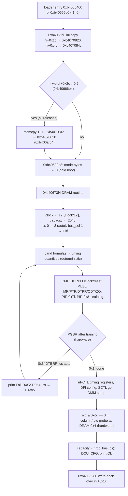

# Stock DRAM timing reconstruction (loader routine `0xb40673f4`)

Scope: the **original 2022–2023 RG35XX** (Actions ATM7039S) and the four Anbernic stock releases acquired in [PR #3](anbernic-stock-reverse-engineering.md) (221203, 221223, 230309, 20231014). Everything here is offline analysis of hash-pinned files. Nothing was executed on, or sent to, a handheld; no register was touched; no firmware, disassembly listing or decompiler output is committed. Ghidra 11.4.2 was used locally as a reading aid only; its output stayed outside the repository.

Findings: **MEM-006**, **DDR-002**, **DDR-003**; contradiction **C-INI-RECORD** (corrects how MEM-005 should be read). Evidence: [`evidence/firmware/stock-ddr-timing.json`](../evidence/firmware/stock-ddr-timing.json). Tools: [`ddr_emulate.py`](../tools/ddr_emulate.py), [`ddr_symbolic.py`](../tools/ddr_symbolic.py), [`ddr_model.py`](../tools/ddr_model.py), [`ddr_timing.py`](../tools/ddr_timing.py). Tests: [`tests/test_ddr_timing.py`](../tests/test_ddr_timing.py).

## 1. Results in brief

| Result | Confidence | Where |
|---|---|---|
| Every DDR3 timing value the routine writes is a closed formula of the rounded clock F = 12·⌊clock/12⌋ and the record bytes, in five clock bands. At 468 MHz: tRFC 164, tRP = tRCD 8, tRAS 18, tRC 26, tRRD 5, tFAW 24, tWR 8, CL 8, CWL 6, tREFI 3650 cycles; PUBL DTPR0 `0x34b28890`, DTPR1 `0xa400c0`, DTPR2 `0x10023200`, PTR0–2 `0x2a5766`/`0x5439210`/`0x3a96da0`, MR0 `0x1140`, MR2 `0x248`; CMU_DDRPLL `0x327` | Strongly supported (three methods agree exactly) | DDR-002, §5–6 |
| The loader code is identical in all four releases. Only MR1 (`0x6` → `0x42`) and ZQ0CR1 (`0x4c` → `0x29`) differ, because 20231014 changes the ini ODT/drive bytes | Verified by reproduction | §6 |
| **Cold boot does not use the "256 MiB, 1 CS, rcc 0x48" record.** The ini word at +0x2c (= 1 in every release) selects the second record (cs 0, rcc 0, capacity 0). Chip selects come from PUBL training (cs = 2 first, cs = 1 after a training error), rows/columns from a DRAM aliasing probe, capacity from both | Strongly supported (instruction level); outcomes hardware-dependent | MEM-006, §4, §7 |
| On success the loader writes the result back over the ini primary record. Under a single-rank ×16 2 Gb hypothesis this write-back reproduces the shipped primary record **byte for byte in all four releases**; three other geometries do not | Consistent with, not proof of, the board geometry | MEM-006, §7.3 |
| Timings are computed *before* detection with capacity forced to 2048 MiB, so tRFC always takes the 350 ns class; MR0 carries tWR as a cycle count at bit 9 (JEDEC WR field 0, bit 12 set) | Inferred interpretation of exact values | DDR-003 |
| Of the 113 writes of the final init pass: 45 constants, 47 ini-derived, 9 hardware-detected, 12 carry bits from unknown reset values. Model labels never under-report what differential runs observe | Reproducible | §6 |

## 2. Inputs and provenance

| Item | Value | Source |
|---|---|---|
| Releases | 221203, 221223, 230309, 20231014 | `acquisitions.json` (SHA-256-pinned archive.org mirror; no manufacturer checksum, FW-014) |
| Loader region | 448 sectors at disk offset `0x200200`; hashes equal `stock-loaders.json` | `ddr_timing.py` checks; `validate_firmware.py` enforces |
| Code identity | SHA-256 of loader bytes `0x5400..0x33c00` identical in all four (`6b17b88c…`) | `code_sha256` in evidence |
| bootloader.ini load address | `0xb4062400` (PACK directory, BOOT-009) | |
| Record layout in the ini | u16 clock +0, u16 capacity +4, then bus_sel, cs, type, rcc, rdodt, wrodt, drv at +8..+0xe; packed to 12 bytes by `0xb4065ff8` | independent decoder = emulated firmware copy (`decode_matches_firmware_copy`) |

| Record | Offset | clock | capacity | bus_sel | cs | type | rcc | rdodt | wrodt | drv |
|---|---|---|---|---|---|---|---|---|---|---|
| primary (221203–230309) | ini+0x1c | 468 | 256 | 1 | 1 | 0x10 | 0x48 | 1 | 1 | 0xc |
| second (221203–230309) | ini+0x4c | 468 | 0 | 1 | 0 | 0x10 | 0 | 1 | 1 | 0xc |
| primary (20231014) | ini+0x1c | 468 | 256 | 1 | 1 | 0x10 | 0x48 | 2 | 2 | 0x9 |
| second (20231014) | ini+0x4c | 468 | 0 | 1 | 0 | 0x10 | 0 | 2 | 2 | 0x9 |
| selector word | ini+0x2c | 1 in all four releases → second record selected | | | | | | | | |

## 3. What was traced



Solid boxes are firmware instructions at the given addresses; the two diamonds marked *hardware* are the only places where values read from the DRAM subsystem change control flow or results on this path. The resume path (mode 1, `0xb40690d0`/`0xb4069128`, reached when `0xb40665d0` returns 2) and the LPDDR branch (`type & 0xf != 0`) are outside this reconstruction.

## 4. Methods and their independence

| Method | What it executes | Shares with the others | Result |
|---|---|---|---|
| **A. Bounded Unicorn emulation** (`ddr_emulate.py`) | The firmware's own instructions from `0xb4065ff8`, `0xb40666ac..e4`, `0xb40690b8`, `0xb4066280` in QEMU's ARM core; ≤ 2 M instructions; delay `0xb40693f8` and printf `0xb4066854` stubbed (printf arguments captured and formatted) | Oracle rules for MMIO/DRAM reads | 156 MMIO writes, console lines, write-back |
| **B. Symbolic evaluation** (`ddr_symbolic.py`) | Our own A32 semantics over Capstone decoding, z3 bit-vectors; clock symbolic over 100–1200 MHz; forks only on input-dependent branches | Oracle rules (re-implemented); division helpers modelled as UDiv/SDiv | 8 feasible paths partitioning the domain; per-write expressions; no dependence on clobbered registers |
| **C. Readable model** (`ddr_model.py`) | Plain Python with named quantities, written from the instruction listing | Nothing executable | Full write sequence with provenance class, formula and call-site |
| Differential classification (`ddr_timing.py`) | Method A re-run varying reset seed, hardware hypothesis, clock and ODT/drive bytes | — | Which inputs each write actually depends on |

Separate checks of the shared assumptions:

* The division helpers (`0xb406ae80` unsigned, `0xb406ad40` signed) were executed in Unicorn on 2,213 operand pairs, including every boundary of the `·/1000` and `·/12` forms used: 0 mismatches against integer division.
* Our interpreter was checked against Unicorn on random register states for every instruction class it implements (`TestSymbolicInterpreterConformance`).
* The ini decoder was checked against the firmware's own copy routine.

**Oracle rules.** Every read from a peripheral or DRAM is logged with the rule that answered it (`hardware_reads` in the evidence): uPCTL STAT follows the last SCTL command with the DesignWare state encoding in `ddr_rk3288.h` (reset state Init_mem); MCMD start bit clears; POWSTAT/CMDTSTAT/DFISTSTAT0 report done; PGSR reports 0x7 after reset, 0xf after the DRAM-init PIR and, after the training PIR, 0x1f or 0x3f by hypothesis (training passes iff configured ranks ≤ present ranks); ZQ0SR0 reports done; DXGSR0 reads 0; any other register returns its last written value or a reset seed. DRAM reads follow a wrap-around hypothesis of the DMM address map. Read sites in the evidence are the load's call site (for read-modify-writes, the load inside the helper). **These rules decide control flow, not arithmetic:** the timing formulas are the same whatever they return, which is why they are classified as deterministic.

## 5. Recovered formulas (DDR3 branch, mode 0)

F is the clock rounded down to a 12 MHz multiple (468 stays 468). All divisions are integer divisions by the firmware's helpers; "+1" is the firmware's own rounding. Interpretation in nanoseconds is ours (constant × 1/F).

| Quantity | F ≤ 400 | 400 < F ≤ 533 | 533 < F < 668 | 668 ≤ F < 801 | F ≥ 801 |
|---|---|---|---|---|---|
| CL / CWL | 6 / 5 | 8 / 6 | 10 / 7 | 11 / 8 | 13 / 9 |
| tRP = tRCD | F·15/1000+1 | F·15/1000+1 | F·15/1000+1 | F·1375/100000+1 | F·1391/100000+1 |
| tRAS | F·375/10000+1 | F·375/10000+1 | F·36/1000+1 | F·35/1000+1 | F·34/1000+1 |
| tFAW | F/20+1 | F/20+1 | F·45/1000+1 | F/25+1 | F·35/1000+1 |
| tRRD | 4 | F/100+1 | F·75/10000+1 | F·75/10000+1 | F·6/1000+1 |
| tXP | 3 | 4 | F·6/1000+1 | 5 | F·6/1000+1 |
| tCKE | 3 | 3 | 4 | F/200+1 | F/200+1 |

Band-independent (or differently banded) quantities:

| Quantity | Formula | Notes |
|---|---|---|
| tRFC | F·tRFC_ns/1000+1 | tRFC_ns = 110/160/260/350 for per-rank density < 256 / < 512 / < 1024 / ≥ 1024 MiB, density = capacity / (x16 ? 1 : 2) / cs with capacity forced to 2048 → always 350 (DDR-003) |
| tRC | tRP + tRAS | |
| tRTP = tWTR | 4 if F ≤ 533, else F·75/10000+1 | |
| tWR | F·15/1000+1 if F ≥ 400, else 6 | |
| tXPDLL | 10 if F ≤ 416, else F·24/1000+1 | |
| tCKSRE = tCKSRX | 5 if F < 500, else F/100+1 | |
| tCKESR | tCKE + 1 | |
| tRSTL | F·150/1000 | no +1 |
| tREFI (cycles) | F·78/10 | 7.8 µs, floored; written to uPCTL+0x148, ×8 to TZQCSI |
| TRTW | CL + 6 − CWL | |
| DFI write latency | (CWL even ? CWL−2 : CWL−1) >> 1 | |
| DFI read-data enable | (CL even ? CL−2 : CL−3) >> 1 | |
| TOGCNT1U / TOGCNT100N | F >> 1 / F/20 | controller clock = F/2 |
| CMU_DDRPLL | (F/12) \| 0x300 | low byte = multiple of 12 MHz, like COREPLL/DEVPLL; bit 8 = DDRPLLEN per vendor clock tree; bit 9 not established |

Packed registers (the field positions are the firmware's own packing; names follow `ddr_rk3288.h` where it defines them):

| Register | Packing | 468 MHz |
|---|---|---|
| uPCTL MCFG | ((tFAW / tRRD) − 3) << 18 \| 0x28029 (TFAW_SHIFT 18; DDR3_EN, BL8, PD_EXIT_FAST, PD_IDLE 0x80 per header) | `0x68029` |
| uPCTL MCFG1 | (tRRD·(⌊tFAW/tRRD⌋+1) − tFAW) << 8 | `0x100` |
| PUBL MR0 | (CL−4)<<4 \| 0x1100 \| tWR<<9 | `0x1140` |
| PUBL MR1 | RTT_NOM[wrodt] \| 2, RTT_NOM = {1: 0x4, 2: 0x40, 3: 0x44, 4: 0x200, 5: 0x204} | `0x42` (wrodt 2) / `0x6` (wrodt 1) |
| PUBL MR2 | (CWL−5)<<3 \| 0x240 | `0x248` |
| PUBL PTR0 | min(F·80/1000+1, 63 when F·80 > 62999) \| (F·5120/1000+1)<<6 \| 10<<18 (DLLSRST/DLLLOCK/ITMSRST shifts per header) | `0x2a5766` |
| PUBL PTR1 | F·500 \| (tRFC + F/100)<<19 (DINIT0/DINIT1) | `0x5439210` |
| PUBL PTR2 | F·200 \| F<<17 (DINIT2/DINIT3) | `0x3a96da0` |
| PUBL DTPR0 | tRTP<<2 \| tWTR<<5 \| tRP<<8 \| tRCD<<12 \| tRAS<<16 \| tRRD<<21 \| tRC<<25 | `0x34b28890` |
| PUBL DTPR1 | tFAW<<3 \| tRFC<<16 | `0xa400c0` |
| PUBL DTPR2 | 0x200 \| tXPDLL<<10 \| tCKESR<<15 \| 0x200<<19 | `0x10023200` |
| PUBL ZQ0CR1 | ZQ_ODT[rdodt] \| drv, ZQ_ODT = {1: 0x40, 2: 0x20, 3: 0x60, 4: 0xc0, else 0x80} | `0x29` / `0x4c` |
| DMM+0x80 | ((tRC+3)>>2)+1 \| (((tWR+tRCD+3+CWL+tRP)>>2)+1)<<4 \| (((tRTP+tRCD−1+tRP)>>2)+1)<<8 | `0x598` |

JEDEC readings (interpretation, DDR-003): MR1 `0x42` = output drive RZQ/7, RTT_Nom RZQ/2 (120 Ω); `0x6` = RTT_Nom RZQ/4 (60 Ω). MR2 `0x248` = CWL 6, auto self-refresh, RTT_WR RZQ/4. MR0 `0x1140` = CL 8, BL8, DLL reset, PPD fast exit, WR code 000. PTR1's DINIT1 = tRFC + 10 ns is JEDEC tXPR.

The symbolic paths partition 100–1200 MHz at F = 408, 420, 504, 540, 672, 792 and 804 (clock values; F is the rounded clock). Their expressions evaluated at 468 MHz equal method A's 156 writes exactly; `test_exhaustive_three_way_agreement` repeats this for every third integer clock with the model.

## 6. Every write of the successful pass (468 MHz)

The table is generated from the evidence file (`final_pass`). *Class* is the model's provenance label; *Varies with* is what the differential runs observed (`reset` = reset seed, `hardware` = training/probe hypothesis, `clock`, `ini_odt_drv` = rdodt/wrodt/drv bytes). "=" means the older releases write the same value. The first pass (cs = 2, failing training) writes indices 0–42 with PGCR `0x18c2e02` and is omitted.

| # | Call site | Register | 20231014 | 221203–230309 | Class | Varies with | Formula / source |
|---|---|---|---|---|---|---|---|
| 0 | `0xb406800c` | CMU_DDRPLL | `0x227` | = | detected | hardware, clock | prev & ~0x100 |
| 1 | `0xb4068018` | CMU_DEVCLKEN0 | `0x0` | = | reset | reset | prev & ~0xa |
| 2 | `0xb4068024` | CMU_DEVRST0 | `0x0` | = | reset | reset | prev & ~0x5 |
| 3 | `0xb4068038` | CMU_DEVRST0 | `0x5` | = | reset | reset | prev \| 0x5 |
| 4 | `0xb406804c` | CMU_DDRPLL | `0x327` | = | ini | clock | (F/12) \| 0x300  (F/12 = PLL multiple of 12 MHz) |
| 5 | `0xb4068060` | CMU_DEVCLKEN0 | `0xa` | = | reset | reset | prev \| 0xa |
| 6 | `0xb40680d8` | PUBL.ACDLLCR | `0x0` | = | constant | — | 0 |
| 7 | `0xb40680ec` | PUBL.ACDLLCR | `0x40000000` | = | constant | — | DLLSRST |
| 8 | `0xb4068100` | PUBL.PIR | `0x10000000` | = | constant | — | PIR_CLRSR |
| 9 | `0xb406811c` | uPCTL.DFITCTRLUPDMIN | `0x4` | = | constant | — | 4 |
| 10 | `0xb4068128` | uPCTL.DFITCTRLUPDMAX | `0xa` | = | constant | — | 10 |
| 11 | `0xb4068134` | uPCTL.DFITCTRLUPDDLY | `0x8` | = | constant | — | 8 |
| 12 | `0xb406814c` | uPCTL.TOGCNT1U | `0xea` | = | ini | clock | F >> 1   (1 us in controller clocks, F/2) |
| 13 | `0xb4068170` | uPCTL.TOGCNT100N | `0x17` | = | ini | clock | F / 20  (100 ns in controller clocks) |
| 14 | `0xb406817c` | uPCTL.TINIT | `0xc8` | = | constant | — | 200 |
| 15 | `0xb4068188` | uPCTL.TRSTH | `0x1f4` | = | constant | — | 500 (DDR3 branch) |
| 16 | `0xb4068194` | DMM+0x64 | `0x1` | = | constant | — | 1 |
| 17 | `0xb40681a8` | DMM+0x64 | `0x0` | = | constant | — | 0 |
| 18 | `0xb40681bc` | uPCTL.POWCTL | `0x1` | = | constant | — | POWER_UP_START |
| 19 | `0xb40681f0` | uPCTL.MCFG | `0x68029` | = | ini | clock | ((tFAW/tRRD) - 3) << 18 \| 0x28029 |
| 20 | `0xb4068218` | uPCTL.MCFG1 | `0x100` | = | ini | clock | (tRRD*(tFAW/tRRD + 1) - tFAW) << 8 |
| 21 | `0xb4068224` | PUBL.DCR | `0xb` | = | constant | — | 0xb (DDR3 branch) |
| 22 | `0xb4068240` | PUBL.MR0 | `0x1140` | = | ini | clock | (CL-4)<<4 \| 0x1100 \| tWR<<9 |
| 23 | `0xb406824c` | PUBL.MR1 | `0x42` | `0x6` | ini | ini_odt_drv | RTT_NOM[wrodt] \| 2 |
| 24 | `0xb4068258` | PUBL.MR2 | `0x248` | = | ini | clock | (CWL-5)<<3 \| 0x240 |
| 25 | `0xb4068264` | PUBL.PTR0 | `0x2a5766` | = | ini | clock | min63(F*80/1000+1) \| (F*5120/1000+1)<<6 \| 0xa<<18 |
| 26 | `0xb4068270` | PUBL.PTR1 | `0x5439210` | = | ini | clock | F*500 \| (tRFC + F/100)<<19 |
| 27 | `0xb406827c` | PUBL.PTR2 | `0x3a96da0` | = | ini | clock | F*200 \| F<<17 |
| 28 | `0xb4068288` | PUBL.DTPR0 | `0x34b28890` | = | ini | clock | tRTP<<2\|tWTR<<5\|tRP<<8\|tRCD<<12\|tRAS<<16\|tRRD<<21\|tRC<<25 |
| 29 | `0xb4068294` | PUBL.DTPR1 | `0xa400c0` | = | ini | clock | tFAW<<3 \| tRFC<<16 |
| 30 | `0xb40682a0` | PUBL.DTPR2 | `0x10023200` | = | ini | clock | 0x200 \| tXPDLL<<10 \| tCKESR<<15 \| 0x200<<19 |
| 31 | `0xb40682ac` | PUBL.DTAR | `0x20000000` | = | constant | — | 0x20000000 |
| 32 | `0xb40682c4` | PUBL.DXCCR | `0x911` | = | ini | ini_odt_drv | 0x911 |
| 33 | `0xb40682d0` | PUBL.ODTCR | `0x21` | = | ini | ini_odt_drv | 0x21 |
| 34 | `0xb4068314` | PUBL.ZQ0CR1 | `0x29` | `0x4c` | ini | ini_odt_drv | ZQ_ODT[rdodt] \| drv |
| 35 | `0xb4068320` | PUBL.ACIOCR | `0xbc03812` | = | ini | ini_odt_drv | 0xbc03812 |
| 36 | `0xb4068600` | PUBL.ODTCR | `0x210021` | = | ini | ini_odt_drv | prev \| 0x210000 |
| 37 | `0xb406862c` | PUBL.DX2GCR | `0x0` | = | reset | reset | prev & ~0x1 |
| 38 | `0xb4068638` | PUBL.DX3GCR | `0x0` | = | reset | reset | prev & ~0x1 |
| 39 | `0xb4068690` | PUBL.DSGCR | `0xf2001807` | = | ini | — | 0xf2001807 (DDR3 branch) |
| 40 | `0xb40686d8` | PUBL.PGCR | `0x1842e02` | = | detected | hardware | cs==1 ? 0x1842e02 : 0x18c2e02 (rank enables) |
| 41 | `0xb4068700` | PUBL.PIR | `0x7f` | = | constant | — | PIR 0x7f (DDR3, mode 0) |
| 42 | `0xb406879c` | PUBL.PIR | `0x81` | = | constant | — | PIR_INIT\|PIR_QSTRN (data training) |
| 43 | `0xb40687e0` | uPCTL.TMRD | `0x4` | = | constant | — | 4 |
| 44 | `0xb40687ec` | uPCTL.TRFC | `0xa4` | = | ini | clock | tRFC |
| 45 | `0xb40687f8` | uPCTL.TRP | `0x8` | = | ini | clock | tRP |
| 46 | `0xb4068804` | uPCTL.TAL | `0x0` | = | constant | — | 0 |
| 47 | `0xb4068810` | uPCTL.TCL | `0x8` | = | ini | clock | CL |
| 48 | `0xb406881c` | uPCTL.TCWL | `0x6` | = | ini | clock | CWL |
| 49 | `0xb4068828` | uPCTL.TRAS | `0x12` | = | ini | clock | tRAS |
| 50 | `0xb4068834` | uPCTL.TRC | `0x1a` | = | ini | clock | tRC |
| 51 | `0xb4068840` | uPCTL.TRCD | `0x8` | = | ini | clock | tRCD |
| 52 | `0xb406884c` | uPCTL.TRRD | `0x5` | = | ini | clock | tRRD |
| 53 | `0xb4068858` | uPCTL.TRTP | `0x4` | = | ini | clock | tRTP |
| 54 | `0xb4068864` | uPCTL.TWR | `0x8` | = | ini | clock | tWR |
| 55 | `0xb4068870` | uPCTL.TWTR | `0x4` | = | ini | clock | tWTR |
| 56 | `0xb406887c` | uPCTL.TEXSR | `0x200` | = | constant | — | 512 |
| 57 | `0xb406888c` | uPCTL.TREFI | `0x7004e` | = | constant | — | 78 \| 0x70000 |
| 58 | `0xb4068898` | uPCTL+0x148 (reserved5[0] in ddr_rk3288.h) | `0xe42` | = | ini | clock | F*78/10 |
| 59 | `0xb40688a4` | uPCTL.TXP | `0x4` | = | ini | clock | tXP |
| 60 | `0xb40688b0` | uPCTL.TDQS | `0x1` | = | constant | — | 1 |
| 61 | `0xb40688bc` | uPCTL.TRTW | `0x8` | = | ini | clock | CL + 6 - CWL |
| 62 | `0xb40688c8` | uPCTL.TCKSRE | `0x5` | = | ini | clock | F<500 ? 5 : F/100+1 |
| 63 | `0xb40688d4` | uPCTL.TCKSRX | `0x5` | = | ini | clock | F<500 ? 5 : F/100+1 |
| 64 | `0xb40688e0` | uPCTL.TMOD | `0xc` | = | constant | — | 12 |
| 65 | `0xb40688ec` | uPCTL.TCKE | `0x3` | = | ini | clock | tCKE |
| 66 | `0xb40688f8` | uPCTL.TMRR | `0x2` | = | constant | — | 2 |
| 67 | `0xb4068904` | uPCTL.TRSTL | `0x46` | = | ini | clock | F*150/1000 |
| 68 | `0xb4068910` | uPCTL.TZQCS | `0x40` | = | constant | — | 64 |
| 69 | `0xb406891c` | uPCTL.TZQCL | `0x200` | = | constant | — | 512 |
| 70 | `0xb4068928` | uPCTL.TXPDLL | `0xc` | = | ini | clock | tXPDLL |
| 71 | `0xb4068934` | uPCTL.TZQCSI | `0x7210` | = | ini | clock | (F*78/10) << 3 |
| 72 | `0xb4068940` | uPCTL.TCKESR | `0x4` | = | ini | clock | tCKE + 1 |
| 73 | `0xb406894c` | uPCTL.TDPD | `0x0` | = | constant | — | 0 |
| 74 | `0xb406896c` | uPCTL.MCMD | `0x80100000` | = | detected | hardware | START \| rank mask(cs) \| NOP |
| 75 | `0xb406899c` | uPCTL.MCMD | `0x80100001` | = | detected | hardware | START \| rank mask(cs) \| 1 |
| 76 | `0xb4067218` | uPCTL.SCTL | `0x1` | = | constant | — | CFG_STATE (via 0xb4067170) |
| 77 | `0xb40689c0` | uPCTL.SCFG | `0x700` | = | constant | — | 0x700 |
| 78 | `0xb40689cc` | uPCTL.DFITPHYRDLAT | `0xa` | = | constant | — | 10 |
| 79 | `0xb40689d8` | uPCTL.DFITPHYWRDATA | `0x0` | = | constant | — | 0 |
| 80 | `0xb40689ec` | uPCTL.PPCFG | `0x1` | = | ini | — | bus_sel ? 1 : 0 |
| 81 | `0xb4068a04` | uPCTL.DFIODTRANKMAP | `0x1` | = | detected | hardware | cs==2 ? 0x21 : 1 |
| 82 | `0xb4068a10` | uPCTL.DFISTCFG0 | `0x7` | = | constant | — | 0x7 |
| 83 | `0xb4068a1c` | uPCTL.DFISTCFG1 | `0x3` | = | constant | — | 0x3 |
| 84 | `0xb4068a28` | uPCTL.DFISTCFG2 | `0x3` | = | constant | — | 0x3 |
| 85 | `0xb4068a34` | uPCTL.DFILPCFG0 | `0x70101` | = | constant | — | 0x70101 |
| 86 | `0xb4068a40` | uPCTL.ECCCFG | `0x0` | = | constant | — | 0x0 |
| 87 | `0xb4068a4c` | uPCTL.DFITPHYWRLAT | `0x2` | = | ini | clock | (CWL even ? CWL-2 : CWL-1) >> 1 |
| 88 | `0xb4068a58` | uPCTL.DFITRDDATAEN | `0x3` | = | ini | clock | (CL even ? CL-2 : CL-3) >> 1 |
| 89 | `0xb4068a64` | uPCTL.DFITDRAMCLKDIS | `0x2` | = | constant | — | 0x2 |
| 90 | `0xb4068a70` | uPCTL.DFITDRAMCLKEN | `0x2` | = | constant | — | 0x2 |
| 91 | `0xb4068a7c` | uPCTL.DFITCTRLDELAY | `0x2` | = | constant | — | 0x2 |
| 92 | `0xb4068a88` | uPCTL.DFITPHYUPDTYPE0 | `0x1` | = | constant | — | 0x1 |
| 93 | `0xb4068aa0` | uPCTL.DFIODTCFG | `0x808` | = | ini | ini_odt_drv | 0x808 |
| 94 | `0xb4068ab8` | uPCTL.DFIODTCFG | `0xa0a` | = | ini | ini_odt_drv | prev \| 0x202 |
| 95 | `0xb4068ac4` | uPCTL.TSTATEN | `0x1` | = | constant | — | 1 |
| 96 | `0xb4067218` | uPCTL.SCTL | `0x2` | = | constant | — | GO_STATE (via 0xb4067170) |
| 97 | `0xb4068b80` | DMM+0x88 | `0x1` | = | constant | — | 1 |
| 98 | `0xb4068ba8` | DMM DCU_CFG (+0x28; name from the loader string) | `0x8` | = | detected | hardware | x32 \| 8 \| x32<<12 \| (cs-1)<<4 |
| 99 | `0xb4068bb4` | DMM+0x00 | `0x40000000` | = | reset | reset | prev \| 0x40000000 |
| 100 | `0xb4068bc0` | DMM+0x24 | `0x2` | = | constant | — | 2 |
| 101 | `0xb4068c1c` | DMM+0x80 | `0x598` | = | ini | clock | ((tRC+3)>>2)+1 \| (((tWR+tRCD+3+CWL+tRP)>>2)+1)<<4 \| (((tRTP+tRCD-1+tRP)>>2)+1)<<8 |
| 102 | `0xb4068c28` | DMM+0x00 | `0x48000000` | = | reset | reset | prev \| 0x8000000 |
| 103 | `0xb4068c74` | DMM DCU_CFG (+0x28; name from the loader string) | `0x200e` | = | detected | hardware | prev & 0xfffe1f99 \| 0x2006 (column probe) |
| 104 | `0xb4068ce4` | DMM DCU_CFG (+0x28; name from the loader string) | `0x206c` | = | detected | hardware | prev & 0xffffff99 \| col<<1 \| 0x60 (row probe) |
| 105 | `0xb4068f04` | DMM DCU_CFG (+0x28; name from the loader string) | `0x202c` | = | detected | hardware | prev & 0xfffc1899 \| rcc>>1 \| 0x2000 \| ((cap>>8)-1)<<8 |
| 106 | `0xb406736c` | DMM+0x0c | `0xf801` | = | reset | reset | prev & ~0xffff \| 0xf801 |
| 107 | `0xb406737c` | DMM+0x04 | `0x818f808` | = | constant | — | prev & ~0xffffffff \| 0x818f808 |
| 108 | `0xb406738c` | 0xb01b00b4 | `0x3ff` | = | reset | reset | prev & ~0xffff \| 0x3ff |
| 109 | `0xb4067398` | DMM+0x68 | `0x3180` | = | constant | — | 0x3180 |
| 110 | `0xb40673a4` | DMM+0x10 | `0xf8010000` | = | constant | — | 0xf8010000 |
| 111 | `0xb40673b0` | DMM+0x00 | `0x48000000` | = | reset | reset | prev & ~0x4 |
| 112 | `0xb40673bc` | DMM+0x00 | `0x48000004` | = | reset | reset | prev \| 0x4 |

Timing quantities at 468 MHz (`timings` in the evidence; ns = cycles × 1000 / F):

| Quantity | Cycles | ns |
|---|---|---|
| tRFC | 164 | 350.427 |
| tRP | 8 | 17.094 |
| tRCD | 8 | 17.094 |
| tRAS | 18 | 38.462 |
| tRC | 26 | 55.556 |
| tRRD | 5 | 10.684 |
| tFAW | 24 | 51.282 |
| tWR | 8 | 17.094 |
| tRTP | 4 | 8.547 |
| tWTR | 4 | 8.547 |
| CL | 8 | 17.094 |
| CWL | 6 | 12.821 |
| tXP | 4 | 8.547 |
| tXPDLL | 12 | 25.641 |
| tCKE | 3 | 6.41 |
| tCKESR | 4 | 8.547 |
| tCKSRE | 5 | 10.684 |
| tRSTL | 70 | 149.573 |
| tREFI_cycles | 3650 | 7799.145 |
| tZQCSI | 29200 | 62393.162 |
| TRTW | 8 | 17.094 |
| dfi_wrlat | 2 | 4.274 |
| dfi_rddata_en | 3 | 6.41 |

F = 468 MHz, tCK = 2.1368 ns, density used for tRFC = 2048 MiB, tRFC class = 350 ns.

## 7. Hardware-dependent behaviour (not deterministic)

### 7.1 Rank detection by training

With cs = 0 in the record, mode 0 starts with cs = 2. The PGCR rank-enable bits (`0x18c2e02` vs `0x1842e02`), the MCMD rank mask (`0x803…` vs `0x801…`), DFIODTRANKMAP and DCU_CFG bit 4 follow the rank count in force. If PGSR reads 0x3f (DTERR) after PIR = 0x81, the routine prints the four DXGSR0 lane words, sets cs = 1 and repeats the whole pass, including the CMU DDR PLL/clock/reset sequence. A second failure with cs = 1 returns `0x1017fa11` (bus_sel is not auto in these records, so the x32 retry branch is not reachable). Other failure codes end the routine without retry: `0x2a00fa11` (ZQ not done in 101 polls), `0x9a00fa11` (PGSR & 7 ≠ 7 in 101 polls), `0xdf00fa11` (DFISTSTAT0 not ready), `0xf000fa11` / `0xc000fa11` (probe or capacity exponent out of range), `0x4d00fa11` (clock field 0). The PGSR = 0xf poll after PIR = 0x7f is unbounded.

### 7.2 Capacity probe

Because rcc & 0xcc = 0, DCU_CFG is set to a column-probe configuration (`prev & 0xfffe1f99 | 0x2006`), then for k = 0..3 the routine writes 0 to DRAM address 4, the pattern 0x6996 to 2^(k+9)+4 (×16; halfword store via `0xb4067160`) or 2^(k+10)+4 (×32) and reads address 4; the first alias gives the column code c (rcc bits 3:2). A row probe follows with DCU_CFG `prev & 0xffffff99 | c<<1 | 0x60` and addresses 2^(k+0x19+c)+4 (×16), giving the row code r (rcc bits 7:6). Then, for the 8-bank code (rcc & 3 = 0):

capacity (MiB) = 2^(r + c + bus + cs + 3), bus = 1 for ×16 and 2 for ×32,

and DCU_CFG = `prev & 0xfffc1899 | rcc>>1 | 0x2000 | ((capacity>>8) − 1)<<8` (the last term only for capacity ≥ 256). The routine prints `Ok:DCU_CFG:0x…,…MByte Cap.` and the caller then calls `0xb406631c(capacity)` (memory test, not analysed) and `0xb4066280` (write-back).

### 7.3 Corroboration from the write-back

`0xb4066280` copies the final block over ini+0x1c (zeroing +0x1e/+0x1f/+0x22/+0x23). Running the firmware with each geometry hypothesis:

| Hypothesis (aliasing model) | Write-back of ini+0x1c..0x2b | Equals shipped primary record |
|---|---|---|
| 1 rank, ×16, 10 col / 14 row (2 Gb, 256 MiB) | `d4010000 00010000 01011048 …` | **yes, all four releases** |
| 2 ranks, ×16, 2 Gb each (512 MiB) | `… 00020000 01021048 …` | no |
| 1 rank, ×16, 15 rows (4 Gb, 512 MiB) | `… 00020000 01011088 …` | no |
| 1 rank, ×16, 13 rows (1 Gb, 128 MiB) | `… 80000000 01011008 …` | no |

The shipped primary record is therefore exactly what this routine would write back on a board with one ×16 2 Gb DDR3 rank, including the per-release ODT/drive bytes. Whether Anbernic's tools persisted such a write-back, or the values were entered by hand, is not known. This is the strongest offline evidence so far for the board's DRAM geometry (C-DDR-WIDTH), but it remains an inference: a 32-bit-capable SoC configured ×16 by its record would behave the same way.

### 7.4 Reset-dependent bits

Twelve final-pass writes are read-modify-writes whose untouched bits come from registers whose reset values are unknown: CMU_DEVCLKEN0/CMU_DEVRST0 (masks 0xa / 0x5), PUBL DX2GCR/DX3GCR (bit 0 cleared for ×16), DMM+0x00 (bits 30, 27, 2), DMM+0x0c and `0xb01b00b4` (low 16 bits set). CMU_DDRPLL's enable-clear reads a reset value only in the first pass; in a retry it reads the first pass's value, which is why the final-pass write is classed *detected* (a retry exists only because training failed). The evidence lists the values for reset seed 0; the tests confirm the model tracks other seeds (`0xffffffff`, `0xa5a5a5a5`, `0x12345678`) exactly. Hardware reset values must not be guessed from these.

## 8. Expected loader console output

Derived, not observed. For a board matching the reference hypothesis, 20231014 prints:

```
DRAM init mode0,type16,2cs,x16bus,rcc0x0,wrodt2,rdodt2,drv9,468MHz.@180525_R...
Fail:<DXGSR0 lane 0>,<lane 1>,<lane 2>,<lane 3>;
DRAM init mode0,type16,1cs,x16bus,rcc0x0,wrodt2,rdodt2,drv9,468MHz.@180525_R...
Ok:DCU_CFG:0x202c,256MByte Cap.
```

Releases 221203–230309 print `wrodt1,rdodt1,drvc`. The lane words are hardware values (shown as 0 by the emulator). A read-only serial log (C-INI-RECORD next validation) would test the training and probe hypotheses; it cannot falsify the formulas, which do not depend on those reads.

## 9. Validation summary

| Check | Scope | Result |
|---|---|---|
| Model vs Unicorn, complete write sequence and console | every integer clock 100–1200 MHz × 4 releases (firmware-selected record) | 0 mismatches |
| Same, primary record / 4 hardware hypotheses / 2 reset seeds | every 7th / 7th / 11th clock × 4 releases | 0 mismatches |
| Symbolic (8 paths) evaluated at 468 MHz vs Unicorn | 4 releases, 156 writes | identical |
| Symbolic vs Unicorn vs model at every 3rd clock of each path | 20231014 (`ATM7039S_STOCK_LOADERS` test) | identical |
| Division helper models vs firmware helpers | 2,213 operand pairs | 0 mismatches |
| Interpreter vs Unicorn instruction conformance | 60 random states × 28 instructions | identical |
| Model provenance labels vs differential observation | 113 writes × 4 releases | no under-reporting; DSGCR and PPCFG labelled ini but their inputs (type, bus_sel) were not varied |
| JEDEC plausibility (cycles × tCK ≥ nominal) | F = 300–1066 | holds; tREFI is floored, the rest rounded up |
| Evidence regeneration from real loaders | 4 releases | equals committed evidence |

## 10. Unresolved

* **Training and ZQ outcomes**: whether the real PUBL reports DTERR for cs = 2 on this board, the DXGSR0 lane words, and ZQ calibration codes. Hardware only.
* **DMM address map**: the aliasing model that turns geometry into probe results is a hypothesis; the probe's formula is not.
* **Reset values** of the twelve RMW'd registers (§7.4).
* **Register semantics** beyond the firmware's packing: uPCTL+0x148 (reserved in the RK3288 layout), DMM +0x00/+0x04/+0x0c/+0x10/+0x24/+0x64/+0x68/+0x80/+0x88, PUBL+0x3fc, DSGCR/ACIOCR/DXCCR/ODTCR constants, CMU_DDRPLL bit 9, MCFG bit 3.
* **MR0 WR field**: whether the PHY forwards MR0 unchanged and how the DRAM treats WR code 000 (DDR-003).
* **Not analysed**: the mode-1 resume path, the LPDDR branch, the memory test `0xb406631c`, anything that persists the write-back, and the pre-DRAM clock setup `0xb4069254`. *Done in PR #6* ([report](dram-complete-reconstruction.md)): `0xb4069254` is an ADFU check, not a clock setup (C-PREDRAM-9254).

**Corrections from PR #6** (this report's text above is kept as written):

* §7.1: the codes `0x2a00fa11`, `0x9a00fa11`, `0xdf00fa11`, `0xf000fa11` and `0xc000fa11` are printed and then returned as `0x1747fa11` (C-FAILCODE).
* §7.2 and `ddr_model.capacity_probe`: a row probe without an alias leaves the row code at 0 (13 rows); `0xf000fa11` is unreachable, because exponent 31 always ends the search first (C-PROBE-NOALIAS). The model is corrected; the committed evidence is unaffected because it covers only aliasing geometries.
* §3 diagram: the write-back `0xb4066280` (and the AFI write) also run after a failed init (C-WRITEBACK-FAIL).
* **Authenticity**: the four images come from a community mirror; no manufacturer checksum exists (FW-014).

## 11. Reproduce

```sh
python -m pip install -r requirements-dev.txt -r requirements-firmware.txt
python tools/acquire_firmware.py anbernic-stock-archive INPUTS --filename RG35XX-221203.zip --expand   # and the other three
python -c "import sys; f=open(sys.argv[1],'rb'); f.seek(0x200200); open(sys.argv[2],'wb').write(f.read(448*512))" INPUTS/stock-221203.img loader-221203.bin
python tools/ddr_emulate.py loader-221203.bin trace.json                     # one bounded emulation, full trace
python tools/ddr_symbolic.py loader-221203.bin sym.json --evaluate-clock 468  # symbolic paths and formulas
python tools/ddr_timing.py OUT.json --loader stock-221203=loader-221203.bin ... # all methods + classification
ATM7039S_STOCK_LOADERS=DIR python -m unittest tests.test_ddr_timing -v        # DIR holds loader-<release>.bin
```

The 20231014 RAR member is larger than 2 GiB; `lsar` 1.10.1 mis-reports its size, which `archive_members.py` now treats as unknown (the expanded size and hash are still checked). Without the firmware, `python -m unittest tests.test_ddr_timing` still checks the model against every committed firmware-derived value.
