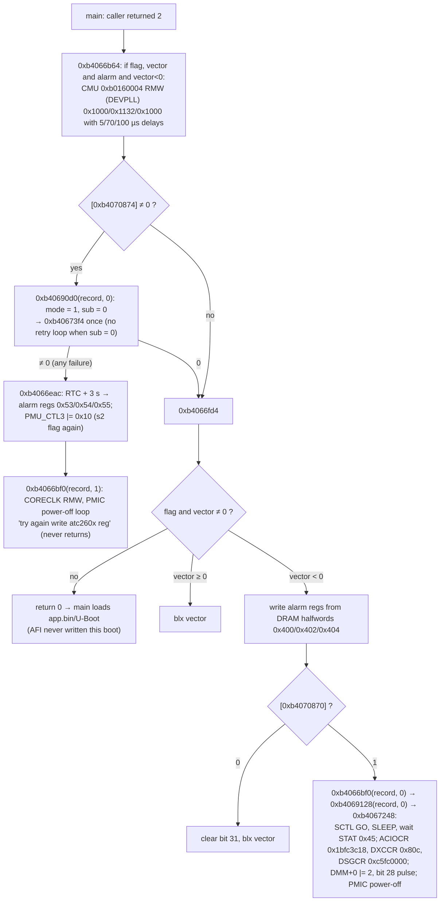
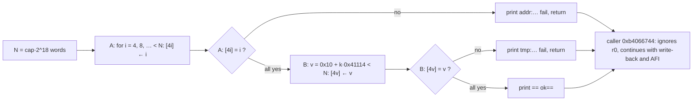
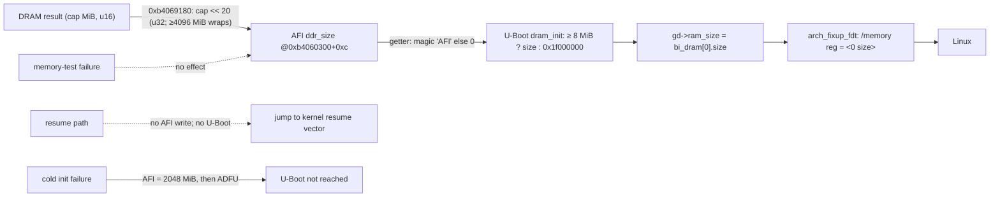

# Stock DRAM subsystem: resume, memory test, training, recovery and handoff (PR #6)

Scope: the **original 2022–2023 RG35XX** (Actions ATM7039S), the four hash-pinned Anbernic stock releases (221203, 221223, 230309, 20231014) and Koriki v1.0 as a control. Everything here is offline. No handheld, card, register, clock, regulator or PMIC was touched. No firmware, disassembly listing or decompiler output is committed. Ghidra was not needed for this PR; Capstone listings stayed in a scratch directory.

Findings: **MEM-007 … MEM-010, DDR-004 … DDR-006, BOOT-021**. Contradictions: **C-PROBE-NOALIAS**, **C-FAILCODE**, **C-WRITEBACK-FAIL**, **C-PREDRAM-9254** (all resolved by instructions) and **C-RESUME-DRAMRST** (open). Evidence: [`evidence/firmware/stock-dram-complete.json`](../evidence/firmware/stock-dram-complete.json). Tool: [`tools/dram_complete.py`](../tools/dram_complete.py), plus a mode-1 path in [`tools/ddr_model.py`](../tools/ddr_model.py) and `--dram-scenario` in [`tools/boot_chain.py`](../tools/boot_chain.py). Tests: [`tests/test_dram_complete.py`](../tests/test_dram_complete.py).

The [SD2 DRAM caller comparison](sd2-dram-reconstruction.md) independently executes both boot codes through the actual caller and main return dispatch. The earlier mode-0/mode-1, retry, failure, write-back and diagnostic findings transfer under the tested synthetic assumptions. The comparison also captures actual AFI stores and terminal PC.

## 1. Executive summary

1. **"Mode 1" is suspend-to-RAM resume, decided by the PMIC.**
   * `pmu_init` (`0xb40699e8`, PMIC type 2 hard-wired at its only call) reads PMU_CTL3 (PMIC reg 3).
   * If its bit 4 ("s2 flag") is set and PMIC reg 0x14 bit 15 is set ("not from S4"), it rebuilds a resume vector from PMIC scratch registers 8 (low half) and 0x5d (high half), stores it at `0xb4070878` and sets `0xb4070874 = 1`.
   * When both are non-zero, the DRAM caller returns **2 before the record swap, the DRAM init, the memory test, the write-back and the AFI write**.
   * Main then runs `0xb40664e4` → `0xb4067094`. This re-initialises DRAM in mode 1 from the **primary** (persisted) ini record and **jumps to the resume vector**. The loader never reaches app.bin or U-Boot on this path.
2. **Mode 1 programs everything again except the DRAM's own state.**
   * PLL, clock gates, controller and PHY resets, all timings and the DMM are rewritten, as in mode 0.
   * The differences: the clock is not rounded, the capacity is not forced to 2048 MiB (so tRFC uses the 160 ns class: 75 cycles instead of 164), and PTR2 = F/10.
   * PIR is `0x3f` (no DRAMINIT, so no mode-register writes), followed by 8 PREA and 8 REF through MCMD, data training (PIR `0x81`), and 8 more REF before GO_STATE.
   * There is **no capacity probe and no rank/bus retry**: DCU_CFG is rebuilt from the stored rcc and capacity.
3. **A resume failure is retried by power-cycling.**
   * `0xb4066eac` reads the PMIC RTC, sets an alarm **3 seconds later**, sets the s2 flag again and calls the PMIC power-off `0xb4066bf0`, which never returns.
   * A resume vector with bit 31 set and an alarm wake-up instead restores DRAM, puts it back into self-refresh (`0xb4067248`) and powers off. That is a wake-for-a-check cycle.
4. **The memory test `0xb406631c(capacity_MiB)` is diagnostic only.**
   * It writes and verifies 24 power-of-two addresses (value i at byte 4·i, up to half the claimed capacity), then 252 addresses at a stride of 0x104450 bytes (value = word address).
   * It prints the first mismatch, restores nothing, uses no cache, controller or DMA operation, and **its result is ignored by the caller**. A failing test changes neither the capacity nor the AFI, and does not stop the boot.
   * By construction it **cannot detect a twofold capacity overestimate** caused by address wrap-around (§4.3).
5. **Every non-training failure code is collapsed.** `0x2a00fa11` (ZQ), `0x9a00fa11` (PHY init), `0xdf00fa11` (DFI) and `0xc000fa11` (capacity exponent) are printed as `Fail: 0x…` and then returned as **`0x1747fa11`**. Only the training error `0x1017fa11` is returned as is (correction **C-FAILCODE**).
6. **The write-back and the AFI write also run after a failed cold init.**
   * The capacity field then holds the forced 2048 MiB, so the SRAM ini primary record and the AFI carry 2048 MiB.
   * Main then takes the ADFU exit (`load fail to adfu`), so nothing reaches U-Boot or the card (correction **C-WRITEBACK-FAIL**).
7. **The row probe does not fail when it finds no alias.** It silently reports 13 rows (rcc row code 0), so a device larger than the probe range is reported *smaller*. The PR #4 model raised an error there and has been corrected (**C-PROBE-NOALIAS**).
8. **The LPDDR branch is an LPDDR2/LPDDR3-class path.**
   * The evidence is PUBL DCR `0x1000000c` (DDRMD 4, `DDRMD_LPDDR2_LPDDR3` in the pinned header) and PIR `0x5f` (no DRAMRST).
   * It also writes MR1/MR2/MR3 instead of MR0, uses its own timing tables and sets DSGCR `0xf1001807`.
   * Exact type byte 1 selects MCFG memory-type 3 (`LPDDR2_EN`); other non-zero low nibbles select 1, which the public header does not define.
   * The type byte's high nibble 1 (the stock `0x10`) disables idle self-refresh (MCFG1 low byte). The branch is unreachable with any shipped record.
9. **uPCTL+0x148 is TREFI_MEM_DDR3.** A later DesignWare uPCTL layout (RK322x, same U-Boot revision) names offset 0x148 `tref_mem_ddr3`. The firmware writes tREFI in memory clocks there for DDR3 and 0 for LPDDR.
10. **`0xb4069254` is an ADFU check, not a clock setup.** It reads PMIC reg 0x35 (bit 1 → "Prepare to entry ADFU mode") and, on non-SD0 boot codes only, a GPIO handshake expecting `0x55aa55aa` (correction **C-PREDRAM-9254**). The DRAM prerequisites are the 24 MHz timer (`0xb4069440`), the PMIC regulator writes in `pmu_init`, and the CMU sequence inside the DRAM routine (§10).
11. **Geometry.** The firmware measures only two quantities: the column width under its column-probe configuration, and the total decoded address width under the row-probe configuration. It *assumes* 8 banks from the ini.
    * Under three DMM decode hypotheses and 180 device geometries, the shipped primary record is reproduced only by the in-order col→bank→row decode of a 1-rank, 10-column, 14-row device (8 banks: 2 Gb ×16; a 4-bank device would also match but is not DDR3).
    * 73 of the 180 combinations are reported at the wrong capacity *and* pass the memory test.
12. **All DRAM code is identical in all four releases and in Koriki v1.0.** Koriki's whole loader region is byte-identical to 230309. Only the ini ODT/drive bytes of 20231014 change MR1 and ZQ0CR1, in both modes.

What remains is not instruction-level. Section 14 lists it: the PUBL v1 semantics of PIR bit 5 in resume (**C-RESUME-DRAMRST**), the real training and ZQ outcomes, the DMM address map, reset values, PMIC regulator meanings, and the Boot ROM.

## 2. Methods and their independence

| Method | What runs | Shares assumptions with | Used for |
|---|---|---|---|
| A. Raw listing (Capstone, scratch only) | nothing; instructions read | — | control flow, constants, callers (word-by-word branch scan of `0x5400..0xb200`) |
| B. Unicorn harness (`dram_complete.Harness`, a subclass of PR #4's `ddr_emulate.Emulation`) | the firmware's own instructions from the caller `0xb40665d0`, the resume entry `0xb40664e4`, `0xb40690b8`/`0xb40690d0`, `0xb406631c` | the explicit models below | every scenario table |
| C. Independent Python | `ddr_model.run(mode=1)`; `dram_complete.memtest_model`; `afi_ddr_size`/`uboot_ram_size`/`returned_code` | instruction reading (A) only | 0-mismatch comparison with B |
| D. Public layout comparison | `ddr_rk3288.h`, `sdram_rk322x.h` at the pinned U-Boot revision | — | register and bit names (applicability inferred) |
| E. Synthetic code | hand-encoded A32 in the tests | none | harness RAM-model and fault-injection mechanics |

**Modelled behaviour (B), all synthetic:**
* **PMIC** register file behind the loader's I2C accessors `0xb4069610`/`0xb40696c0` (slave 0x65 on the bus named by ini+0x18), with detection `0xb4069890` stubbed. Defaults: version register 0xdc = 1, reg 0x14 bit 15 = 1.
* **PUBL/uPCTL status** per `Scenario`. Every read is logged with its rule.
* **DRAM**:
  * during the capacity probe: PR #4's wrap model, or the `dmm` field-decode hypothesis;
  * during the memory test: `Ram` (wrap/open/dmm with injected read XOR, dropped writes and stuck bits).
* **Stubs** as in PR #4: UART init, delay and printf. Printf arguments are formatted, and `%i` was added to the formatter.

**Circularity audit.**
* B and C share only the instruction reading. C was written as plain Python and compared with B at 1,101 clocks × 4 releases (mode 1), 48 geometries (probe), 14 memory-test cases and the type-byte variants. They therefore agree on *what the code computes*.
* Both depend on the same oracle for status registers, so agreement says nothing about training results.
* The `dmm` geometry study uses an address-decode hypothesis that is not tested by anything else. Its value is in *ruling out* hypotheses that cannot reproduce the shipped record, not in proving the remaining one.
* The persisted record itself (C-INI-RECORD) is the one input not produced by our models.
* **No agreement here is hardware validation.**

## 3. The DRAM caller and the resume decision

### 3.1 Caller `0xb40665d0(ini, r1)` (main passes r1 = 0)

| Step | Address | Action | Notes |
|---|---|---|---|
| 1 | `0xb4065ff8` | ini → globals; record ini+0x1c → `0xb4070820`, ini+0x4c → `0xb407084c`; ini+0x18..0x1b → PMIC config `0xb4070858` | main has zeroed `0xb4070800..0xb407087c` |
| 2 | `0xb4069440(0)` | 24 MHz timer 0 (`0xb0168008`) init; every delay (`0xb40693f8`: n × 24 ticks = n µs) depends on it | prerequisite |
| 3 | `0xb4066784` | UART init (stubbed) | |
| 4 | `0xb40664f0` = 5 and r1 = 0 | `0xb40663f8`: SPI-NAND: if ini+0x1400 holds `SFVD`, restore the record from ini+0x141c.. ("spinand:back wr para") | not the SD path |
| 5 | `0xb40661b0`, `0xb4066194` | print `row_col`, `ddr_cap`, `bootdev`, `scan`; `strcmp(ini,"1.1")`, failure → −1 → ADFU | |
| 6 | `0xb406a608` | board MMIO RMW from ini+0x0d | |
| 7 | `0xb40699e8(0xb4070858, sp+4, 2)` | `pmu_init` type 2: regulator writes, resume decision (§3.2) | |
| 8 | r1 = 0 only | `0xb4069254(ini+0x14)`: ADFU checks (§10); `0xb406622c` publishes pointers at `0xb4064c60..c74` | |
| 9 | `0xb4066688..a8` | **if `[0xb4070874]` ≠ 0 and `[0xb4070878]` ≠ 0: return 2** | before 10–13 |
| 10 | `0xb40666ac..e4` | ini+0x2c ≠ 0 → second record over the first (PR #4) | cold only |
| 11 | r1 = 1 only | 360 MHz, rdodt = wrodt = 0, "during produce process!" | unreachable (single caller, r1 = 0) |
| 12 | `0xb40690b8` | mode-0 DRAM init | |
| 13 | success: `0xb406631c(capacity)`; failure: "ddr init error" | memory test (§4), result ignored | |
| 14 | `0xb4066280`, `0xb4066588` → `0xb4066500` | write-back and AFI write, **on success and failure** | C-WRITEBACK-FAIL |

Main (`0xb4065400`):
* return 0 → set SCTLR.I (`0xb4065fc0`), load app.bin and U-Boot;
* return 2 → `0xb40664e4`, whose return would lead to the same load path;
* anything else → clear SCTLR.I, print "load fail to adfu", copy the ROM at `0xffff5200` to SRAM and jump (`0xb40691a4`).

The loader never enables the D-cache or MMU and performs no cache maintenance. Its only CP15 writes are SCTLR.I and VBAR.

### 3.2 Who sets the resume state

| Location | Written by | Value |
|---|---|---|
| `0xb4070874` (resume flag) | main memset → 0; `pmu_init` `0xb4069f98` → 0; `0xb406a108` → 1 on the "in s2" path | 1 iff PMU_CTL3 bit 4 was set and PMIC reg 0x14 bit 15 was set |
| `0xb4070878` (resume vector) | `0xb406a044` | PMIC reg 8 \| reg 0x5d << 16 (bit 31 = check-and-sleep request, see below) |
| `0xb4070870` (alarm wake) | `0xb406a08c` | 1 iff (PMIC reg 1 & 0xf100) == 0x100 |
| PMU_CTL3 bit 4 | cleared (`0xb406a0b4`) unless alarm-wake with vector bit 31; cleared on "from s4"; **set again** by the failure path | so a resume attempt is one-shot unless it fails |
| PMIC reg 0x5d bit 14 | set when alarm-wake + bit 31 (marks the check as done), cleared otherwise if set | |

Nothing in the loader writes PMIC regs 8 or 0x5d with a vector. The vector must come from the kernel's suspend code, which was not analysed. **Both flags are therefore runtime PMIC state, and offline analysis can only enumerate them.**

### 3.3 Resume dispatcher `0xb4067094(record)`



The `return 0` box is reachable only if the flag or vector were cleared in between. Nothing between the caller and `0xb4066fd4` does that, so in practice the resume path ends in a jump or a power-off. If a resume vector returned, `blx` would return into `0xb4067070` → main → app.bin/U-Boot with an **unwritten AFI**. The SRAM at `0xb4060300` then holds whatever the ROM left. In the image that is code (`a660a0e1…`), so U-Boot's getters would see no magic: PRODUCE mode, `ramboot`, ram_size fallback `0x1f000000`. That scenario is hypothetical; the evidence records the bytes U-Boot would read under that assumption.

### 3.4 Mode 1 against mode 0 (DDR3, 468 MHz, reference responses)

| Item | Mode 0 (cold) | Mode 1 (resume) | Site |
|---|---|---|---|
| Record | second (ini+0x4c) with cs 0, rcc 0, capacity 0 | **primary (ini+0x1c)** as persisted: cs 1, rcc `0x48`, 256 MiB | caller returns before `0xb40666ac` |
| Clock | rounded to 12 MHz multiple | as stored | `0xb40674c0` vs `0xb406749c` |
| Capacity for timings | forced 2048 → tRFC 350 ns class (164) | stored 256 → 160 ns class (**75**) | `0xb4067480` |
| cs / bus retry | cs 2 → 1, bus x32 → x16 | none | `0xb4068fa4..0xb4069038` |
| CMU DDRPLL, DEVCLKEN0, DEVRST0 | sequence | **same sequence** (controller and PHY reset again) | `0xb4067fec..0xb4068064` |
| PTR1 | `0x5439210` | `0x27b9210` (via tRFC) | |
| PTR2 | F·200 \| F<<17 (`0x3a96da0`) | **F/10** (`0x2e`; tDINIT2 ≈ 100 ns, tDINIT3 0) | `0xb4067a04` |
| DTPR1, TRFC | `0xa400c0`, `0xa4` | `0x4b00c0`, `0x4b` | |
| PIR after PGCR | `0x7f` (… DRAMRST, DRAMINIT) | **`0x3f`** (DRAMINIT clear, DRAMRST set) | `0xb40686e0` |
| Before data training | — | 8 × MCMD PREA, 8 × MCMD REF (rank mask from cs) | `0xb4068714..0xb4068790` |
| Data training | PIR `0x81` | PIR `0x81` (writes training patterns at DTAR `0x20000000`) | |
| Before GO_STATE | — | 8 × MCMD REF | `0xb4068aec` |
| Capacity probe | yes (DRAM writes at 4, 2^k + 4) | **no** | `0xb4068c34` |
| Final DCU_CFG | from the probe | from stored rcc/capacity (`0x202c`) | `0xb4068e74` |
| Memory test, write-back, AFI | yes | **no** | caller / dispatcher |
| Training failure | retry, then `0x1017fa11` | `0x1017fa11` immediately | |

Unicorn (B) and `ddr_model.run(mode=1)` (C) produce identical write sequences, console lines and results at every integer clock from 100 to 1200 MHz in all four releases.

**Is memory expected to survive?** The resume entry, the PREA/REF bursts and the absence of DRAMINIT and of any probe or memory test all point to self-refresh retention. The vector also expects the kernel image to be intact, and the alarm-check path reads halfwords the kernel left at DRAM 0x400.

The one contrary indication is PIR bit 5. The pinned header calls it DRAMRST (RESET# pulse), and the LPDDR path omits it as expected for a part without RESET#. A DDR3 reset would void retention. Mode 1 shortens tDINIT2 (reset-low time) to about 100 ns, exactly JEDEC tPW_RESET's minimum.

Whether this PUBL revision actually pulses RESET# for `0x3f` without DRAMINIT is not decidable offline (**C-RESUME-DRAMRST**). Mode 1 also sends PIR `0x3f` for LPDDR types, which have no RESET#. That makes the bit look like a constant of the resume sequence, but it does not settle the question.

### 3.5 Unreachable variants (documented, not used)

* **Sub-flag** (`0xb4070805`, r1 of `0xb40690d0`/`0xb4069128`). Both callers pass r1 = 0.
  * If set, the first pass runs at 240 MHz (CMU_DDRPLL `0x314`), up to 10 times until it succeeds.
  * It then reads every word below `0x1400000` and restores the stored clock in the record only; the wrapper reruns the routine at the stored clock.
  * The harness executes it up to the start of the read sweep.
* **Produce mode** (caller r1 = 1): 360 MHz with ODT off; the only caller passes 0.
* **`0xb4069128` with r1 ≠ 0** (10-attempt resume returning −1): not called that way.

## 4. Memory test `0xb406631c`

### 4.1 Algorithm (instruction level)

The argument is the record capacity in MiB (u16 from record +2/+3, `0xb4066734`). N = cap << 18 is the number of 32-bit words, in 32-bit arithmetic.

| Stage | Instructions | Address | Pattern | Width | Compare / branch | Failure |
|---|---|---|---|---|---|---|
| Banner | `0xb406631c..2c` | — | — | — | — | prints `==ddr_test %d MB ==` |
| A-write | `0xb4066330..48` | `4·i`, i = 4, 8, 16, … while i < N (`lsl r2, r3, #2`) | i | `str` 32 | `cmp r3, r4; blo` | — |
| A-verify | `0xb406634c..70` | same order | expect i | `ldr` 32 | `cmp r2, r1; bne` | prints `addr:ddr_test fail %i, 0x%x ` (i, value read) and returns |
| B-write | `0xb4066374..98` | `0x40 + k·0x104450` while v < N | v = 0x10 + k·0x41114 (= address/4) | `str` 32 | `cmp r3, r4; blo` | — |
| B-verify | `0xb406639c..d8` | same | expect v | `ldr` 32 | `cmp r2, r1; beq` | prints `tmp:ddr_test fail %i, 0x%x ` (expected, read) and returns |
| Done | `0xb40663dc` | — | — | — | — | prints `== ok==` |



Properties:
* **Destructive:** 276 words for 256 MiB, nothing saved or restored.
* **Units:** MiB in, words internally.
* **Range:** byte 0x10 up to just below `cap` MiB. The lowest 16 bytes and every unvisited word are untouched.
* **Addresses:** fixed formulas of the argument only.
* **No cache, DMA or controller operation.** Whether accesses hit a cache depends on the ROM's SCTLR state, which is unknown; the loader turns on only the I-cache, and only after this test.
* **It tests integrity and address aliasing at fixed points, not geometry.** It does not feed the probe and does not change the record.

### 4.2 Return value and caller

`0xb406631c` tail-calls printf, so r0 is printf's return. The caller does not read it and proceeds identically. **A failing test has no effect on capacity, AFI, retry or boot.** Only the console shows it.

### 4.3 Model and scenario results

Each case runs the firmware (B) and the independent model (C) on the same `Ram` model. In all 14 cases, console text and the complete access sequence are identical, including the firmware's trailing spaces; the out-of-window case agrees on where execution leaves the modelled DRAM window.

| Case | Argument | RAM model | Result (both methods) |
|---|---|---|---|
| valid-256 | 256 | contiguous 256 MiB | `== ok==` |
| valid-128 | 128 | contiguous 128 MiB | `== ok==` |
| **alias-2x** | 256 | 128 MiB, wraps | **`== ok==`** (not detected) |
| alias-4x | 256 | 64 MiB, wraps | `addr:ddr_test fail 16777216, 0x2000000 ` |
| open-2x | 256 | nothing above 128 MiB (reads float 0xffffffff) | `addr:ddr_test fail 33554432, 0xffffffff ` |
| read-fault | 256 | bit 8 flips at a stride point | `tmp:ddr_test fail 799564, 0xc324c ` |
| read-fault-phaseA | 256 | bit 0 flips at byte 0x100 | `addr:ddr_test fail 64, 0x41 ` |
| write-drop | 256 | one stride write lost | `tmp:ddr_test fail 1865628, 0x0 ` |
| write-drop-unvisited | 256 | lost write at 0x1004 | `== ok==` |
| stuck-data-bit | 256 | data bit 20 stuck 0 | `addr:ddr_test fail 1048576, 0x0 ` |
| zero-size | 0 | — | `== ok==` (nothing tested) |
| wrapped-size-16384 | 16384 | — | `== ok==` (N wraps to 0) |
| size-4096 | 4096 | — | phase A reaches byte `0x80000000`, outside any modelled DRAM |
| size-2048 | 2048 (the forced mode-0 value) | 256 MiB | `addr:ddr_test fail 67108864, 0x10000000 ` |

Why a 2× overestimate passes:
* The highest phase-A address (cap/2 bytes) aliases byte 0, which is never written.
* The phase-B stride 0x104450 = 16 × an odd number, so two of at most 256 points can alias modulo 2^m only if 2^(m−4) divides their index difference, which is impossible for m ≥ 13.
* A 4× overestimate is caught because two phase-A addresses then alias each other.

The tests check this property for 128…2048 MiB.

### 4.4 Relation to the capacity probe

The probe (`0xb4068c58..`) writes `0x6996` (halfword on ×16) and compares at DRAM address 4. The memory test never uses address 4, never reads the probe's results, and cannot correct them. It adds no geometry information beyond "the claimed space is not aliased four ways at these points".

## 5. Training, failure handling and the controller state machine

### 5.1 Polls and their bounds

| Wait | Site (load) | Condition | Bound | Failure |
|---|---|---|---|---|
| ZQ0SR0 done | `0xb4068654` | bit 31 | 101 reads, no delay | `0x2a00fa11` → returned `0x1747fa11` |
| PGSR after reset | `0xb40686a8` | `& 7 == 7` (IDONE, DLDONE, ZCDONE) | 101 reads | `0x9a00fa11` → `0x1747fa11` |
| PGSR after PIR `0x7f`/`0x5f`/`0x3f` | `0xb4068708` | `== 0xf` | **unbounded** | hang |
| PGSR after PIR `0x81` | `0xb40687a4` | `== 0x1f` pass, `== 0x3f` DTERR | **unbounded** for any other value (e.g. DTIERR `0x5f`) | hang |
| DFISTSTAT0 | `0xb40687cc` | bit 0 | 101 reads | `0xdf00fa11` → `0x1747fa11` |
| MCMD start bit | `0xb4068740`, `0xb406877c`, `0xb4068b18`, … | bit 31 clear | unbounded | hang |
| uPCTL STAT transitions (`0xb4067170`) | `0xb4067220`, `0xb40671c4` | target state | unbounded | hang |
| CMDTSTAT, STAT Config after TSTATEN | `0xb4068acc`, `0xb4068adc` | bit 0; `== 1` | unbounded | hang |
| STAT 0x15 (type high nibble ≠ 1) | `0xb4068b6c` | idle Low_power | unbounded | hang |
| STAT 0x45 (self-refresh entry) | `0xb40672b0` | Low_power, lp_trig 4 | 1001 polls, then continues | none |

Timeouts are iteration counts, not times. Their real duration depends on bus timing.

### 5.2 State machine (mode 0; mode 1 differences in §3.4)

```mermaid
stateDiagram-v2
  [*] --> Setup: F = 12·⌊clock/12⌋, cap := 2048, cs := 2 (auto) or 1, bus x32 (auto) or x16
  Setup --> Clocks: timings (5 bands)
  Clocks --> PhyCfg: DDRPLL off, gates/resets, DDRPLL = F/12|0x300, DLL reset, PIR CLRSR
  PhyCfg --> ZQwait: uPCTL timers, POWCTL, MCFG, DCR, MR, PTR, DTPR, ODT/ZQ/IO
  ZQwait --> PhyInit: ZQ0SR0 done
  ZQwait --> Fail: 101 reads (0x2a00fa11)
  PhyInit --> DramInit: PGSR&7=7, PGCR rank enables, PIR 0x7f
  PhyInit --> Fail: 101 reads (0x9a00fa11)
  DramInit --> Training: PGSR=0xf (unbounded), PIR 0x81
  Training --> CtlCfg: PGSR=0x1f
  Training --> Retry: PGSR=0x3f (DTERR), print 4 lane words
  Retry --> Clocks: cs 2→1, or bus x32→x16 (and cs back to 2)
  Retry --> Fail1017: no alternative left (record cs/bus restored)
  CtlCfg --> Go: DFI ready, uPCTL timings, MCMD NOP/PREA, CFG, DFI/ODT, TSTATEN
  CtlCfg --> Fail: DFI not ready in 101 reads (0xdf00fa11)
  Go --> Probe: GO_STATE (and idle SR if type&0xf0≠0x10), DMM 0x88/0x28/0x00/0x24/0x80
  Probe --> Done: rcc, capacity, DCU_CFG, "Ok:DCU_CFG"
  Probe --> Fail: capacity exponent >31 (0xc000fa11); 0xf000fa11 is unreachable
  Done --> DMM: 0xb406735c DMM setup
  DMM --> [*]: return 0
  Fail --> [*]: print "Fail: 0x…", return 0x1747fa11
  Fail1017 --> [*]: return 0x1017fa11
```



Each retry repeats the full pass, including the PLL and the controller/PHY resets. The retry order with both fields on auto is: (cs 2, x32) → (cs 1, x32) → (cs 2, x16) → (cs 1, x16). The shipped record (bus_sel = 1) makes only cs 2 → cs 1 reachable.

### 5.3 Scenario results (20231014; identical in every release apart from MR1/ZQ0CR1)

| Scenario (synthetic) | Return | Training PIRs | Last console line |
|---|---|---|---|
| reference (1 rank) | `0x0` | 2 | `Ok:DCU_CFG:0x202c,256MByte Cap.` |
| two ranks, first attempt | `0x0` | 1 | `Ok:DCU_CFG:0x213c,512MByte Cap.` |
| persistent training failure (lanes 1,0,0x10,0) | `0x1017fa11` | 2 | `Fail:0x1,0x0,0x10,0x0;` |
| ZQ timeout | `0x1747fa11` | 0 | `Fail: 0x2a00fa11.` |
| PHY init timeout | `0x1747fa11` | 0 | `Fail: 0x9a00fa11.` |
| DFI timeout | `0x1747fa11` | 2 | `Fail: 0xdf00fa11.` |
| DRAM init never done | unbounded poll at `0xb4068708` | — | — |
| other training status (`0x5f`) | unbounded poll at `0xb40687a4` | — | — |
| controller stuck before Config | unbounded poll at `0xb4067220` | — | — |
| 17 row bits | `0x0` | 2 | `Ok:DCU_CFG:0x200c,128MByte Cap.` (silently small) |
| 12 column bits | `0x0` | 2 | `Ok:DCU_CFG:0x234e,1024MByte Cap.` |
| non-zero lane words, cs 1 passes | `0x0` | 2 | lane words printed, then Ok |
| bus auto (patched record) | `0x0` | 4 | `Ok:DCU_CFG:0x202c,256MByte Cap.` |

Comparison with DesignWare-based public code (`sdram_rk3288.c`, pinned): the uPCTL state encoding, SCTL commands, MCMD command numbers (PREA 1, REF 2) and PIR/PGSR bit names match the RK3288 layout. ZQ0SR0 is polled before PIR as on RK3288. The RK3288 driver does not poll PGSR ZCDONE separately and trains with its own PIR set. Register offsets in the PUBL block differ in places from the RK3288 layout (`+0x3fc`, written only for type 2, lies outside it).

## 6. LPDDR branch (`type & 0xf != 0`)

Recovered by emulation (`lpddr_branch`: types `0x01`, `0x02`, `0x11`, `0x12` × 200/400/468/533 MHz × both modes). No hand model was written, deliberately: the branch is not reachable with any shipped record.

* **Distinction:** low nibble of the type byte. The DDR3 path is `type & 0xf == 0`. Exact byte value 1 versus other values selects MCFG bit 23 (`0x10e62040` versus `0x10662040`, i.e. memory-type field 3 = `LPDDR2_EN` versus 1). PUBL `+0x3fc` = 1 only for byte value 2.
* **High nibble:** 1 (stock `0x10`) → GO_STATE only. Otherwise MCFG1 |= `0x60` (DDR3) or `0x20` (LPDDR) and a wait for STAT `0x15` (idle self-refresh, lp_trig 1). The DesignWare field name of MCFG1[7:0] (self-refresh idle) is inferred, not pinned.
* **Different calculations:** tRFC classes 90/130/210 ns by density < 128 / < 768 / ≥ 768 MiB; RL table 3 (≤ 200 MHz), 6 (≤ 400), 7 or 8 (< 468, by type), 8 (≤ 533), 9 (≤ 600), 10 (< 668), 11 (≤ 733), 12. At 468 MHz the timing registers differ as listed in the evidence (`differs_from_ddr3_at_468MHz_mode0`).
* **Different registers:** DCR `0x1000000c` (DDRMD 4 + 8 banks) versus `0xb`; MR1 `0xc3`, MR2 `0x6`, MR3 `0x3` instead of MR0/MR1/MR2; DSGCR `0xf1001807`; TREFI `0x70027` (3.9 µs); uPCTL+0x148 = 0; TRSTH/TRSTL/TXPDLL/TMOD 0; TDPD 500.
* **Training:** PIR `0x5f` (no DRAMRST), then the same `0x81` QSTRN training; mode 1 uses `0x3f` for LPDDR too.
* **Resume:** same mode-1 differences as DDR3.
* **Reachability:** none of the four releases (type `0x10` in both records).

Not established: which JEDEC LPDDR variant a given type value targets, and the meaning of the LPDDR MR values.

## 7. Registers and bitfields

Addresses are firmware-visible MMIO addresses, assumed physical (no MMU). "Related" means a name from a public layout of another SoC.

| Register | Writes (sites; value) | Interpretation | Basis | Confidence |
|---|---|---|---|---|
| uPCTL+0x148 | `0xb4068898`; F·78/10 (DDR3), 0 (LPDDR) | **TREFI_MEM_DDR3**: tREFI in memory clocks | `sdram_rk322x.h` lines 72–107 (field `tref_mem_ddr3` at 0x148); value semantics | strongly supported (layout related; applicability inferred) |
| uPCTL MCFG bit 3 | constant in `0x28029` | not named in `ddr_rk3288.h` | — | unknown |
| uPCTL MCFG bits 23:22 | 0 (DDR3), 3 (type 1), 1 (other LPDDR) | memory type; 3 = LPDDR2_EN | `ddr_rk3288.h` | strongly supported for 0/3; 1 unknown |
| uPCTL MCFG1[7:0] | `\|= 0x60`/`0x20` when type high nibble ≠ 1 | self-refresh idle count | instruction (STAT 0x15 wait follows) | inferred |
| PUBL PIR | `0x10000000`, `0x7f`/`0x5f`/`0x3f`, `0x81` | CLRSR; INIT…DRAMINIT; QSTRN | `ddr_rk3288.h` | strongly supported |
| PUBL DCR | `0xb` / `0x1000000c` | DDRMD 3 / 4 (+ DDR8BNK bit 3) | `ddr_rk3288.h` DDRMD | strongly supported |
| PUBL DSGCR | `0xf2001807` (DDR3), `0xf1001807` (LPDDR), `0xc5fc0000` (self-refresh entry) | not decoded; the self-refresh value differs in bits 31:16 and clears the low bits | instruction | unknown fields |
| PUBL ACIOCR | `0xbc03812` (ODT on), `0xbc3f8f6` (rdodt 0), `0x1bfc3c18` (self-refresh entry) | I/O configuration incl. power-down bits (likely, from context) | instruction | inferred |
| PUBL DXCCR | `0x911` / `0x800` (rdodt 0) / `0x80c` (self-refresh entry) | DATX8 common configuration | instruction | unknown fields |
| PUBL ODTCR | `0x21`, `\|= 0x210000` when wrodt | ODT per rank (read / write halves) | DesignWare field split by halfword | inferred |
| PUBL DXnGCR | bit 0 cleared on lanes 2/3 for ×16; `& ~0x786` on all lanes when rdodt 0 | lane enable; DQ ODT/termination bits | instruction | inferred |
| PUBL +0x3fc | 1 only if type byte == 2 | outside the RK3288 layout | instruction | unknown |
| CMU_DDRPLL bit 9 | always set with bit 8 (`\| 0x300`) | not established; bit 8 = enable per vendor clock tree | PR #4 | unknown |
| CMU 0xb0160004 | `0xb4066b64` pre-wake RMW (mask 0x1000 / 0x7f) | DEVPLL (per S500 vendor tree) — used only on alarm-check resume | instruction | inferred |
| CMU 0xb016001c | `0xb4066bf0`: bits 1:0 := 1 before power-off | CPU clock source selection (likely) | instruction | inferred |
| DMM+0x00 | bits 30, 27 (init), 2 (end), bit 1 and a bit-28 pulse (self-refresh entry) | DMM control; bit 28 pulse plausibly a port/clock reset | instruction | unknown fields |
| DMM+0x04/0x0c/0x10/0x24/0x64/0x68/0x80/0x88 | constants as in PR #4; 0x80 timing-derived | no public layout | instruction | unknown |
| `0xb01b00b4` | low 16 bits := `0x3ff` | no public layout (shares the chip-ID block `0xb01b00e0`) | instruction | unknown |

**MR0 write recovery (DDR-003, unchanged).** The firmware packs tWR in cycles at bit 9. At 468 MHz that is 8 << 9 = bit 12, which leaves the JEDEC WR field (A11:A9) at 000 and sets bit 12 (PPD). In later JESD79-3 revisions, WR code 000 means 16 clocks, which is at least as long as the 8 required. The RK3288 driver takes MR values precomputed from the device tree, so it gives no public formula to compare against. Whether this PUBL forwards MR0 verbatim during DRAMINIT is not established. In mode 1 MR0 is written but never sent, since there is no DRAMINIT.

**Reset-preserving RMWs (12, PR #4).** Unchanged. Mode 1 performs the same RMWs on the same registers. In a resume, those registers hold whatever the power-off/S2 state left; no new evidence on reset values.

## 8. Geometry and address mapping

**Facts established by instructions:**
* The column probe sets DCU_CFG column code 3 and takes c = the first alias index in 0..3, or 3 if there is none.
* The row probe uses the found column code and row code 3. It tests exponents 0x19 + c + k (×16), takes r = k at the first alias or at exponent 31, and **leaves r = 0 when nothing aliases**. Its exponent-32 error `0xf000fa11` cannot fire, because exponent 31 always ends the search first (x32 with c = 3 reports r = 2, 2048 MiB).
* The bank code comes from the record (rcc bits 1:0, 0 = 8 banks) and is not probed.
* Capacity = 2^(r + c + bus + cs + 3) MiB for 8 banks.

**Consistent with the stored configuration.** The persisted primary record (rcc `0x48`, 256 MiB, cs 1) equals the write-back for one ×16 2 Gb rank under PR #4's wrap model.

**DMM decode study** (`geometry_study`):
* Inputs: three CPU-address decode orders (col→bank→row, col→row→bank, bank→col→row), DCU_CFG field widths (columns 8 + code, rows 13 + code, 8 banks, a rank bit when cs = 2), and devices with 9–11 columns, 12–16 rows, 4 or 8 banks and 1–2 ranks (180 runs).
* **Only col→bank→row reproduces the shipped record**, with a 1-rank 10×14 device (8 banks = DDR3 2 Gb; the 4-bank variant also matches but is not a DDR3 part).
* Reported capacity is wrong in 128 runs, 73 of which also pass the memory test. For example, a 12-row device is reported as 13 rows, at twice its true size.

**Hardware-dependent:** the real DMM decode, the device's real geometry and rank count.

**Not distinguishable offline:** bank ordering within the claimed width, any bijective address hashing inside the decoded width, and whether a second rank exists but fails training at the PHY.

**Smallest distinguishing observation:**
* The loader's own two console lines: `DRAM init …2cs…` followed by `Fail:` and `…1cs…` → `Ok:DCU_CFG:0x202c,256MByte Cap.` confirm rank count and probe result together.
* The kernel's total memory (`/proc/meminfo` MemTotal near 256 MiB less reservations) confirms only capacity, not the mapping.
* A board photograph of the DRAM marking would fix the device geometry independently of all models.

## 9. Configuration persistence and handoff

| Stage | Location | Value (stock) | Authoritative for |
|---|---|---|---|
| 1. Image | card ini+0x1c (primary), +0x4c (second), +0x2c selector | primary 468/256/cs1/rcc48; second cs0/rcc0/cap0; selector 1 | — |
| 2. SRAM copy | ini at `0xb4062400` (8 sectors reloaded) | same | both paths |
| 3. Selected record | `0xb4070820` | cold: second; **resume: primary** | DRAM init input |
| 4. Calculated | timings from clock and capacity | cold: capacity forced 2048; resume: stored | register values |
| 5. Hardware-detected | cs (training), rcc and capacity (probe) | cold only | record after init |
| 6. AFI | `0xb4060300` | cold: capacity << 20 (also after failure); resume: not written | U-Boot |
| 7. Write-back | ini+0x1c..+0x2b in SRAM (with +0x1e/1f/22/23 zeroed) | every cold boot, success or failure | next resume, if persisted |
| 8. Persisted | card disk `0x202600`, 20 sectors | only if ini+0x400 lacks `SFVD` and app.bin runs (success path) | future boots |
| 9. Consumers | U-Boot `gd->ram_size`, DT `/memory` | `ddr_size ≥ 8 MiB ? ddr_size : 0x1f000000` | Linux |

* The persisted record is used **only by resume**, and on the SPI-NAND path via the ini+0x1400 backup. Cold boot always re-detects, because the selector stays 1 and the write-back does not touch +0x2c.
* A card with the SFVD marker is never rewritten, so a stale primary record survives, and resume programs it **without any check** (`resume-stale-capacity`: DCU_CFG `0x212c` for 512 MiB, then the jump).
* A record with cs = 0 on the resume path produces a garbage DCU_CFG (`0xfffc38bc`); the signed division helper returns without trapping.



`boot_chain.py analyze --dram-scenario reference` now derives the 256 MiB fed into its loader emulation by running the loader's DRAM code (`dram_complete.derived_capacity`). It records the scenario and its synthetic nature in `dram_outcome` and in `models`. A scenario that does not reach U-Boot is reported as such instead of producing a size. The default (`--ram-mib 256`) and the committed PR #5 evidence are unchanged.

## 10. Prerequisites before DRAM init

| Prerequisite | Where | Status |
|---|---|---|
| 24 MHz timer 0 (`0xb0168008`, enable via `0xb406a6ac(0x3b)`) | `0xb4069440` | reconstructed. All DRAM delays are timer-based; the 101-read timeouts are not |
| Boot ROM state: SRAM code/data, SCTLR, clock tree up to HOSC | ROM | unknown; the loader assumes the CPU runs and SRAM is mapped |
| PMIC present (reg 0xff `0xca` → "--pmu- ok", HOSC check, GPIO 0x5a pulse fallback) | `0xb4069890` (stubbed) | partially read |
| PMIC regulator writes before DRAM: regs 0x51, 0x39, 0x11 `0xe84f`, 0x12 `0x68cc`, 0x14 `0x80ca \| ((ini+0x1b adj) << 8)`, 0x15 `0xe8ce`, 0x16 `0x334b`, 0x29, 0x00 | `pmu_init` type 2 | values reconstructed; **electrical meaning unknown** (likely DC-DC/LDO settings including VDDR) |
| PMIC version ≠ 0 (else "pmu ver=0 not support" loop) | `0xb4069f18` | reconstructed |
| ADFU exits: pmu_status (reg 0x35) bit 1; on non-SD0 boot codes a GPIO 0x55aa55aa handshake | `0xb4069254` | reconstructed; **no effect on DDR** |
| DDR PLL, DEVCLKEN0 bits 1/3, DEVRST0 bits 0/2 | DRAM routine | reconstructed (PR #4); reset values unknown |

No clock or regulator value can be safely invented from this. An independent loader would have to reproduce the PMIC writes byte for byte until their meaning is known.

## 11. Cross-release comparison

| Item | 221203 | 221223 | 230309 | 20231014 | Koriki v1.0 |
|---|---|---|---|---|---|
| bootloader code SHA-256 (`0x5400..0x33c00`) | `6b17b88c…` | = | = | = | = (whole loader region = 230309) |
| Function-span hashes (caller, memtest, resume, DRAM, PMU, ADFU) | identical | = | = | = | = |
| Memory test, training, resume, sub-flag results | identical | = | = | = | (230309) |
| Mode-1 differences from mode 0 | identical set | = | = | = | |
| MR1 / ZQ0CR1 (both modes) | `0x6` / `0x4c` | = | = | `0x42` / `0x29` | `0x6` / `0x4c` |
| Persisted primary record | 468/256/cs1/rcc48, ODT 1/1, drv 0xc | = | = | ODT 2/2, drv 9 | = 230309 |
| SFVD marker | present | present | present | present | present |

The runtime behaviour is identical as far as code is concerned. Every runtime difference follows from the ini bytes or from hardware state. Board revision (C-DDR-WIDTH) remains unestablished.

## 12. Validation results

| Check | Scope | Result |
|---|---|---|
| Mode-1 Unicorn vs `ddr_model.run(mode=1)` | every integer clock 100–1200 MHz × 4 releases | 0 mismatches |
| Probe/capacity model vs Unicorn after the C-PROBE-NOALIAS fix | 48 geometries (8–13 columns, 11–18 rows) | 0 mismatches |
| Model vs Unicorn for type high-nibble variants (0x00, 0x20, 0x10) | both modes | identical |
| Memory test model vs Unicorn | 14 cases × 4 releases | identical text and access sequences (out-of-window case: same stop point) |
| PR #4 suite incl. firmware-backed sweeps | `tests.test_ddr_timing` with `ATM7039S_STOCK_LOADERS` | 22 tests pass |
| Evidence regeneration | 4 releases | deterministic (`dram_complete.py evidence`) |
| `0xf000fa11` reachability | model, every bus × column code × probe result | never reached (exponent 31 ends the search); confirmed by Unicorn for x32 geometries |
| Boot chain with a derived DRAM outcome | `boot_chain.py analyze --dram-scenario reference`, 20231014 | 256 MiB, AFI `0x10000000`, emulation reaches app.bin; a failing scenario is refused |
| Whole suite, no firmware | `python -m unittest discover -s tests` | 233 tests, OK, 6 skipped (firmware-gated) |
| Whole suite, pinned inputs | same with `ATM7039S_STOCK_LOADERS` and `ATM_FIRMWARE_DIR` (4 stock images, Koriki v1.0) | 233 tests, OK, 0 skipped |
| Ledger and generated files | `research.py validate`, `research.py generate --check`, `render_catalogue.py`, `render_html.py` | no errors |

Skipped in CI: everything that needs `ATM7039S_STOCK_LOADERS` (pinned loaders are not redistributable). CI still checks the models against the committed firmware-derived evidence.

## 13. Independent bootloader readiness

**A. Can the manufacturer's algorithm be reproduced?** For DDR3, yes at instruction level:
* cold init, the resume init, retries, failure handling, the probe, the memory test, the write-back and the AFI production;
* in both cases, every register write and decision is reproduced by an independent model.

What is not reproduced:
* the LPDDR branch, which is recorded by emulation only;
* the PMIC driver beyond the register values written;
* the ROM.

**B. Can an independent equivalent be implemented?** A clean-room DDR3 stage needs:
1. a µs timer;
2. the PMIC writes (as opaque values);
3. the CMU sequence;
4. the uPCTL/PUBL/DMM sequence of DDR-002 plus this report;
5. a rank and capacity policy;
6. the AFI record.

It depends on the Boot ROM for loading and SRAM layout, and on undocumented controller behaviour: the DMM registers, DSGCR/ACIOCR/DXCCR fields, PUBL+0x3fc and CMU_DDRPLL bit 9. These would be copied, not understood. Nothing requires calling vendor code.

**C. Will it work on hardware?** Not established. None of the following has been observed:
* training and ZQ results;
* the rank count;
* the DMM map;
* regulator voltages;
* reset values;
* self-refresh retention (C-RESUME-DRAMRST).

| Component | Status |
|---|---|
| Clock prerequisites (timer, DDR PLL, gates) | Reconstructed but dependent on hardware assumptions |
| Reset sequencing (DEVRST0, DLL reset, PIR CLRSR) | Reconstructed but dependent on hardware assumptions (reset values) |
| DRAM controller configuration (uPCTL) | Reconstructed and independently validated offline |
| PHY initialisation (PUBL) | Reconstructed but dependent on hardware assumptions (undocumented fields) |
| DDR3 timing calculation | Reconstructed and independently validated offline |
| Mode-register programming | Reconstructed but dependent on hardware assumptions (MR0 WR encoding, PHY forwarding) |
| ZQ calibration | Requires physical hardware validation |
| Memory training | Requires physical hardware validation |
| Failure recovery (retry, ADFU, resume alarm/power-off) | Reconstructed and independently validated offline |
| Geometry detection | Partially reconstructed (algorithm complete; DMM map hypothetical) |
| Memory validation (memory test) | Reconstructed and independently validated offline |
| AFI creation | Reconstructed and independently validated offline |
| U-Boot-compatible handoff | Reconstructed and independently validated offline (PR #5 + §9) |
| Resume (mode 1) | Reconstructed but dependent on hardware assumptions (C-RESUME-DRAMRST, PMIC state) |
| PMIC regulator setup | Blocked by missing evidence (meaning of the values) |

### 13.1 Clean-room reference specification (DDR3, cold boot)

This is derived from the documented behaviour above and in [DDR-002](ddr-timing-reconstruction.md), not from decompiler output.

```
inputs: F_req (MHz), rdodt, wrodt, drv, bus = x16, ranks_max = 2
F = 12 * floor(F_req / 12)
for cs in (2, 1):
    T = ddr3_timings(F, density_for_trfc = 2048 / cs)           # DDR-002 tables
    cmu: DDRPLL.enable=0; gate DDR clocks off; pulse DDR resets; DDRPLL = F/12 | 0x300; wait 120 us; gates on
    publ: ACDLLCR = 0, then DLLSRST; PIR = CLRSR
    upctl: DFI update timers 4/10/8; TOGCNT1U = F/2; TOGCNT100N = F/20; TINIT 200; TRSTH 500
    dmm: +0x64 = 1, 0; upctl POWCTL = 1 (power-up start)
    upctl MCFG/MCFG1, publ DCR = 0xb, MR0..MR2, PTR0..2, DTPR0..2, DTAR = 0x20000000, ODT/ZQ/IO per rdodt/wrodt/drv
    lanes 2/3 disabled for x16; DSGCR = 0xf2001807
    wait ZQ0SR0.done          (bounded; failure -> stop)
    wait PGSR & 7 == 7        (bounded)
    PGCR = rank enables(cs); PIR = 0x7f; wait PGSR == 0xf
    PIR = 0x81; wait PGSR in {0x1f, 0x3f}   # bound this wait in a new implementation
    if PGSR == 0x3f: report DXGSR0[0..3]; continue          # next cs
    wait DFISTSTAT0.0 (bounded)
    upctl timing registers (DDR-002 list), TREFI_MEM_DDR3 = F*78/10, MCMD NOP/PREA to ranks(cs)
    SCTL -> CFG; SCFG, DFI and ODT config; TSTATEN; wait CMDTSTAT, STAT == Config; SCTL -> GO
    dmm: +0x88=1, DCU_CFG base, +0x00 |= bit30, +0x24=2, +0x80=f(T), +0x00 |= bit27
    probe columns, rows (address 4 vs 2^k+4) -> c, r; capacity = 2^(r+c+1+cs+3) MiB
    DCU_CFG final; dmm +0x0c/+0x04/0xb01b00b4/+0x68/+0x10; +0x00 bit2 clear/set
    return capacity, cs
fail
```

Recommended deviations for a new loader, each a deliberate change from stock behaviour:
* bound every poll that is unbounded here (§5.1);
* treat an un-aliased row probe as an error rather than "13 rows";
* use the real per-rank density for tRFC;
* stop on a memory-test failure;
* do not write the AFI or the ini after a failed init.

## 14. Remaining unknowns and the observations that resolve them

| Unknown | Why offline analysis stops | Smallest resolving observation |
|---|---|---|
| Training outcome (cs 2 failure, cs 1 pass) and lane words | hardware response | read-only UART log of one stock boot (four predicted lines, PR #4 §8) |
| Real rank count, capacity, DMM decode | hardware | same log line `Ok:DCU_CFG:0x202c,256MByte Cap.`; DRAM marking photograph; `/proc/meminfo` (capacity only) |
| Memory-test output | hardware | same log (`==ddr_test 256 MB ==`, `== ok==`) |
| PIR bit 5 in resume (C-RESUME-DRAMRST), retention | PUBL v1 databook not available | a suspend/resume cycle with a UART log (not authorized); offline, a PUBL v1 databook or an older Synopsys-PUBL driver with a resume path |
| Who writes PMIC regs 8/0x5d and reg 3 bit 4 | stock kernel suspend code not analysed | offline: trace the stock kernel's PM code (next PR) |
| PMIC regulator meanings | no ATC260x datasheet pinned | offline: datasheet or vendor PMIC driver; hardware: rail measurement (not authorized) |
| Reset values of the 12 RMW'd registers | hardware | early read-only register dump (requires a modified loader; not authorized) |
| DMM / DSGCR / ACIOCR / DXCCR / +0x3fc fields, CMU_DDRPLL bit 9 | no Actions documentation | S500 TRM sections, if ever located |
| Boot ROM | not in any image | none offline |

## 15. Reproduce

```sh
python -m pip install -r requirements-dev.txt -r requirements-firmware.txt
python tools/acquire_firmware.py anbernic-stock-archive INPUTS --filename RG35XX-221203.zip --expand   # and the others
# The 20231014 RAR5 member is > 2 GiB: unar 1.10.1 truncates it and Debian's 7zip lacks the RAR codec.
# unrar (non-free) extracts it; the result must match the manifest's expanded_sha256.
python -c "import sys; f=open(sys.argv[1],'rb'); f.seek(0x200200); open(sys.argv[2],'wb').write(f.read(448*512))" INPUTS/stock-221203.img loader-221203.bin
python tools/dram_complete.py evidence OUT.json --loader stock-221203=loader-221203.bin ...   # about 4 min per release
python tools/dram_complete.py resume loader-20231014.bin --case resume-training-failure
python tools/dram_complete.py memtest loader-20231014.bin --capacity 256 --ram wrap:128
python tools/boot_chain.py analyze INPUTS/stock-20231014.img out.json --release stock-20231014 --dram-scenario reference
ATM7039S_STOCK_LOADERS=DIR python -m unittest tests.test_dram_complete -v
```
