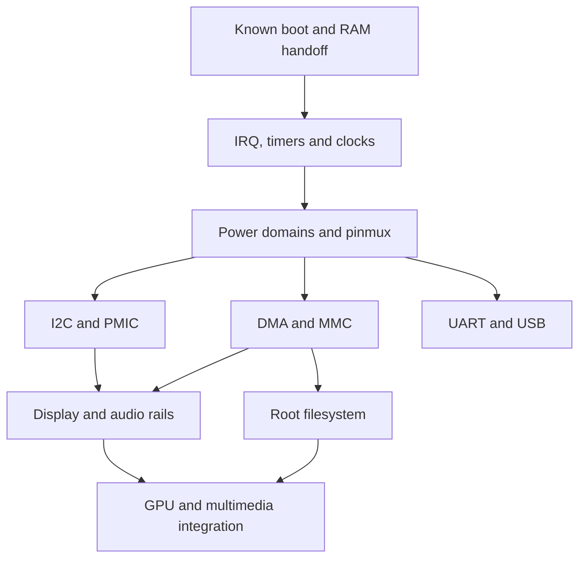

# Linux driver compatibility and development route

Assessment against **Linux v6.12**, pinned commit in `evidence/sources.json`, and the vendor RG35XX branch. Newer upstream support was not exhaustively audited; this release is the reproducible comparison baseline. No subsystem was boot-tested. Difficulty estimates refer to investigation/porting effort, not a promised schedule.

| Subsystem | Existing implementation / closest target | Supporting evidence | Missing / contradictory evidence | Changes and validation required | Difficulty | Benefit / proprietary dependency |
|---|---|---|---|---|---|---|
| CPU startup | Vendor `platsmp-owl.c`; S500 mainline machine support | A9/SCU/GIC descriptions; four-CPU config | Two DT nodes; powersave path; no runtime topology | Match startup method and final DT, memory/cache handoff; passive boot log then separately approved spare-media boot | High | Essential; early boot binary still needed |
| GIC / PL310 | Standard ARM controllers / S500 | Matching resource bases and PL310 IRQ | Cache implementation, SMP/cache policy unknown | Correct bindings/latency/cache properties; inspect boot log and IRQ delivery | Moderate | Essential, standard drivers plausible |
| Timer | `timer-owl.c`, A9 private timer | S500 timer header/blocks; standard ARM names | Private timer/watchdog resource mismatch | Separate resource definitions, IRQ type and rate; verify monotonic time only after boot path exists | Moderate | Essential, no proprietary userspace expected |
| CMU/reset | `drivers/clk/actions/owl-s500.c` | Important CMU offsets agree | Target PLL constraints, gate/reset identities not fully reviewed | Field-by-field comparison, boot clock snapshot and retained clock policy | High | Blocks most peripheral ports |
| Power domains | `drivers/pmdomain/actions/owl-sps.c` | S500 vendor power-gate code and shared family | Target domain IDs/ack/isolation/rail sequencing unverified | Compare state transitions, never trial-write undocumented gates | High | Critical stability; board PMIC dependency |
| GPIO/pinmux/SIRQ | `drivers/pinctrl/actions/pinctrl-s500.c`; Owl SIRQ support | GPIO/SIRQ bases and IRQs match | Vendor binding splits blocks; board comments conflict | Translate mux/groups, pull/drive fields and interrupt resources; review generated DT | Moderate | Controls, panel and power prerequisites |
| UART | `drivers/tty/serial/owl-uart.c` | Seven bases and IRQ tuples match; related register offsets | No established physical console pads/voltage | Match clocks/pinctrl; source build first; no physical connection without approval | Moderate | High debugging value |
| I2C | `drivers/i2c/busses/i2c-owl.c` | Four bases and IRQs match S500 | FIFO/dividers/clear semantics and PMIC behavior need review | Compare vendor controller, binding and clock/reset; no indiscriminate live scans | Moderate | PMIC/audio/regulator access |
| MMC | `drivers/mmc/host/owl-mmc.c` | Three bases, 0x38 extents and IRQs agree | DMA routing, delays, slot detect, boot slot mapping unknown | Adapt board DT/detect, prove DMA/reset/timing and read-only transfer under later approval | Moderate | Root filesystem; no new binary userspace required |
| DMA | `drivers/dma/owl-dma.c` | Base/size/four IRQs match | S500 selects S900_DMA configuration while S700 differs; descriptor/request IDs need review | Compare descriptors, IRQ ack, request routing and cache maintenance | Moderate | Storage/audio prerequisite; incorrect DMA can corrupt RAM |
| SPI | Vendor Owl SPI / U-Boot definitions | Four resource blocks and offsets available | No upstream Owl SPI driver found in pinned release | New/adapted driver with clock/IRQ/FIFO review; board wiring unknown | High | Lower immediate benefit; no assumed stock API compatibility |
| USB | Vendor atm7059tc USB, related DWC3 code | Enabled 0xb0400000 resource and related code | Legacy USB base contradiction, PHY/VBUS role policy | Reconstruct wrapper/PHY, clock/reset and PMIC coupling before choosing driver | High | Debug/network/controllers; no USB3 speed claim |
| LCD / display engine | Vendor `drivers/video/owl` | Panel timing/control DT, DE/LCD source | No proven modern DRM/KMS programming match | Recover scanout/format/stride, panel init, power and memory ownership; retained framebuffer may aid early boot | High | Usable OS prerequisite; boot splash not a full driver |
| Audio | Vendor ATC260x codec + SoC audio/DMA | External codec and I2S/PCM nodes; jack DT differences | Exact codec routing/clocking and amplifier wiring | Audit ASoC architecture, DMA, rate clock and speaker/jack control | High | Complete handheld use; separate analog/digital roles |
| PMIC/regulators/RTC | ATC260x source implementations; exact board config needed | ATC2603C at I2C1/0x65 and supply phandles | Fitted revision, charger thresholds, shutdown/wake sequence unknown | Bind transport and regulators conservatively from reviewed source; no raw PMIC experiments | High | Essential power safety; not a SoC MMIO block |
| GPU integration | Selected vendor Eurasia Linux DDK / S500 | SGX544 rev115 build config; source kernel glue; DTB enabled | Actual GPU ID, userspace ABI, firmware and memory interface unverified | Match DDK module/userspace pair and display bridge; offline ABI audit first | High | Acceleration possible in existing stacks; proprietary userspace remains |
| GPU full replacement | Modern upstream powervr is not SGX544 support | Series6+ scope excludes target | No recovered complete SGX544 programming/API implementation | Assess specific SGX projects and command/firmware/toolchain gaps | Research blocked | Very large effort beyond kernel integration |
| Video codec | Vendor VDE/VCE | Named resources and source code | Codec/microcode/IOCTL/buffer ABI not reconstructed | Recover user/kernel interface and command sequences | High | Lower priority than core OS |
| Suspend / DVFS | Vendor PM/hotplug/cpufreq | Source routines exist | Safe rails, retention, wake and board behavior unvalidated | Source audit and known-good traces; no voltage/clock test authorized | High | Battery/latency, substantial hardware risk |

No target driver is labelled low difficulty solely because its address matches. Standard-controller binding work may eventually be low difficulty once the boot/clock/memory foundation is established. A missing board DT and verified boot path make even an apparently simple port a broader integration task.

Dependency edges describe engineering prerequisites, not strict Linux probe order. The practical route starts by preserving the proven early boot chain on a separately approved spare card, obtaining logging, then validating standard ARM blocks and conservative clocks before storage/display. Replacing every vendor component at once would remove the ability to localize failures.
