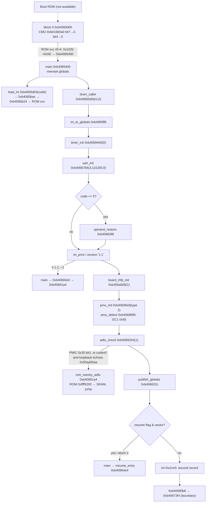

# SD2 pre-DRAM initialization reconstruction (PR #9)

Scope: the original RG35XX (ATM7039S) early loader, from loader block 0 to the cold DRAM init call `0xb40690b8`. The work used the five pinned images (Koriki v1.0 as the reference, plus stock 221203, 221223, 230309 and 20231014). All of it was offline. No device, card, register, clock or power state was touched, and nothing here authorizes a physical experiment.

**New findings:** BOOT-024 (sequence and environment), BOOT-025 (SD0/SD2 divergence), CLK-007 (timer and delays), UART-004 (UART3 set-up), PMIC-002 (PMIC detection and init), GPIO-002 (board MFP write).
**Ledger changes:** BOOT-021 is refined. C-PREDRAM-PATH is narrowed but stays **open**. C-PREDRAM-LABELS is opened and resolved in this PR.
**Machine-readable evidence:** [`evidence/firmware/sd2-predram.json`](../evidence/firmware/sd2-predram.json).
**Tool:** [`tools/predram_analysis.py`](../tools/predram_analysis.py). **Tests:** [`tests/test_predram.py`](../tests/test_predram.py).
**Developer reference:** [docs/predram-initialization.md](../docs/predram-initialization.md).

## 1. Executive summary

* **The pre-DRAM sequence is reconstructed and reproducible.** In order:
  1. block 0 chooses the boot code;
  2. main clears the globals and reloads `bootloader.ini`;
  3. dram_caller runs ini_to_globals, timer 0, UART3, the ini version check, one board MFP write, PMIC detection and type-2 init over I2C1, the ADFU check, the pointer publication, the resume test and the record choice, then calls `0xb40690b8`.

  There are 91 statically reachable functions (403 call edges). Everything on the path was executed under explicit synthetic peripheral rules.
* **SD0 and SD2 differ before DRAM in exactly one place.** In `adfu_check` `0xb4069254`, boot code ≠ 0 runs a 32-bit **GPIO loopback test**: it drives C11 with `0x55aa55aa`, LSB first, at 1 ms per bit, samples C10, and enters ADFU only on an exact echo. It adds about 32 ms of requested delay. It also leaves two bits changed: `0xb01b0064` bit 17 is cleared and `0xb01b0020` bit 11 is 0.

  Everything else is identical event for event for codes 0 and 2: storage reads, timer, UART, board, PMIC, the console text and the DRAM argument. Re-running the PR #6 DRAM caller for code 2 (reference scenario) shows that the whole DRAM-stage MMIO sequence differs only by that block.
* **All five releases are identical here.** Pre-DRAM code, data tables and executed event sequences match byte for byte. Only 20231014's ODT/drive ini bytes differ, and they pass through untouched to the DRAM routine.
* **Corrections:**
  * the GPIO "handshake" is a loopback test, and the status write-back clears bits 0–1 (BOOT-021 refined);
  * `0xb4069440` is the timer, not "PMIC/clock setup" (C-PREDRAM-LABELS);
  * the UART3/pad-0 entry performs **no pin-mux write**;
  * PMIC detection (stubbed in every earlier emulation) is now executed and decoded;
  * the existing DRAM evidence ran only code 0 (`run_caller` never passed a boot code).
* **Why C-PREDRAM-PATH stays open:** the Boot ROM's state after an SD2 boot, the board wiring of C10/C11 and the non-reference DRAM scenarios for code 2 are still unknown.

## 2. Research questions

1. Which CPU and memory state does the loader establish, and which does it inherit?
2. What is the exact call graph from `0xb4065400` to the DRAM boundary?
3. Where is the boot code produced and consumed, and what differs for codes 0 and 2?
4. How are the timer, UART, board MFP and PMIC initialized, and what do they depend on?
5. What is the structure of `0xb4069254`?
6. Do the five pinned releases behave the same?
7. Which emulator assumptions could hide a code-0/code-2 difference?

## 3. Firmware provenance

Every image was fetched with `tools/acquire_firmware.py`, and its whole expanded image was SHA-256-checked against `evidence/firmware/acquisitions.json` before use. The tool repeats this check.

| Release | Expanded image SHA-256 | Loader region (disk `0x200200`, 0x38000 B) | bootloader.bin code `0x5400..0x33c00` |
|---|---|---|---|
| koriki-v1.0 | `d5bd3007…539d6ae` | `a3a56aca…` (= 230309) | `6b17b88c…` |
| stock-221203 | `7c466a74…3ebecde7` | `c4630f0a…` | = |
| stock-221223 | `0bd553d5…6139eecc` | `bb59f065…` | = |
| stock-230309 | `e3772f59…309d7407` | `a3a56aca…` | = |
| stock-20231014 | `e5f61b7d…ec66ec8` | `ec9e4ec8…` | = |

Full hashes, archive names and the block-0 hash (`0b74b609…`, identical in all five) are in `releases` in the evidence file. Function hashes are in `call_graph`. Tool versions: predram_analysis v1, Capstone 5.0.6, Unicorn 2.1.4. The 20231014 archive is RAR5. Expanding it needed a RAR-capable 7-Zip (`7zip-rar`), and the output matched the manifest hash. No firmware bytes, extracted regions or listings are committed.

## 4. Methods

`predram_analysis.py` keeps four kinds of statement separate, and each record carries its type:

* **decoded**: Capstone A32, recursive descent from roots, with straight-line constant tracking per basic block. Jump tables are bounded by the preceding `cmp`. Tail calls are recognized against the known-entry set. Indirect calls are resolved only from a constant register. Literal pools are never decoded, because only control flow is followed.
* **static-path**: reachability and call edges. The pre-DRAM subgraph is main's calls up to `0xb4065424` plus dram_caller's calls before `0xb4066718`, closed transitively. Reachable does not mean executed.
* **executed**: Unicorn from `0xb4065400` with SRAM loaded from the image. Only these are supplied: the Boot ROM read service (from the disk image), printf (text captured), and the I2C transaction layer `0xb406ac10/0xb406ac60` (a PMIC register file). Every peripheral read follows a named rule:

  | Rule | Response |
  |---|---|
  | timer | T0 count +24 per read |
  | uart_stat | `0x400` |
  | i2c_fifostat | `0x1` |
  | gpio_cdat | bit 10 := 0, or := bit 11 in the loopback scenario |
  | seeded | last written value, or the run seed (0 / `0xffffffff`) |

  Runs stop at `0xb40690b8`, at the ADFU re-entry, at the resume entry, on self-loops or at an instruction limit.
* **annotated**: hand-written formulas for the bit-indexed helpers (clock gate, reset, GPIO, timer and I2C base). The firmware-backed tests check them against executed addresses.

Scenarios: codes 0 and 2; both again with seed `0xffffffff`; loopback for codes 0 and 2; code 2 with ini+0x14 = 0; code 2 with PMIC status bit 1. This confirms structure. It is not an exhaustive handshake matrix.

## 5. Execution environment (BOOT-024)

| Category | State |
|---|---|
| Set by firmware | A32 throughout (no Thumb interworking). main memsets `0xb4070800..0xb407087b` and reloads the ini. No SP, CPSR, SPSR or CP15 write before DRAM init. SCTLR.I is set or cleared only after dram_caller returns. VBAR := `0xffff0000` only in `0xb40691a4` (the ADFU exit). No MMU, D-cache or cache-maintenance code exists on the path. |
| Inherited from the Boot ROM | SP (neither block 0 nor main sets it), CPU mode, IRQ/FIQ masks, vectors, SCTLR, the whole clock and pin-mux state, `CMU_DEVCLKEN0` bit 7 (read by block 0), and the ROM service code in SRAM `0xb4060400..0xb4061e00` (zero in the image) |
| Supplied by the emulator | SP `0xb409f000`, CPSR `0x1d3`, the boot-code word, the synthetic rules above |
| Inferred from later behaviour | SRAM persists from block 0 to main (shared `0xb4064c00`, AFI at `0xb4060300`) and extends to at least `0xb4070880` |
| Unknown | ROM register state at the jump, vectors, interrupt controller, caches/L2, reset values of every register read before DRAM |

Measured pre-DRAM stack depth is 136 bytes, relative to the emulator's SP. Executed SRAM writes outside the stack land in three places only: the pointer table `0xb4064c60..0xb4064c78`, the I2C bus cache `0xb406ba10` and the globals `0xb4070800..0xb407087c`. This holds for both codes. The SRAM map is in the [technical reference](../docs/predram-initialization.md#execution-environment).

## 6. Initialization call graph



Shared helpers on the path:

* delay_us `0xb40693f8`, delay_ms `0xb4069434`;
* clk_gate_on `0xb406a6ac`, reset_pulse `0xb406a728`;
* the accessor pairs `0xb4069194/919c`, `0xb4069514/951c`, `0xb40669c4/69cc`, `0xb406a748/a750/a774/a784`;
* i2c_select `0xb406a788`, i2c_probe `0xb406ab7c`, i2c_xfer `0xb406a994`;
* printf `0xb4066854`, putc `0xb40667a8`, uart_tx `0xb4066adc`;
* memset, memcpy and strcmp at `0xb406af4c`, `0xb406af64` and `0xb406af84`.

The type-0 (SPI) and type-1 PMIC branches are reachable statically but are not taken (pmu_init is called with 2). Their accesses are listed under `static_only_accesses`. Function boundaries come from control flow. Where code jumps over inline data the record says `noncontiguous`.

## 7. Boot-code production and consumers

* **Writer.** Block 0, at three `str r1, [r0]` sites that store to `0xb4064c00`. Bit 7 of `0xb01600a0` is tested first: code 2 at `0xb40600cc`; bit 4 gives code 0. Otherwise the `0xb4060408 == 0xeb0001d0` test gives 4 or 5. Codes 0 and 2 then share one instruction path into `0xb4065400`. No other code writes the word.

| Consumer | Pre-DRAM | Code 0 vs 2 |
|---|---|---|
| main → load_ini `0xb4065d04(r0=code)` | yes | same branch (sector `0x1013`, 8 sectors) |
| storage dispatch `0xb4065bac(r3=code)` | yes | same (`0xb4065b24`) |
| dram_caller `get_boot_code()==5` | yes | neither |
| adfu_check `get_boot_code()!=0` | yes | **code 2 runs the loopback test** |
| afi_from_boot_code `0xb4066588` | after DRAM | AFI `0x20` / `0x22` |
| load_app / load_uboot | after DRAM | same storage branch |

The boot code does not influence the configuration record, PMIC, timer, UART, board init, clocks or the DRAM argument. Five values are often confused and must be kept apart:

* the firmware boot code (2);
* the AFI boot_dev (`0x22`, written after DRAM);
* the ini `bootdev` byte (`0x22`, printed only, at `0xb407081c`);
* the U-Boot MMC index (1);
* the Linux index (mmcblk0).

The ROM service selector r9=4 is the same for both codes.

## 8. Timer (CLK-007)

* `timer_init(0)` sets the gate `0xb01600a4` bit 27. It then writes `0xb0168008`, `0xb0168010` and `0xb016800c` := 0 twice, then `0xb0168008` := 4.
* `delay_us(n)` spins until `(int32)(count − (start + 24n)) ≥ 0`. The count is at control + 8, counting up. The comparison is wrap-safe, but there is no iteration bound.
* `delay_ms(n)` is `delay_us(1000n)`.

Every pre-DRAM wait depends on this timer: the UART reset pulse (1 µs), the clock-out wait (300 µs), the I2C timeout (501 × 1 ms) and the code-2 test (32 × 1 ms). The tick rate is the firmware's constant. "24 MHz" and "counts up" are inferred from the instructions, not measured. The executed timer is synthetic, so no physical time is claimed. The code is the same for codes 0 and 2.

## 9. UART (UART-004)

ini+0x0e/+0x10/+0x0f (3, 115200, 0) flow into `uart_setup 0xb4066a14`, which uses table entry 14 at `0xb406b7c0`:

1. set the gate (bit 51 = `0xb01600a4` bit 19);
2. reset pulse on bit 47 (`0xb01600ac` bit 15: clear, then 1 µs, then set);
3. `0xb0126000` := `0x8003`;
4. divider `0xb01600b0` := 24000000/(8·115200) − 1 = 25. With a 24 MHz clock that gives 115384.6 baud, +0.16 % (inference);
5. store the handle at `0xb4070800`.

There are **no MFP writes for UART3/pad 0**. The other UART entries carry up to three. So the loader relies on pin state it does not set: ROM, reset default, or the later board_mfp_init. Which balls carry UART3 is not established.

TX waits on status bit 6, then on bit 10. Both polls are unbounded, so a stuck UART would hang the loader. FIFO and RX configuration are not touched. The serial-console document is updated accordingly. No test pads are inferred.

## 10. Board-specific registers (GPIO-002)

board_mfp_init takes the index from ini+0x0d. Index 1 (all releases) writes `0xb01b0048` (MFP_CTL2 in the related header): clear `0x000e39e0`, set `0x000619c0`. Index 0 would write `0xb01b0044`: clear `0xfc000000`, set `0x24000000`. Indexes above 1 return −1.

The PMIC path adds more pre-DRAM pad and MFP writes (§11). The pin functions selected are unknown. S500 names are analogies only.

## 11. PMIC dependencies (PMIC-002)

* **Bus, address and register format.** I2C bus ini+0x18 = 1 (`0xb0174000`), slave `0x65`, 16-bit big-endian registers. This agrees with the DT `atc2603c` node at 0x65 on I2C1 (PMIC-001), so type 2 is probably the ATC2603C (inference).
* **Clock-out select.** `0xb4069710(1)` runs first. It writes MFP_CTL3 bit 30 := 0, sets `0xb0160084` bit 0 (with a 300 µs wait only if it was clear), `0xb01b0084[31:30]` := 2, `0xb01600d0` := `0x8000002d`, `0xb01b0090` := `0x10` and `0xb01b0094` := `0x20000000`. The failure message "not find HOSC" suggests a clock is routed to the PMIC. That is a hypothesis.
* **Identity checks.** Reg 0xff must read `0x00ca`; on failure it retries with `0xb4069710(0)`, then prints and pulses GPIO 90. Reg 0x32 must read `0x1bc0`, otherwise the loader loops forever at `0xb40699c4`.
* **Cold-path writes, in order:**

  | Register | Operation |
  |---|---|
  | 0x51 | \|= 0x800 |
  | 0x39 | &= 0x7fff |
  | 0x11 | := 0xe84f (read back and printed) |
  | 0x12 | := 0x68cc |
  | 0x14 | := 0x80ca \| (adj(ini+0x1b) << 8); 0x89ca for ini 3 |
  | 0x15 | := 0xe8ce, only if reg 0xdc > 0 |
  | 0x16 | := 0x334b, only if reg 0xdc > 0 |
  | 0x29 | &= 0x7fc5 |
  | 0x03 | read: bit 4 = s2 flag → resume decision (PR #6 §3.2) |
  | 0x00 | := (0x00 & 0x1f) \| 0xe0c0 |
  | 0x3f | bit 3 cleared if reg 0xdc reads 0 |

  Version 0 hangs.

**Dependency map:**

* the timer must run (bus waits, I2C timeouts);
* the clock-out and bus MFP must be set before any PMIC access;
* the PMIC identity must match, or the loader hangs;
* the regulator writes come before adfu_check (which reads reg 0x35) and before DRAM init;
* the resume flags decide whether DRAM init runs in mode 0 at all.

No value is converted into a voltage. Their electrical meaning is unknown.

## 12. ADFU routine structure (BOOT-021 refined, BOOT-025)

The routine spans `0xb4069254..0xb40693c0`. Its literal pool starts at `0xb40693c0`. It takes one argument, the ini word +0x14.

1. `0xb406925c`: status register number = halfword `0xb406b9d4` = `0x35`. The value is printed as `pmu_status`.
2. `0xb4069280`: if bit 1 is set, write back `value & ~3` (`0xb4069288`), print "Prepare to entry ADFU mode" and tail-call `0xb40691a4`.
3. `0xb4069298`: if the argument is 0, return. `0xb40692a0`: if `get_boot_code()` is 0, return. **This is the SD0/SD2 split.**
4. GPIO set-up: `0xb40692c0` (PULLCTL1 bit 17 cleared), then save OUTEN/INEN, then C10 := input and C11 := output (`0xb40692ec..0xb406932c`).
5. Loop `0xb4069330..0xb4069388`, 32 times: drive C11 with the next pattern bit (`0xb4069358`), `delay_ms(1)` (`0xb4069364`), sample C10 (`0xb4069370`).
6. Restore INEN/OUTEN (`0xb4069394`, `0xb40693a0`). The pattern was loaded from the literal pool at `0xb40692b8`, and the sampled word is compared with `0x55aa55aa` at `0xb40693a8`. On a match it prints and tail-calls `0xb40691a4`. Otherwise it returns.

**State left behind on normal return:** PULLCTL1 bit 17 = 0 and C data bit 11 = 0. Direction registers are restored. Nothing reads these back before the DRAM boundary.

**The ROM re-entry `0xb40691a4`:**

1. re-inits timer 0;
2. copies `0x2e00` bytes from ROM `0xffff5200` over SRAM `0xb4060000`;
3. writes CMU `0xb0160000` := `0x30a` and `0xb0160004` := `0x114`, then sets `0xb0160004` |= `0x1000` and clears `0xb016001c` bits 19:16, with 5 ms / 5 ms / 5 µs waits;
4. sets VBAR = `0xffff0000` and SP = `0xb4070800`;
5. `blx 0xb4060000`, which is now ROM code, not block 0.

**Needed to model the handshake on real hardware:**

* what C10/C11 connect to on the board;
* their pad configuration and pulls (PULLCTL1 bit 17 is probably a pull for one of them; inference);
* input sampling latency;
* whether a factory jig or cable is the intended partner.

None of this is available offline. Physical triggering is not authorized.

### Follow-up

The [ADFU loopback reconstruction](adfu-loopback-reconstruction.md) checked this routine in full:
* PMIC read failure → ADFU;
* any non-zero boot code runs the test;
* only an exact echo enters ADFU;
* the pins are SD0 DAT0/DAT1;
* the persistent CDAT effect depends on the unknown read semantics;
* there is no downstream use in the loader.

## 13. Cross-release comparison

* **Code:** all 91 functions have identical raw instruction hashes and identical entry-to-pool extents in all five images. No normalization was applied. The UART, board and PMIC-register tables are identical.
* **Config:** the ini pre-DRAM inputs (+0x0c..+0x1b, +0x2c) are identical. Only the primary and second records differ: 20231014 has `…0202 09…` (ODT 2/2, drive 9) where the others have `…0101 0c…`. Nothing before the boundary reads them, and they arrive unchanged as the DRAM argument.
* **Behaviour:** the executed code-0 and code-2 event sequences are identical across releases.

So equal code here does conceal configuration-dependent behaviour, but only inside the DRAM routine (PR #6, MR1/ZQ0CR1).

## 14. Emulation assumption audit

| Item | Classification | Note |
|---|---|---|
| `boot_chain.loader_main` | Supplied state + Stubbed | stubs timer, UART, board, PMIC, adfu_check and DRAM (stub labels outdated; C-PREDRAM-LABELS) |
| `dram_complete.Harness` / `run_caller` | Supplied state | `boot_code=0` default; `run_caller` never passed it, so all PR #6 runs are code 0. PR #9 adds an optional `boot_code` (default unchanged) |
| dram_complete stubs | Stubbed | uart_init, pmu_detect, delay, printf |
| dram_complete MMIO oracle | Partially modelled | last-written/seed responses make GPIO C10 never echo C11, i.e. silently "no loopback" |
| `ddr_emulate.Emulation` | Executed from `0xb4065ff8`/DRAM | nothing before the ini copy |
| this tool | Executed + Partially modelled | executes every pre-DRAM function; stubs only printf, the ROM service and the I2C transaction layer |

Assumptions that could hide a difference:

* Seeded reads of 9–12 MFP/CMU/GPIO registers (`seeded_read_addresses`). With seed `0xffffffff` the control flow changes once: `0xb0160084` bit 0 already set skips the 300 µs wait. All other seed effects are data-only.
* The I2C FIFOSTAT rule makes every probe succeed.
* The UART status rule never blocks.
* The timer always advances.

Each of these would hide a hang that real hardware could show, equally for both codes.

## 15. Confirmed findings

BOOT-024, BOOT-025, CLK-007, UART-004, PMIC-002 and GPIO-002, all `strongly-supported`, `reproducible-static-analysis`, not hardware-validated. Claims and limitations are in `evidence/findings.json`.

## 16. Contradictions

* **C-PREDRAM-PATH** (open, narrowed): the code-level divergence is now fully established. Hardware-state questions remain.
* **C-PREDRAM-LABELS** (resolved): outdated stub labels in `boot_chain.LOADER_STUBS`. They are kept unchanged because committed evidence records them.

## 17. Remaining uncertainties

* Boot ROM behaviour: whether an SD2 boot leaves different clock, pin-mux or SD state than an SD0 boot.
* The board wiring of GPIO C10/C11, and whether the code-2 loopback test could ever pass on a unit.
* The UART3 pin mux during the loader.
* Reset values of the seeded registers.
* PMIC register meanings (regulators, VDDR).
* Real timer rate.
* The DRAM-stage failure and training scenarios for code 2 (not re-run).

## 18. Reproduction

```sh
python -m pip install -r requirements-dev.txt -r requirements-firmware.txt
for f in RG35XX-221203.zip RG35XX-EN-221223.rar RG35XX-64GB230309EN.rar RG35XX-20231014-EN4GB.rar; do
  python tools/acquire_firmware.py anbernic-stock-archive FW --filename $f --expand; done   # RAR5 needs 7-Zip with RAR support
python tools/acquire_firmware.py koriki-v1.0-release FW --expand
python tools/predram_analysis.py evidence evidence/firmware/sd2-predram.json --reference koriki-v1.0 \
  --image koriki-v1.0=FW/koriki-v1.0.img --image stock-221203=FW/stock-221203.img \
  --image stock-221223=FW/stock-221223.img --image stock-230309=FW/stock-230309.img \
  --image stock-20231014=FW/stock-20231014.img          # ~1 min; output is byte-deterministic
python tools/predram_analysis.py trace FW/koriki-v1.0.img --boot-code 2 --scenario loopback
ATM_FIRMWARE_DIR=FW python -m unittest tests.test_predram -v
```
