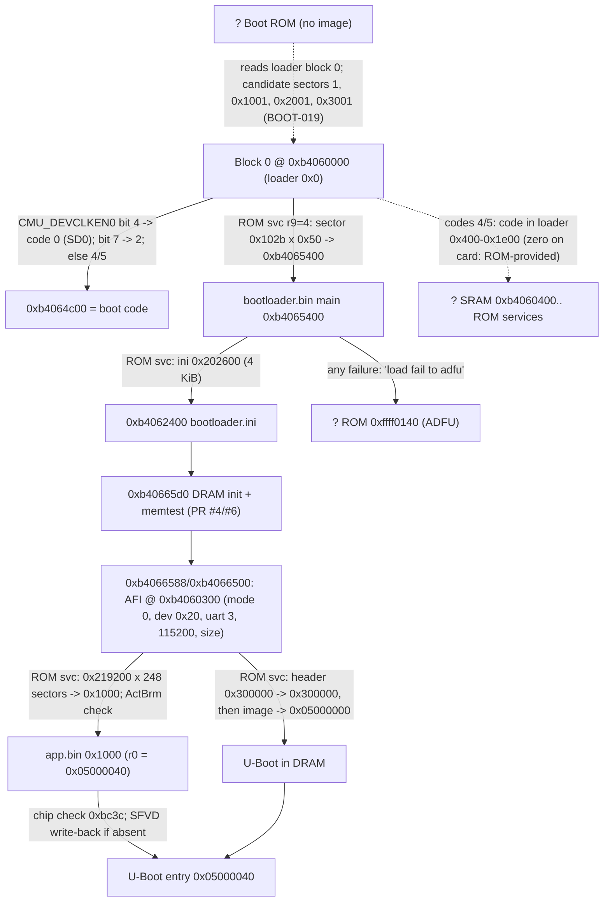
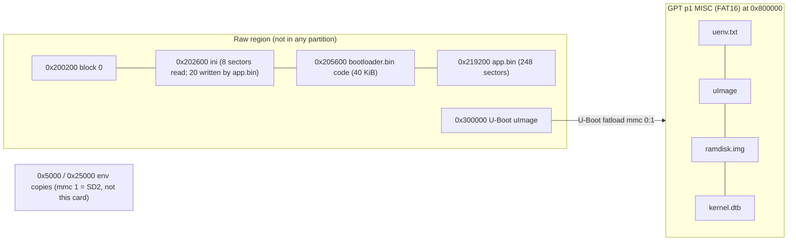
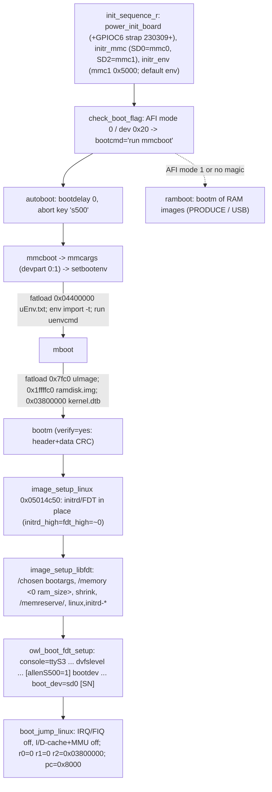

# Stock boot-chain reconstruction (PR #5)

Scope: the **original 2022–2023 RG35XX** (Actions ATM7039S), four hash-pinned Anbernic stock releases (221203, 221223, 230309, 20231014), with Koriki v1.0 as a control. Everything here was done offline. No device, card, register, clock or power state was touched, and no firmware or disassembly listing is committed: the repository holds addresses, hashes, short firmware strings and original analysis only.

Findings: **BOOT-012 … BOOT-020**, revised **BOOT-007**; contradictions **C-UENV** (resolved), **C-APPBIN**, **C-DEVCLK**, **C-OPAQUE**. Machine-readable trace: [`evidence/firmware/stock-boot-chain.json`](../evidence/firmware/stock-boot-chain.json). Tool: [`tools/boot_chain.py`](../tools/boot_chain.py).

## 1. Executive summary

**BOOT-007 is resolved, and its earlier reading was wrong.** The kernel, RAM disk and device tree are not preloaded. They are read from the microSD card by **U-Boot** at boot time:

1. The Boot ROM runs loader block 0 (disk `0x200200`, SRAM `0xb4060000`).
2. Block 0 asks a ROM service at SRAM `0xb4060400` to read bootloader.bin's code (disk `0x205600`, 40 KiB) to `0xb4065400`, then jumps there.
3. **bootloader.bin** reloads `bootloader.ini`, initialises DRAM, writes the AFI record, loads **app.bin** to DRAM `0x1000` (ActBrm-checked) and **U-Boot** to `0x05000000` (sector `0x1800`, header-sized, *not* CRC-checked). It then calls app.bin with `r0 = 0x05000040`.
4. **app.bin** checks a chip identity, writes `bootloader.ini` back to the card if its `SFVD` record is missing, and jumps to U-Boot.
5. **U-Boot** loads its environment, then `check_boot_flag` **overwrites `bootcmd=run ramboot` with `run mmcboot`** because the AFI says boot mode 0 and device `0x20` (SD0).
6. `mmcboot` does `fatload mmc 0:1` (SD0, partition 1 = MISC) of `uEnv.txt` (imported), `uImage` → `0x7fc0`, `ramdisk.img` → `0x1ffffc0` and `kernel.dtb` → `0x03800000`, then runs `bootm`.
7. `bootm` checks both uImage CRCs. The kernel runs in place at `0x8000`, and the RAM disk (`0x2000000`) and DTB (`0x03800000`) stay in place. U-Boot writes `/memory`, `/chosen` (`initrd`, bootargs) and `/memreserve/` into the DTB. The vendor `owl_boot_fdt_setup` rewrites bootargs. U-Boot turns off caches and the MMU and jumps to `0x8000` with `r0=0, r1=0, r2=0x03800000`.

`ramboot` is the PRODUCE (USB download) path. It is taken only when the AFI says `boot_mode 1` or carries no magic.

How each conclusion was reached:

| Question | Answer | How it was established | Confidence |
|---|---|---|---|
| Which stage loads kernel/RAM disk/DTB? | U-Boot (`mmcboot` → `mboot` → `fatload`) | Emulated `check_boot_flag` with real getters; default-env scripts; Koriki `init=/init` reaches `/chosen` | verified (BOOT-015), strongly supported (BOOT-016) |
| Boot source selection | ROM → clock bit → block-0 code → AFI `boot_dev` → U-Boot `bootcmd` | Block-0 emulation for every hypothesis; code→`boot_dev` emulation; `check_boot_flag` table | strongly supported; ROM part inferred |
| Which functions read storage? | ROM service `0xb4060400` (r9=4) for all loader reads; U-Boot's own MMC/FAT driver for the boot files; app.bin's MMC driver only for write-back | Instruction tracing plus emulated reads from the image | strongly supported |
| Validation | app.bin: ActBrm; U-Boot: none; kernel/RAM disk: uImage header+data CRC; DTB: header check | Executed checksum; absence of CRC constants in the loaders; `verify=yes` | strongly supported |
| Load addresses | See §6 | Environment, uImage headers, emulated `image_setup_linux` | verified data, emulated placement |
| How addresses reach Linux | `r2` = DTB; DTB `/chosen linux,initrd-*`, `/memory`, `/memreserve/` | Emulated FDT fixups read back from memory | strongly supported |
| Board-specific parameters | `console=ttyS3`, `androidboot.dvfslevel=0x705x`, `boot_dev=sd0`, optional `allenS500=1`/SN, memory size from the AFI | Emulated `owl_boot_fdt_setup` = static model (two methods agree) | strongly supported, runtime terms conditional |
| What remains unknowable offline | ROM code and media search; the clock bit the ROM leaves set; DRAM outcome; GPIOC6 level; serial number | — | see §10 |

## 2. Method and validation

[`boot_chain.py analyze`](../tools/boot_chain.py) re-derives every result from a pinned image in about 5 s. Code is located by **string or literal anchors**, never by fixed addresses, so the same code path runs on all releases. Every record names its method:

* **static**: Capstone A32 decoding plus a straight-line constant tracker that resolves call arguments (literal pools, `mov`/`movw`/`add`).
* **emulated**: bounded Unicorn execution of the firmware's own instructions. Each run lists its `models`, which are the only behaviour supplied from outside:
  * the ROM read service, which copies sectors from the disk image;
  * named stubs for console, PMIC/clock and DRAM-training outcome;
  * recorders for U-Boot `getenv`/`setenv`/`printf`.

  An unmodelled MMIO read stops the run with an error rather than returning an invented value. No run in the committed evidence needed one.
* **data**: parsers for GPT/MBR, FAT, uImage, FDT and environment.

Independent cross-checks:

| Claim | Method A | Method B | Result |
|---|---|---|---|
| Final bootargs | Static call order of `owl_boot_fdt_setup` plus emulated helper semantics (model) | Execute `owl_boot_fdt_setup` and the whole `image_setup_linux` on the real DTB, read `/chosen` back | Identical for all 5 images, byte for byte. The first run found a model bug: the firmware keeps Koriki's trailing spaces, so the model was corrected |
| `check_boot_flag` decisions | Raw disassembly of the compare/branch tree | Emulation with the firmware's own AFI getters | Agree. Ghidra 11.4.2 decompilation (scratch only) agrees |
| Loader read parameters | Literal/immediate decoding of the three load functions | Emulated main with reads served from the image (app.bin checksum executes and passes) | Agree, and the bytes land at the destinations whose SHA-256 is recorded |
| Release identity | SHA-256 of each component | Normalised function hashes plus string sets | Consistent (§8) |
| Reproducibility | Committed JSON | `ATM_FIRMWARE_DIR=… python -m unittest tests.test_boot_chain` re-analyses all images | Equal |

## 3. Boot-stage diagrams

Legend: solid `-->` = shown by instructions or emulation; dashed `-.->` = inferred; nodes marked `?` = not reconstructable from the images.

**Reset to U-Boot entry**



**Storage map read and written before Linux** (disk offsets, SD card)



**Kernel, RAM disk and DTB loading; U-Boot to Linux**



## 4. Earliest stages (BOOT-012, BOOT-019)

**Block 0** (`0b74b609…`, identical in every release) is about 100 words of A32 code and literal pool. Under emulation:

| `0xb01600a0` (CMU_DEVCLKEN0) | SRAM `0xb4060408` | Code at `0xb4064c00` | Next |
|---|---|---|---|
| bit 7 | — | 2 | ROM svc r9=4 (`0x102b`, `0x50`, `0xb4065400`), jump `0xb4065400` |
| bit 4 | — | **0** | same |
| neither | ≠ `0xeb0001d0` (disk value 0) | 5 | calls `0xb4060418/648/e20/e40/d34`, reads `0x600` bytes to `0xb4061200`, runs the relocated reader `0xb40612b0` |
| neither | = `0xeb0001d0` | 4 | calls `0xb4060418/648/b30/a44`, read (`0xb4065400`, `0x5800`, `0x2800`), jump `0xb4065400` |

The code at `0x200..0x400` is linked for `0xb4061200`. Only at that address does its `bl` reach the block-0 word-sum routine `0xb4060140`, which it compares against `sum + 0x1234` (the ActBrm rule). Loader `0x400–0x1e00` is all zero on every card, yet block 0 and bootloader.bin call into it. Its contents, the **service entry `0xb4060400`** (selector in `r9`: 4 = read sector(s), 5 at exit, 6/7 in the fragment below) and the NAND/NOR helpers, must therefore come from the Boot ROM. That is the exact ROM boundary.

Only code 0 gives a working SD boot: code 2 leads U-Boot to `run emmcboot` on mmc 1, and codes 4/5 use NOR/NAND readers. A booting stock card therefore implies that the ROM leaves **bit 4** set. Mainline's S500 clock driver calls bit 4 the NAND gate and bit 5 SD0 (**C-DEVCLK**).

**The `[0x1e00,0x2000)` block** is zero apart from its ActBrm trailer. Its checksum validates from `0x400`, so it describes the empty ROM-filled hole and holds no code.

**The opaque per-release area** (loader `0x3800–0x4c00`) is not a separate object. It is bootloader.ini bytes `0x1400–0x2800`.

* On the SD path bootloader.bin reloads only ini `0x0–0x1000`.
* app.bin writes back 20 sectors from SRAM (BOOT-014).
* ini `0x1000–0x1400` (SRAM `0xb4063400`, identical in all releases) is A32 code using the ROM service ABI. It reads one sector from sectors `1, 0x1001, 0x2001, 0x3001` to `0xb4060000`, verifies it, and records a status nibble at `0xb4071f10`. This resembles the ROM's own SD search, and sector `0x1001` = 4097 is where the loader sits.

The best explanation is that each master card captured uninitialised/ROM-used SRAM on its first boot (**BOOT-019**, inferred; **C-OPAQUE**). No evidence of encryption or a signature was found, and nothing reads the area on the SD path.

## 5. bootloader.bin and app.bin (BOOT-013, BOOT-014)

Emulated main (`0xb4065400`), reads served from the 20231014 image:

| # | ROM service read | Disk offset | Bytes | Destination | Purpose |
|---|---|---|---:|---|---|
| 1 | sector 4115 ×8 | `0x202600` | 4,096 | `0xb4062400` | bootloader.ini 0x0–0x1000 |
| 2 | sector 4297 ×248 | `0x219200` | 126,976 | `0x1000` | app.bin; ActBrm check prints `OK` |
| 3 | sector 6144 ×1 | `0x300000` | 512 | `0x300000` | uImage header (size/load/entry big-endian) |
| 4 | sector 6144 ×1,420 (6 chunks) | `0x300000` | 727,040 | `0x05000000` | U-Boot (header at load address, code at entry `0x05000040`) |

The resulting AFI is `"AFI", mode 0, dev 0x20, uart 3, pad 0, 115200, ddr_size 0x10000000` under the 256 MiB DRAM hypothesis. The console lines are reproduced, including `load uboot: load address is 0x5000000, entry point is 0x5000040`. "`bootdev= 0x22`" is ini byte `+0x0c` printed for information; it is not the AFI source. A previous-boot resume flag (`0xb4070874/878`) diverts to `0xb40664e4` → `0xb40690d0` (DRAM mode 1, PR #6) without writing the AFI.

**app.bin**:

* It saves `r0`, sets CPSR `0xd3` and runs `0x8190`. `0xbc3c` reads `0xb01b00e0` (package ID per kernel `cpu_package()`) and an eFuse-like block at `0xb0150000`; on failure it prints `Error: 0xca00d001, please reburn system` and hangs.
* If ini+`0x400` lacks `SFVD`, it stores `SFVD`, `0xc582bb73` and **rewrites bootloader.ini (20 sectors at disk `0x202600`) on the card** with its own MMC driver.
* All shipped images already carry the record, so no write happens as shipped. This persistence explains why the shipped ini primary record equals the DRAM-detection write-back (C-INI-RECORD): the master card's detected values were written back by app.bin.
* app.bin contains an unreferenced "load uboot" string and SD driver, which misled PR #3 (**C-APPBIN**).

**Implication for a replacement loader:** stock boot writes to the card when the SFVD record is absent. A test card prepared from a modified image must keep the record, or it will be rewritten on first boot.

## 6. U-Boot (BOOT-015 … BOOT-018)

| Function (20231014 VA) | Role | Relation to pinned source `u-boot_s500@0a557e37` |
|---|---|---|
| `0x050041d4/0x05004208/…` | AFI getters; no magic → mode 1, dev `0x20`, uart 5, size 0 | Same as `owl_afi.c` |
| `0x05003f84` dram_init | `ram_size = ddr_size ≥ 8 MiB ? ddr_size : 0x1f000000` | Same as `owl.c` |
| `0x05089304` init_sequence_r | … `power_init_board`, `initr_mmc`, `initr_nand`, `initr_env`, `initr_secondary_cpu`, **`check_boot_flag`**, `check_recovery`, splash, `stdio_add_devices`, … `run_main_loop` | Vendor `board_r.c` order |
| `0x050078a4` power_init_board | "begin to check power!", then strap/check_power `0x05025e5c` if mode ≠ 1 | Vendor addition (strap from 230309) |
| `0x05004108` board_mmc_init | node-order registration: SD0 → mmc 0, SD2 → mmc 1 | Same, plus pin-mux save for slots 0/2 |
| `0x05009a70` env_relocate_spec | mmc 1, `0x5000`/`0x25000`, `0x20000`, redundant | `CONFIG_ENV_IS_IN_MMC` |
| `0x050076c0` check_boot_flag | sets `bootcmd` (see BOOT-015) | Same, except dev `0x01` also → NAND |
| `0x0500704c` autoboot | `bootdelay=0`, default abort key `s500` | `CONFIG_AUTOBOOT_DELAY_STR` |
| `0x05014c50` image_setup_linux | `rd_start +0x98`, `rd_end +0x9c`, `ft_addr +0xa0`, `ft_len +0xa4`, `initrd +0xa8/+0xac`, lmb `+0xc4` | 2015.04, plus vendor `owl_boot_fdt_setup` call |
| `0x05015548` image_setup_libfdt | `fdt_chosen → arch_fixup_fdt → fdt_fixup_ethernet → shrink → fdt_initrd → verify`; no `ft_board_setup` | 2015.04 with board setup off |
| `0x0500456c` owl_boot_fdt_setup | vendor bootargs; **`os_type` no longer read**; `dvfslevel` always added when not PRODUCE; `allenS500=1` from 230309 | Modified from source |
| `0x05004318` bootargs helper | mode 1 prepend, 2 append (`"%s %s"`, no trimming); mode 3 reads an uninitialised stack buffer (unused) | Modified |
| `0x050037fc` boot_jump_linux | `r0=0`, `r1=bi_arch_number` (never written → 0), `r2=ft_addr`; vendor `do_bootm_linux` adds low-power shutdown | 2015.04 |
| `0x0500064c` cleanup_before_linux | IRQ/FIQ masked; SCTLR.I clear; icache/BP invalidate; flush then SCTLR.C+M clear; outer-cache hooks empty | armv7 `cpu.c` |

Default environment (all releases): `kernel_addr_r=0x7fc0`, `ramdisk_addr_r=0x1ffffc0`, `fdt_addr_r=0x03800000`, `initrd_high=fdt_high=0xffffffff`, `scriptaddr=0x04400000`, `mmcdev=0`, `emmcdev=1`, `bootpart=1`, `bootenv=uEnv.txt`, `verify=yes`, `console=ttyS2,115200` (unused).

## 7. Linux handoff (BOOT-017)

Produced by executing `image_setup_linux` on stock 20231014 files (256 MiB AFI):

| Item | Value | Source |
|---|---|---|
| Kernel | uImage `Linux-3.10.37`, type kernel, compression none; header at `0x7fc0`, zImage at `0x8000` = `ih_load` (XIP, no copy); entry `0x8000`; zImage decompresses about 11 MiB to `0x8000` (expected self-relocation; sizes per release in the evidence) | header + env |
| RAM disk | `0x2000000`–`0x20a3600` (669,184 B), in place | `initrd_high=~0` |
| DTB | `0x03800000`, in place; shrunk to 28,800 B | `fdt_high=~0` |
| `/memory reg` | `<0x0 ram_size>`; shipped DTB has `<0 0>` | `arch_fixup_fdt`, `bi_dram[0]` |
| `/memreserve/` | `0x3800000+0x7000` (DTB), `0x2000000+0xa3600` (initrd); none in the shipped DTB | shrink, `fdt_initrd` |
| `/chosen` | `linux,initrd-start/end`; bootargs below (shipped value `earlyprintk clk_ignore_unused selinux=0` is replaced) | emulated |
| bootargs (GPIOC6 low) | `console=ttyS3 earlyprintk clk_ignore_unused selinux=0 loglevel=4 androidboot.dvfslevel=0x705x androidboot.bootdev=sd boot_dev=sd0` | two methods agree |
| bootargs (GPIOC6 high, 230309+) | adds `allenS500=1` after `dvfslevel` | same |
| Conditional terms | `androidboot.serialno=<SN>` if `read_mi_item("SN")` succeeds; `androidboot.mode=charger` if gd flag `0x40000`; PRODUCE adds `powersave androidboot.mode=upgrade` | static |
| Registers / CPU state | `r0=0`, `r1=0`, `r2=0x03800000`; SVC, IRQ/FIQ masked, MMU/D-cache/I-cache off; L2 (PL310) not touched by the cleanup hooks | static |

AFI → Linux relationships:

* `uart_index` → `console=ttyS3`.
* `boot_dev` → `boot_dev=sd0`, `androidboot.bootdev=sd`.
* `ddr_size` → `/memory`.
* `boot_mode` decides the path.

Static from files: addresses, uEnv bootargs, DTB body. Modified by U-Boot: `/chosen`, `/memory`, reservations. Runtime-detected: DRAM size, GPIOC6, SN, charger state. Koriki v1.0 gives the same placements with its own files. Its bootargs carry `init=/init` from uEnv.txt, preserving the file's trailing spaces.

## 8. Cross-release comparison (BOOT-020)

| Component | 221203 | 221223 | 230309 | 20231014 | Boot-sequence effect |
|---|---|---|---|---|---|
| block 0, bootloader.bin code, app.bin | `7c59b12e…` code identical | = | = | = | none |
| ini 0x0–0x1000 | A | A | A | B (ODT/drive) | DRAM tuning only (BOOT-010) |
| ini 0x1000–0x1400 (SRAM fragment) | identical | = | = | = | none |
| ini 0x1400–0x2800 | unique | unique | unique | unique | not read (BOOT-019) |
| U-Boot | banner only differs from 221223 | — | rebuild `sdk-s500`: GPIOC6 strap, `allenS500=1`, `lcd_spics2_gpios` | one immediate in `nv3052c` panel init | only `allenS500=1` reaches Linux |
| uenv.txt | `5d539bb1…` | = | = | = | none |
| Storage reads, AFI, `check_boot_flag`, env, placements | same | same | same | same | identical |
| Koriki v1.0 | loader and U-Boot = stock 230309; MBR + FAT32; its own uEnv/kernel/ramdisk/DTB | | | | same mechanism |

The 230309 strap runs only in `power_init_board` when `boot_mode != 1`. It sets gd flag `0x100000`, which affects only the bootargs.

## 9. Corrections to earlier records

* **BOOT-007**: revised; the preload reading is refuted. The MiaUI statement "the pre-loader reads p1:/uImage directly" is contradicted by the loader code, which performs only raw-sector reads (BOOT-013).
* **C-UENV**: resolved. Alpha 0.1's `root=` in uEnv.txt is applied by `mmcboot`.
* **C-APPBIN**: bootloader.bin, not app.bin, loads U-Boot; no stage checks U-Boot's CRC.
* **C-OPAQUE**: the 5 KiB area is ini space, best explained by SRAM write-back.
* **C-DEVCLK**: new open question about the clock bit.
* The stock dossier and `docs/boot-chain.md` were updated to match.

## 10. Unresolved, and the smallest tests that would resolve them

| Unknown | Why offline analysis stops | Smallest resolving step |
|---|---|---|
| Boot ROM code, media search, its checks of block 0, the sectors it reads | Not in any image | None offline except a vendor manual; the ROM fragment (BOOT-019) is a lead only |
| Which `DEVCLKEN0` bit the ROM leaves (C-DEVCLK) | Hardware state | `/proc/cmdline` showing `boot_dev=sd0` (V3 capture, read-only) confirms code 0 |
| DRAM size and the AFI `ddr_size` | Training/probe outcome (MEM-006) | `/proc/cmdline` plus `/proc/meminfo`, or a serial log (`mem-size=256MB`) |
| GPIOC6 level / `allenS500` | Board strap | `/proc/cmdline` |
| Serial number term | Read from a "misc info" store via `read_mi_item` (not traced) | `/proc/cmdline` |
| uEnv applied (P-UENV) | Offline prediction only | V3 `/proc/cmdline` on Koriki: expect `init=/init` |
| Whether the kernel uses `/chosen` or a built-in command line | Kernel config not checked | Kernel `CONFIG_CMDLINE*` symbols (offline, next PR) |
| Resume (mode 1) path and memory test | Reserved for PR #6 | **Done offline in PR #6** ([report](dram-complete-reconstruction.md)): resume is PMIC-flagged suspend-to-RAM; it never writes the AFI and never reaches U-Boot unless the kernel's resume vector returns |

A single read-only V3 capture (`/proc/cmdline`, `/proc/meminfo`, `/proc/device-tree/chosen`) would confirm C-DEVCLK, P-UENV, the DRAM size and the strap at once. That requires the separate hardware approval in the [validation plan](hardware-validation-plan.md).

## 11. What this means for an independent bootloader

What can be replaced without any vendor code:

* Everything from U-Boot onward. A replacement only has to reproduce the handoff in §7: DTB at `r2`, `/memory`, `/chosen` initrd and bootargs, MMU/caches off, entry `0x8000` for the 3.10 kernel, or a modern zImage/DT.
* The U-Boot hand-off from the loader: a raw image at disk `0x300000` with a uImage header naming load address and entry. The loader does not check the image beyond that header.

What remains dependent:

* The ROM-resident read service at `0xb4060400`, which every loader stage uses for SD reads.
* Block-0's dispatch.
* The DRAM init: reconstructed (PR #4), with the remaining modes in PR #6.
* app.bin's chip-identity gate. It is skippable only if the replacement loader does not chain through app.bin, since bootloader.bin calls app.bin rather than U-Boot directly.

The cleanest replacement point is therefore a new stage at disk `0x300000`, loaded by the stock bootloader.bin. A full replacement of bootloader.bin also needs its own SD driver, or reuse of the ROM service, plus DRAM init.

## 12. Reproduce

```sh
python tools/acquire_firmware.py anbernic-stock-archive INPUTS --filename RG35XX-20231014-EN4GB.rar --expand   # and the other three
python tools/acquire_firmware.py koriki-v1.0-release INPUTS --expand
python tools/boot_chain.py analyze INPUTS/stock-20231014.img out/stock-20231014.json --release stock-20231014 \
    --sha256 e5f61b7d0122f1e0a0409c167e3f3ecf692518356972641dd3956d6ebfa66ec8          # ~5 s each
python tools/boot_chain.py trace out/stock-221203.json out/stock-221223.json out/stock-230309.json \
    out/stock-20231014.json out/koriki-v1.0.json evidence/firmware/stock-boot-chain.json
ATM_FIRMWARE_DIR=INPUTS python -m unittest tests.test_boot_chain -v   # re-derives and compares
```

Requires `requirements-firmware.txt` (Capstone 5.0.6, Unicorn 2.1.4, pyfatfs). Ghidra was used only as a reading aid; its output stays out of the repository.
